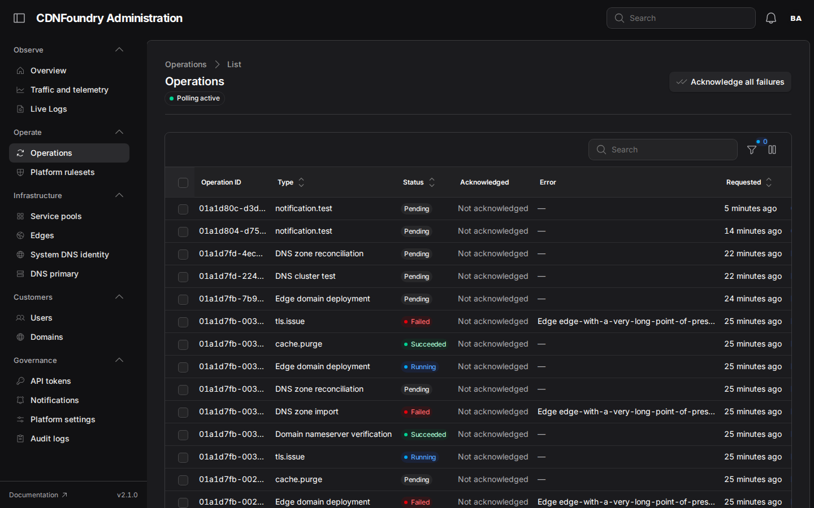

# CDNFoundry

> **Status: pre-production.** The 2.0 rebuild is under way on `dev`. The open
> findings are in the [roadmap](docs/roadmap.md). Qualify it on your own
> hardware with the [production qualification](docs/operations/production-qualification.md)
> before you send customer traffic.

CDNFoundry is free, open-source software for running your own CDN on your own
servers. Authoritative DNS, HTTPS delivery, certificates, cache, and logs stay on
infrastructure you control. It is for ISPs, hosting providers, enterprises, and
anyone who must keep traffic and data on their own network.

## Main features

- Authoritative DNS with Geo-DNS, served by DNSdist and PowerDNS.
- HTTP and HTTPS from bounded OpenResty cells, with cache, purge, and compression.
- Managed DNS-01 certificates or your own, with keys encrypted at rest.
- Per-client limits, origin safety checks, and a managed WAF.
- Logs, usage reports, and Grafana dashboards, from Vector and ClickHouse.
- An administrator panel, a domain-user panel, and a token API.
- A Fleet tool that installs and upgrades hosts over SSH.

## Screenshots

## Quick start

Follow the [quick start](https://vaheed.github.io/CDNFoundry/getting-started/) to serve a
first domain. The [documentation](https://vaheed.github.io/CDNFoundry/) also covers
production setup, guides for every feature, and the API and configuration reference.

## Contribute

Read [AGENTS.md](AGENTS.md) and [CONTRIBUTING.md](CONTRIBUTING.md) first. Report
security problems as described in [SECURITY.md](SECURITY.md). Follow the
[code of conduct](CODE_OF_CONDUCT.md).

## License

[Apache-2.0](LICENSE)
