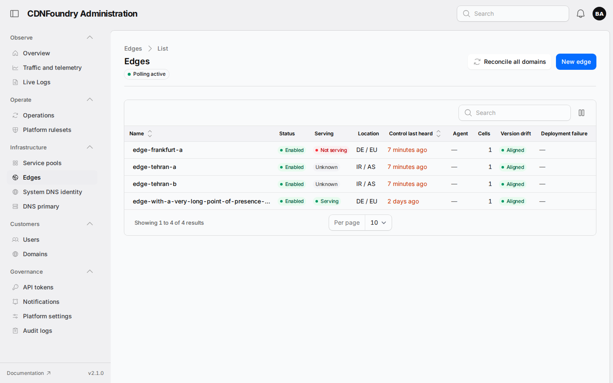
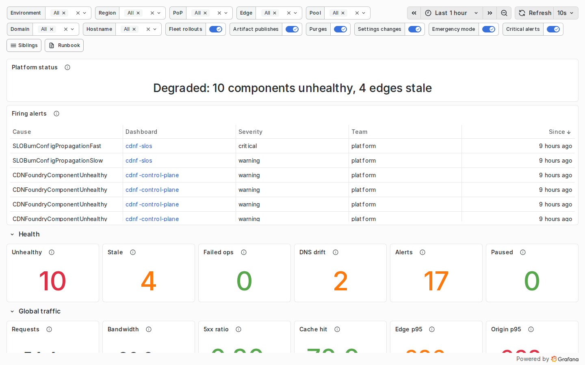

# CDNFoundry

[](https://github.com/vaheed/CDNFoundry/actions/workflows/ci.yml)
[](https://github.com/vaheed/CDNFoundry/releases)
[](LICENSE)
[](core/composer.json)
[](edge-agent/go.mod)
[](https://vaheed.github.io/CDNFoundry/)

> **v2.0.0** is a breaking release with no upgrade from 1.x. Run it in production,
> and [report any bug you find](https://github.com/vaheed/CDNFoundry/issues). Before
> you send customer traffic, run the
> [production qualification](https://vaheed.github.io/CDNFoundry/operations/production-qualification)
> on your own hardware, as you would for any infrastructure. Read the
> [release notes](https://vaheed.github.io/CDNFoundry/operations/releases/v2.0.0).

CDNFoundry is free, open-source software for running your own CDN on your own
servers. Authoritative DNS, HTTPS delivery, certificates, cache, and logs stay on
infrastructure you control. It is for ISPs, hosting providers, enterprises, and
anyone who must keep traffic and data on their own network.

## What you get

| Tool | What it is for |
| --- | --- |
| **Admin panel** | Run the platform: pools, PoPs, DNS, users, settings, audit |
| **Domain panel** | Customers manage their domains: DNS, origins, TLS, cache, security, analytics |
| **API** | Everything the panels do, from scripts, with tokens |
| **Fleet CLI and Fleet web** | Install, upgrade, back up, and roll back hosts over SSH, from the command line or a local web page |
| **Grafana** | 35 dashboards in role-based folders for the NOC, SOC, platform admins, support, and business, with 77 alerts and runbooks |
| **DNS and edge runtime** | DNSdist and PowerDNS for DNS, and bounded OpenResty cells for HTTP and HTTPS, with cache, purge, WAF, and compression |





## Pick your setup

| You want | Servers | Start here |
| --- | --- | --- |
| To try it | 1 machine with Docker | [Installation](https://vaheed.github.io/CDNFoundry/getting-started/installation) |
| A first real CDN | 3: one control node and two PoPs | [Production quick start](https://vaheed.github.io/CDNFoundry/deployment/production-quick-start) |
| More regions and traffic | 3 to about 10, added one at a time | [Scaling](https://vaheed.github.io/CDNFoundry/operations/scaling) |
| A control plane that survives a lost host | Any layout plus a standby | [High availability](https://vaheed.github.io/CDNFoundry/operations/control-plane-high-availability) |
| A large or multi-region network | 15 or more | [Multi-region quick start](https://vaheed.github.io/CDNFoundry/deployment/production-quick-start-multi-region) |

There is no single-server production install. See
[Choose your installation](https://vaheed.github.io/CDNFoundry/deployment/choose-installation)
for all options, including installing by hand without Fleet.

## Install with Fleet web

Fleet web is a local page that installs and manages your hosts. It runs on your own
computer (Windows, macOS, or Linux) and (3.12 or 3.13 recommended) and OpenSSH.

```sh
git clone https://github.com/vaheed/CDNFoundry.git
cd CDNFoundry
python3 scripts/fleet-web.py      # Windows: py scripts\fleet-web.py
```

The first run creates a private Python environment and installs what Fleet needs, then
opens `http://127.0.0.1:8765` in your browser. Everything else happens in the browser: the
page asks you to choose the vault passphrase, enter your domains, release, and hosts, and it
creates the fleet. On later runs it asks for the passphrase to unlock. Use `--port 9000` to pick another port. Fleet web listens on your own machine only; to
use it on a remote workstation, open an SSH tunnel.

If your `python3` is newer than 3.13, the script switches to `python3.13` or `3.12` when one is installed;
otherwise install one (macOS: `brew install python@3.13`). If setup fails, see the
[Fleet web guide](https://vaheed.github.io/CDNFoundry/operations/fleet-web).

Run the script from the repository root, or by its full path. Do not run files inside
`scripts/cdnfoundry_fleet/` directly: they are a Python package, not scripts.

Next: [Production quick start](https://vaheed.github.io/CDNFoundry/deployment/production-quick-start)
and the [Fleet web guide](https://vaheed.github.io/CDNFoundry/operations/fleet-web).

## Read the docs

The [documentation](https://vaheed.github.io/CDNFoundry/) is organized by what you want to do.

- **New here?** [What is in CDNFoundry](https://vaheed.github.io/CDNFoundry/getting-started/whats-in-the-box) and [Your path through the docs](https://vaheed.github.io/CDNFoundry/getting-started/journeys).
- **Installing?** [Production guide](https://vaheed.github.io/CDNFoundry/deployment/production-guide).
- **Using a domain?** [Domain panel tour](https://vaheed.github.io/CDNFoundry/guides/domain-panel).
- **Running the platform?** [Admin panel tour](https://vaheed.github.io/CDNFoundry/guides/admin-panel), [Fleet web guide](https://vaheed.github.io/CDNFoundry/operations/fleet-web), [Grafana by team](https://vaheed.github.io/CDNFoundry/operations/grafana-by-team).
- **Something broke?** [Troubleshoot by symptom](https://vaheed.github.io/CDNFoundry/troubleshooting/by-symptom) and the [alert reference](https://vaheed.github.io/CDNFoundry/reference/alerts).

## Report a bug or contribute

Found a bug or have a question? [Open an issue](https://github.com/vaheed/CDNFoundry/issues). Real use in production is the best test, so reports are welcome.

To change the code, read [AGENTS.md](AGENTS.md) and [CONTRIBUTING.md](CONTRIBUTING.md) first. Report
security problems as described in [SECURITY.md](SECURITY.md). Follow the
[code of conduct](CODE_OF_CONDUCT.md).

## License

[Apache-2.0](LICENSE)
