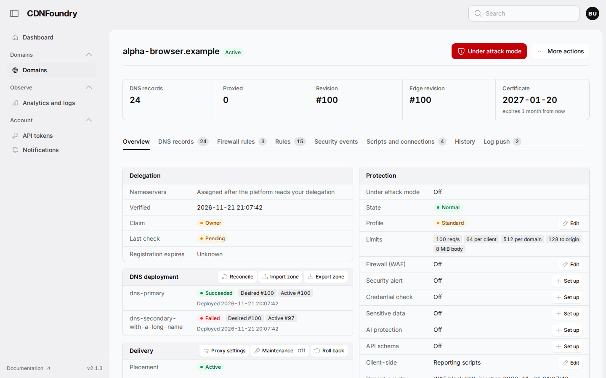
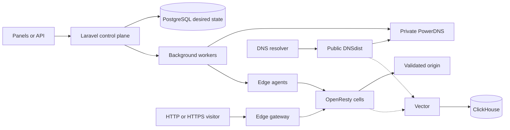

# CDNFoundry

[](https://github.com/vaheed/CDNFoundry/actions/workflows/ci.yml)
[](https://github.com/vaheed/CDNFoundry/releases)
[](LICENSE)
[](core/composer.json)
[](edge-agent/go.mod)
[](https://vaheed.github.io/CDNFoundry/)

CDNFoundry is an open-source, self-hosted CDN and authoritative DNS platform.
Run it on your own servers to deliver content closer to your visitors. Authoritative DNS, HTTPS delivery, certificates, cache, and logs stay on
infrastructure you control. It is for ISPs, hosting providers, enterprises, and
anyone who must keep traffic and data on their own network.

## What you get

| Tool | What it is for |
| --- | --- |
| **Admin panel** | Run the platform: pools, PoPs, DNS, users, settings, audit, and removal of retired edges |
| **Domain panel** | Customers manage their domains: DNS, origins, TLS, cache, security, analytics |
| **API** | Automate domain and platform operations with policy-scoped tokens |
| **Fleet CLI and Fleet web** | Install, upgrade, back up, and roll back hosts over SSH, from the command line or a local web page |
| **Grafana** | Dashboards in role-based folders for operations, security, support, and business, with alerts and runbooks |
| **DNS and edge runtime** | DNSdist and PowerDNS for DNS, and bounded OpenResty cells for HTTP and HTTPS, with cache, purge, WAF, and compression |

## Delivery features

- **DNS:** authoritative records, imports and exports, and Geo-DNS answers.
- **HTTPS:** managed ACME DNS-01 and uploaded certificates, renewal, and edge distribution.
- **Cache:** domain policies, development mode, URL and full purges, gzip and Brotli.
- **Request rules:** redirects, URL rewrites, request and response header changes, and cache overrides with presets.
- **Security:** typed firewall rules, managed ModSecurity/OWASP CRS WAF, rate and connection limits, browser challenges, and incident controls. Challenge verification works on GET-only domains.
- **Geolocation:** signed IPFire country and ASN data refreshed daily, with custom MMDB sources supported.
- **Visibility:** domain analytics, redacted logs, revision acknowledgements, and operation status.

Application controls have resource limits. Protect the uplink through your
network provider when an attack exceeds its capacity. See the
[security guide](https://vaheed.github.io/CDNFoundry/guides/security).

## See the product

Open a domain to review its DNS, origin, TLS, cache, and security settings.



Explore the [admin panel](https://vaheed.github.io/CDNFoundry/guides/admin-panel)
and [domain panel](https://vaheed.github.io/CDNFoundry/guides/domain-panel) tours.
The documentation site shows real captures in light and dark themes with generated test data.

## How it works



A CDN caches content at points of presence (PoPs) while your origin hosts the
application. The control plane stores desired state and publishes validated
revisions asynchronously. DNS and HTTP traffic use local runtime state and keep
serving through a control-plane outage. An invalid replacement keeps the last
valid configuration active. Fleet maintains infrastructure; domains and traffic
policy stay in the panels and API.

Read [the four flows](https://vaheed.github.io/CDNFoundry/concepts/the-four-flows)
for the DNS, HTTP, configuration, and telemetry paths.

## Pick your setup

| You want | Servers | Start here |
| --- | --- | --- |
| To try it | 1 machine with Docker | [Installation](https://vaheed.github.io/CDNFoundry/getting-started/installation) |
| A first real CDN | 3: one control node and two PoPs | [Production quick start](https://vaheed.github.io/CDNFoundry/deployment/production-quick-start) |
| More regions and traffic | 3 to about 10, added one at a time | [Scaling](https://vaheed.github.io/CDNFoundry/operations/scaling) |
| A control plane that survives a lost host | Any layout plus a standby | [High availability](https://vaheed.github.io/CDNFoundry/operations/control-plane-high-availability) |
| A large or multi-region network | 15 or more | [Multi-region quick start](https://vaheed.github.io/CDNFoundry/deployment/production-quick-start-multi-region) |

There is no single-server production install. See
[Choose your installation](https://vaheed.github.io/CDNFoundry/deployment/choose-installation)
for all options, including installing by hand without Fleet. Before sending customer
traffic, [qualify your own fleet](https://vaheed.github.io/CDNFoundry/operations/production-qualification)
and practice [backup and recovery](https://vaheed.github.io/CDNFoundry/operations/backup-and-recovery).
Use the [hardware requirements](docs/operations/hardware-requirements.md)
as a starting point, then measure your own workload.

## Install with Fleet web

Fleet web is a local page that installs and manages your hosts. It runs on your own
computer (Windows, macOS, or Linux). Install Git, OpenSSH, and Python first
(Python 3.12 or higher is recommended).

```sh
git clone https://github.com/vaheed/CDNFoundry.git
cd CDNFoundry
python3 scripts/fleet-web.py      # Windows: py scripts\fleet-web.py
```

The first run creates a private Python environment and installs what Fleet needs, then
opens `http://127.0.0.1:8765` in your browser. Everything else happens in the browser: the
page asks you to choose the vault passphrase, enter your domains, release, and hosts, and it
lets you review the plan and deploy a signed release with digest-pinned images. On later runs it asks for the passphrase to unlock. Use `--port 9000` to pick another port. Fleet web listens on your own machine only; to
use it on a remote workstation, open an SSH tunnel.

Fleet restores edge runtime keys into memory before Docker starts after a host reboot. To install boot
recovery on an existing fleet and start stopped containers from its current release, update this checkout
and run `python3 scripts/cdnfoundry-fleet recover` with your existing vault. See
[Fleet recovery](docs/operations/fleet-engine.md#recover-after-a-host-reboot) for requirements and checks.

Run the script from the repository root, or by its full path. Do not run files inside
`scripts/cdnfoundry_fleet/` directly: they are a Python package, not scripts.

Next: [Production quick start](https://vaheed.github.io/CDNFoundry/deployment/production-quick-start)
and the [Fleet web guide](https://vaheed.github.io/CDNFoundry/operations/fleet-web).

## Release 2.1.5

This release fixes browser verification on GET-only domains, including Under Attack mode. It also adds daily signed
IPFire location updates, live GeoIP database refreshes, and administrator removal of disabled, drained edges.
There are no new database migrations since 2.1.4. Review the
[2.1.5 release notes](docs/operations/releases/v2.1.5.md) for deployment, rollback, and qualification limits.

## Read the docs

The [documentation](https://vaheed.github.io/CDNFoundry/) is organized by what you want to do.

- **New here?** [What is in CDNFoundry](https://vaheed.github.io/CDNFoundry/getting-started/whats-in-the-box) and [Your path through the docs](https://vaheed.github.io/CDNFoundry/getting-started/journeys).
- **Installing?** [Production guide](https://vaheed.github.io/CDNFoundry/deployment/production-guide).
- **Using a domain?** [Domain panel tour](https://vaheed.github.io/CDNFoundry/guides/domain-panel).
- **Running the platform?** [Admin panel tour](https://vaheed.github.io/CDNFoundry/guides/admin-panel), [Fleet web guide](https://vaheed.github.io/CDNFoundry/operations/fleet-web), [Grafana by team](https://vaheed.github.io/CDNFoundry/operations/grafana-by-team).
- **Something broke?** [Troubleshoot by symptom](https://vaheed.github.io/CDNFoundry/troubleshooting/by-symptom) and the [alert reference](https://vaheed.github.io/CDNFoundry/reference/alerts).

- **Changing request behavior?** [Request rules](docs/guides/request-rules.md): redirects, rewrites, headers, and cache rules.
- **Automating or developing?** [API reference](https://vaheed.github.io/CDNFoundry/reference/api/), [developer setup](https://vaheed.github.io/CDNFoundry/development/), and [testing](https://vaheed.github.io/CDNFoundry/development/testing).

Version-specific compatibility belongs in the
[upgrade guide](https://vaheed.github.io/CDNFoundry/deployment/upgrade) and
[release notes](https://github.com/vaheed/CDNFoundry/releases).

## Report a bug or contribute

Found a bug or have a question? [Open an issue](https://github.com/vaheed/CDNFoundry/issues). Include reproducible steps and sanitized diagnostics.

To change the code, read [AGENTS.md](AGENTS.md) and [CONTRIBUTING.md](CONTRIBUTING.md) first. Report
security problems as described in [SECURITY.md](SECURITY.md). Follow the
[code of conduct](CODE_OF_CONDUCT.md).

## License

CDNFoundry is licensed under [Apache-2.0](LICENSE).

## Support CDNFoundry

Help keep CDNFoundry independent, open source, and actively maintained.

| Sponsorship tier | Description | Amount |
| --- | --- | ---: |
| **Buy Me a Beer** | Show your appreciation. | [$10](https://nowpayments.io/payment/?iid=6197093183) |
| **Support Development** | Support ongoing updates and maintenance. | [$100](https://nowpayments.io/payment/?iid=4356260277) |
| **Sponsor a Feature** | Propose and fund a new feature. | [$1,000](https://nowpayments.io/payment/?iid=5697188206) |

*Feature sponsorship is subject to technical review and roadmap alignment.*
