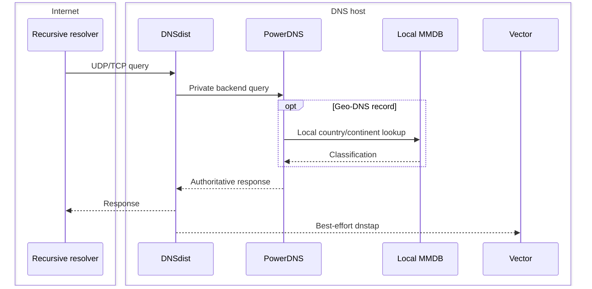
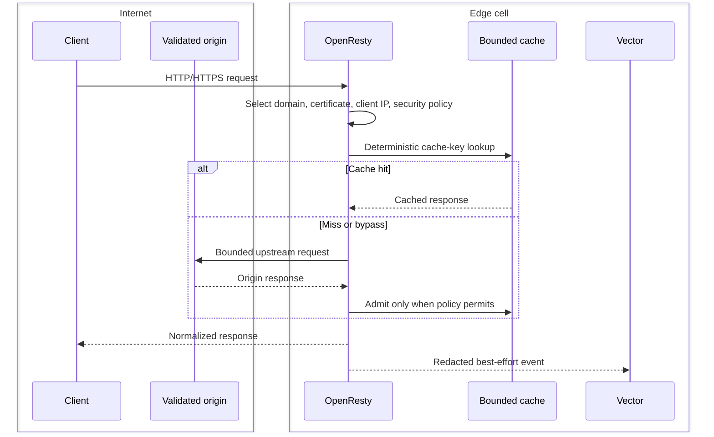
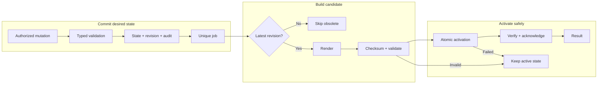
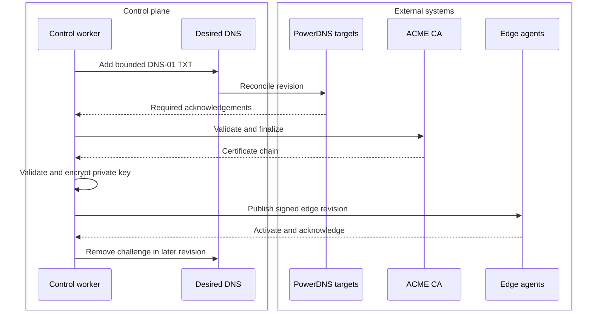
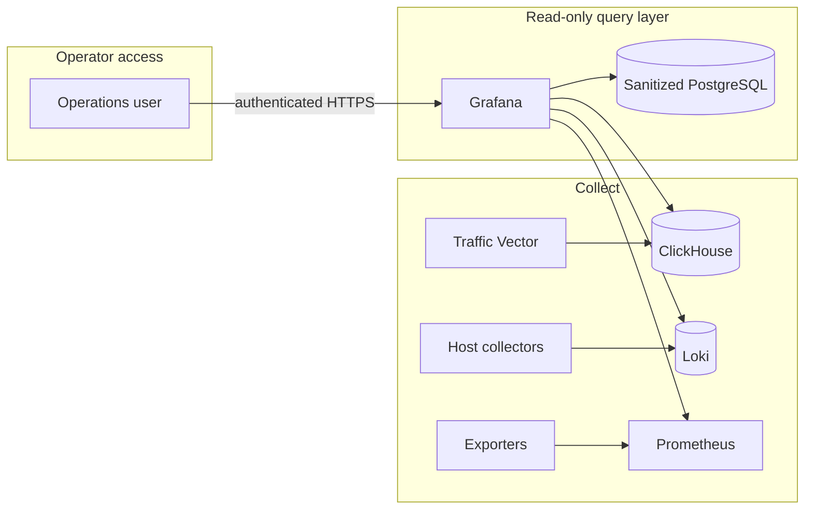

# Architecture data flows

This page follows seven flows from start to end. Read it to learn which service
handles each step, and which flows never touch the control plane (the Laravel
application and its PostgreSQL database). Terms are in the
[glossary](../reference/glossary.md).

Two rules hold in every flow. Serving traffic never waits on Laravel. Changes
reach DNS and edges through the control plane, never by hand.

## Authoritative DNS

1. A resolver (the DNS server that answers for end users) sends a UDP or TCP query to DNSdist.
2. DNSdist picks the first available private PowerDNS backend.
3. PowerDNS answers from its own zone data. The control plane built that data earlier.
4. For a Geo-DNS record, PowerDNS looks up the client in a local GeoIP file (MMDB). It also uses the EDNS Client Subnet when the resolver sends one.
5. After answering, DNSdist sends a best-effort dnstap event (a DNS query log record) to Vector.

Laravel is not in this path. Only DNSdist is public. PowerDNS stays on a private network.

## Customer HTTP and HTTPS

1. DNS returns the address of a pool endpoint that is ready to accept traffic.
2. The client connects to the OpenResty cell assigned to that address.
3. OpenResty rejects hosts it does not know. For known hosts, it picks the certificate from its runtime data.
4. Lua code works out the real client address. It then applies maintenance mode, the ordered security rules, the profile limits, the cache policy, and the origin policy.
5. A cache hit is answered locally. A miss goes to the one origin configured for that hostname.
6. OpenResty sends an access event straight to Vector.

Laravel and ClickHouse take no part in the serving decision.

## Runtime mutation

1. The API or an admin or domain panel action checks permission, validates the input, and saves the new desired state.
2. In the same database transaction, CDNFoundry raises the revision number and writes an audit event.
3. After the commit, one unique job renders DNS record sets or an edge snapshot (the full runtime configuration of an edge). The render is deterministic.
4. The target (PowerDNS or an edge agent) validates the candidate and activates it.
5. Deployment rows, tasks, and the operation record that the target acknowledged the revision, or that it failed.

A job that finds a newer revision skips its work. A candidate that fails validation or activation never replaces the active state, so the previous valid state keeps serving. The HTTP request that started the change returns before any of this runs; the caller follows the operation ID.

See [Desired state](../concepts/desired-state.md) for failure behaviour.

## Edge enrollment and sync

1. An administrator creates the edge in the admin panel and receives a one-time token.
2. The edge agent opens an outbound connection to `EDGE_CONTROL_URL`. It creates a private key and sends a certificate signing request (CSR). The CSR common name must be the edge UUID.
3. Edge control validates the token and signs a short-lived identity certificate.
4. Every later request must present that certificate and its serial number (mutual TLS).
5. The agent polls for tasks. It fetches the manifest, or a full recovery snapshot when it needs one.
6. The agent compiles one immutable runtime generation and verifies it against its exact manifest. It then writes the directory durably and switches the shared `current` pointer in one atomic step. The gateway and the cells therefore read the same generation, not separately replaced JSON files.
7. The agent acknowledges only after the readers report the committed generation.
8. Heartbeats report the sequence, the generation, listener readiness, cell capacity, origin health, and bounded security summaries.

Laravel and its workers never start a connection to an edge host. They commit desired state, artifacts, and durable tasks. The agent pulls these over its outbound control connection and posts the results. An edge therefore needs no inbound address for control traffic.

## Pool routing

A pool is a group of edges that serve the same domains. Two routing modes exist.

- **Geo-Unicast** stores a different address pair (IPv4 and IPv6) on each edge and pool endpoint. DNS answers with country, continent, or global fallback data.
- **Simple Anycast** stores one address pair on the pool. Every attached, ready edge receives the same address. DNS publishes that pair while at least one endpoint is ready.

For Anycast, the operator or network provider alone advertises and withdraws the BGP routes and keeps the route evidence. CDNFoundry holds no router credential and has no command path to a router. See [Simple Anycast](../operations/simple-anycast.md).

## Managed TLS

1. An active domain with verified nameservers gains its first proxied hostname.
2. A bounded certificate job creates or reuses the ACME account. ACME is the protocol certificate authorities (CAs) use to issue certificates automatically.
3. The job adds DNS-01 challenge TXT records to the desired DNS state, and the normal DNS flow publishes them.
4. The job tells the CA to validate only after the DNS targets acknowledge the revision.
5. CDNFoundry validates the returned key and chain, encrypts and stores the private key, and includes the certificate in a new edge revision.
6. A later DNS revision removes the challenge records.

DNS-only domains never create certificate orders.

## Telemetry

OpenResty sends JSON access logs to Vector. DNSdist sends dnstap events. Vector removes authorization headers, cookies, request bodies, and query strings, limits field length, and writes to ClickHouse.

The analytics API accepts a raw-log range of at most 24 hours and an aggregate range of at most 90 days. Raw events stay in ClickHouse for 7 days by default (an administrator can set 1 to 30 days). Usage rollups are finalized into compact PostgreSQL rows.

::: info Independence rule
Telemetry is downstream of serving. Bounded buffers may sacrifice telemetry
when exhausted, but telemetry backpressure must never enter DNS or HTTP paths.
:::

## Operator observability

Grafana shows the operator what the platform is doing. Its dashboards are provisioned from the repository in role-based folders (see [Grafana dashboards](../operations/grafana.md)). They read from four sources:

- **Prometheus** gives current health, alerts, capacity, infrastructure, and gateway metrics.
- **ClickHouse** gives traffic panels, queried by numeric domain ID.
- **PostgreSQL** (a sanitized, read-only view) fills the domain selector from non-deleted domains.
- **Loki** gives normalized, redacted operational logs and live tail. HTTP access logs and DNS queries stay only in ClickHouse.

Each data source account is read-only and bounded on its own. Grafana does not carry telemetry in, does not call Laravel for a panel, and takes no part in a customer request.
