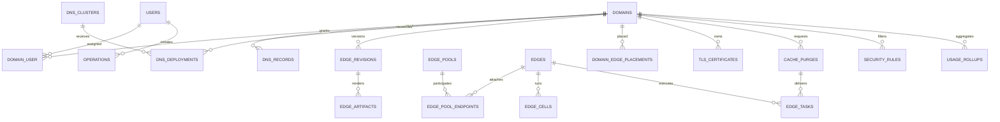

# Data model

This page lists the tables CDNFoundry keeps in PostgreSQL, grouped by purpose, and the rules that protect them. The schema is in `core/database/schema/pgsql-schema.sql` plus later migrations.

| Group | Tables and purpose |
| --- | --- |
| Identity | `users`, `personal_access_tokens`, `personal_access_token_domains`, `domain_user` assignments |
| Audit and request safety | `audit_logs`, `idempotency_keys`, `operations` |
| Domains | `domains`, `domain_name_tombstones` |
| DNS | `dns_records`, `dns_clusters`, `dns_deployments`, `dns_zone_changes`, `platform_dns_settings`, `platform_dns_deployments`, `nameserver_address_probes` |
| Edge | `edge_pools` (kind, routing mode, optional pool-owned Anycast pair), `edge_pool_endpoints` (explicit per-edge participation/readiness and Geo-Unicast pairs), `edges`, `edge_cells`, `domain_edge_placements`, `edge_revisions`, `edge_artifacts`, `edge_tasks`, `domain_edge_cells`, `edge_probe_results` |
| Cache | domain cache fields and `cache_purges` linked to edge tasks |
| TLS | `tls_certificates`, `tls_orders`, `acme_accounts`, `acme_challenges` |
| Security | domain security state, `security_rules`, `platform_rulesets`, `platform_ruleset_rules`, `platform_ruleset_domains`, `waf_exclusions`, `security_events`, `emergency_modes` |
| Analytics and operations | `usage_rollups`, `generated_reports`, `backups`, `fleet_releases`, `fleet_rollouts`, `fleet_rollout_edges`, `control_nodes`, `control_plane_state`, Laravel jobs and failed jobs |
| Product policy | `system_settings`: JSONB groups checked against `core/config/platform.php` |

Domains and DNS records use integer IDs. Edges, operations, tasks, backups,
purges, certificates, orders, and challenges use UUIDs where they cross process
or host boundaries.

## Correctness constraints

PostgreSQL constraints protect these rules: unique domain names, edge identities
and addresses, pool and cell relationships, unique logical DNS records,
increasing edge revisions per domain, artifact content identity, active
deployment relationships, cache purge task delivery, and usage intervals.

A pool's Simple Anycast address is unique to that pool. It cannot also be a
Geo-Unicast endpoint address. Endpoint rows stay separate, so one POP can
degrade or withdraw without changing another POP's state.

JSON and JSONB columns hold only validated structures. Controllers and support
types check the shape of proxy, origin, Geo-DNS, cache, security, operation,
capacity, and platform settings before they are stored.

## Identity and authorization relationships

`users.type` separates administrators from domain users. The `domain_user` table
assigns domains to users. Policies apply it to browser sessions and API tokens
alike. Scoped route binding stops a request from reaching a child record
through another domain's URL.

## Revision relationships

Each domain change raises the domain's desired revision. DNS deployments store
the candidate and active checksums for each cluster. Edge revisions keep the
canonical state and artifacts. Placements and tasks record delivery. A rollback
creates a new, higher revision. It never lowers a sequence number.

## Secret-bearing rows

CDNFoundry encrypts stored secrets that it must read back with the application
key. It stores API tokens as one-way hashes. Status endpoints never show a
one-time bootstrap token or a plaintext API token again.

::: danger Recovery dependency
A PostgreSQL dump alone cannot restore the platform. You also need the
original encryption and signing keys and the externally stored TLS material.
:::

## Derived data

The PowerDNS schema under `docker/postgres/` is migrated separately. A global
DNS reconciliation can rebuild it from the control database. CDNFoundry can
rebuild edge artifacts and snapshots from the desired domain and placement
state. ClickHouse events and aggregates are telemetry, not configuration.

The PostgreSQL view `grafana_domain_operational_metadata` is a derived,
sanitized read model. It exposes no certificate keys, credentials, audit
payloads, or raw customer request data. You can recreate it from the
control-plane tables.
