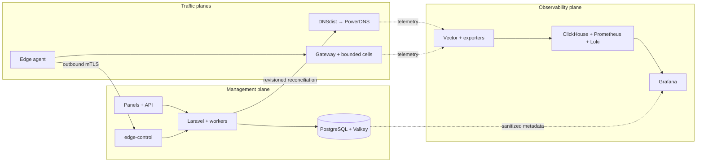

# System architecture

CDNFoundry is one Laravel application (the control plane) surrounded by
separate DNS, edge, and monitoring services. PostgreSQL stores the desired
state. You can rebuild everything else: PowerDNS data, signed edge artifacts,
runtime snapshots, cache contents, ClickHouse events, and aggregates.

## DNS namespaces and addresses

| Namespace or address | Owner and purpose | CDNFoundry PowerDNS? |
| --- | --- | --- |
| `control.<operator-zone>`, `edge-control.<operator-zone>`, `telemetry.<operator-zone>`, `grafana.<operator-zone>` | Independent external DNS provider; management and recovery reachability | Never |
| `ns1.<platform-zone>`, `ns2.<platform-zone>` and glue | Parent/registrar delegation to public DNSdist addresses | Served by DNSdist from derived PowerDNS state after bootstrap |
| Enrolled customer zones | PostgreSQL desired state reconciled into private PowerDNS databases | Yes |
| Edge pool service addresses | Public HTTP and HTTPS addresses that platform and customer DNS return | Stored as platform desired state |
| Private PowerDNS, PostgreSQL, Valkey, ClickHouse, and agent or status addresses | Host or private service networks | No public DNS needed |

::: danger Avoid a DNS bootstrap loop
Management names must resolve while CDNFoundry DNS is empty, degraded, or being
restored. If you host them in the platform's own PowerDNS, the control plane can
become unreachable exactly when you need it to repair DNS.
:::

| Plane | Components | Responsibility |
| --- | --- | --- |
| Management | Laravel, Filament, Horizon, scheduler | Authorization, validation, desired state, operations, reconciliation |
| Durable control data | PostgreSQL, Valkey | Desired state, audit, operation records, queues, sessions, cache |
| Authoritative DNS | DNSdist, PowerDNS, PowerDNS PostgreSQL | Public DNS ingress and private authoritative answers |
| Edge HTTP | Edge agent, edge gateway, bounded OpenResty cells | Artifact activation, destination/Host/SNI routing, TLS selection, proxying, cache, security |
| Observability | Vector, ClickHouse, Prometheus, Alertmanager, Grafana | Bounded event delivery, analytics, metrics, alerts, read-only operator diagnosis |

Only three things belong on public ingress: DNSdist, the edge-gateway service
listeners, and the reverse proxy for the browser and API. Edge control uses
mutual TLS. The production Caddy configuration restricts the telemetry and
PowerDNS API gateways by source address. Keep these private: databases, Valkey,
ClickHouse, raw metrics, Grafana port 3000, and PowerDNS itself. For remote
Grafana access, use an authenticated HTTPS proxy or a trusted tunnel that you
run.

## Architectural decisions

### PostgreSQL owns intent

The control database stores what the operator asked for, who may change it,
which revision is current, and whether each derived target acknowledged it.
You can rebuild PowerDNS tables, artifacts, active edge directories, cache
objects, and analytics aggregates.

### Reconciliation owns side effects

Controllers and Filament actions authorize, validate, and commit desired state.
They do not call PowerDNS, ACME, an edge, an origin, or ClickHouse to finish a
request. Background jobs do that work. A job is unique per target, so repeated
changes coalesce. Jobs skip obsolete revisions, validate candidates, activate
them in one step, and record receipts.

### Data planes remain autonomous

An outage of Laravel, PostgreSQL, Valkey, ClickHouse, or Vector does not stop
DNS answers or HTTP requests that are already configured. DNSdist and OpenResty
work from their own private runtime state. The edge agent keeps the active and
previous snapshots.

### Observability is read-only and downstream

Grafana reads Prometheus, ClickHouse telemetry, and a sanitized PostgreSQL view,
each through a separate account with minimal rights. It cannot change desired
state or ingest traffic. The provisioned dashboards are read-only views for
diagnosis. A dashboard or datasource failure does not affect serving or
reconciliation.

### Scale uses bounded shared units

Domains are data inside shared DNS and OpenResty runtimes. You scale by adding
workers, DNS capacity, telemetry capacity, edge nodes, and cells. A normal
domain never gets its own container, daemon, timer, cache directory, or reload.

::: warning Boundary test
A feature must not need Laravel, PostgreSQL, ClickHouse, or an external API
while it answers a visitor's DNS or HTTP request.
:::

## Failure isolation

| Failure | Existing traffic | Management/recovery |
| --- | --- | --- |
| Laravel or PostgreSQL unavailable | DNS and HTTP continue from active runtime | UI, mutations, and reconciliation pause |
| One PowerDNS target fails | Other authoritative targets keep answering | The failed target keeps its last valid zone |
| Invalid edge artifact | The active cell keeps serving | CDNFoundry rejects the candidate and records the failure |
| ClickHouse or Vector unavailable | DNS and HTTP continue | Analytics becomes partial or unavailable |
| Grafana or Prometheus unavailable | DNS and HTTP continue | Dashboards or alert rules stop working; the source data is unchanged |
| Origin unavailable | Cache and stale policy may serve eligible objects | Origin health and errors show in monitoring |

Next, read [Components](components.md), [Data flows](data-flows.md), and
[Data model](data-model.md). Before allocating production hosts, compare the
[Production reference architectures](production-reference-architectures.md).
