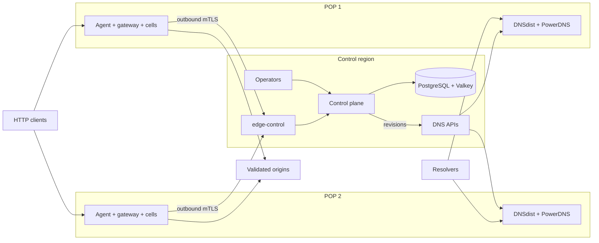
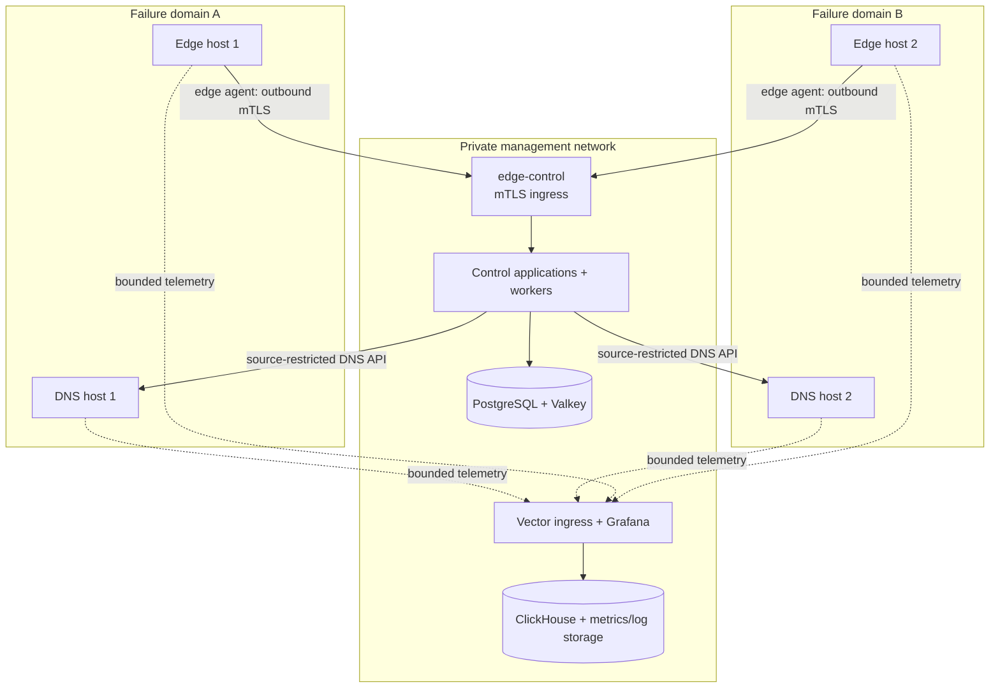
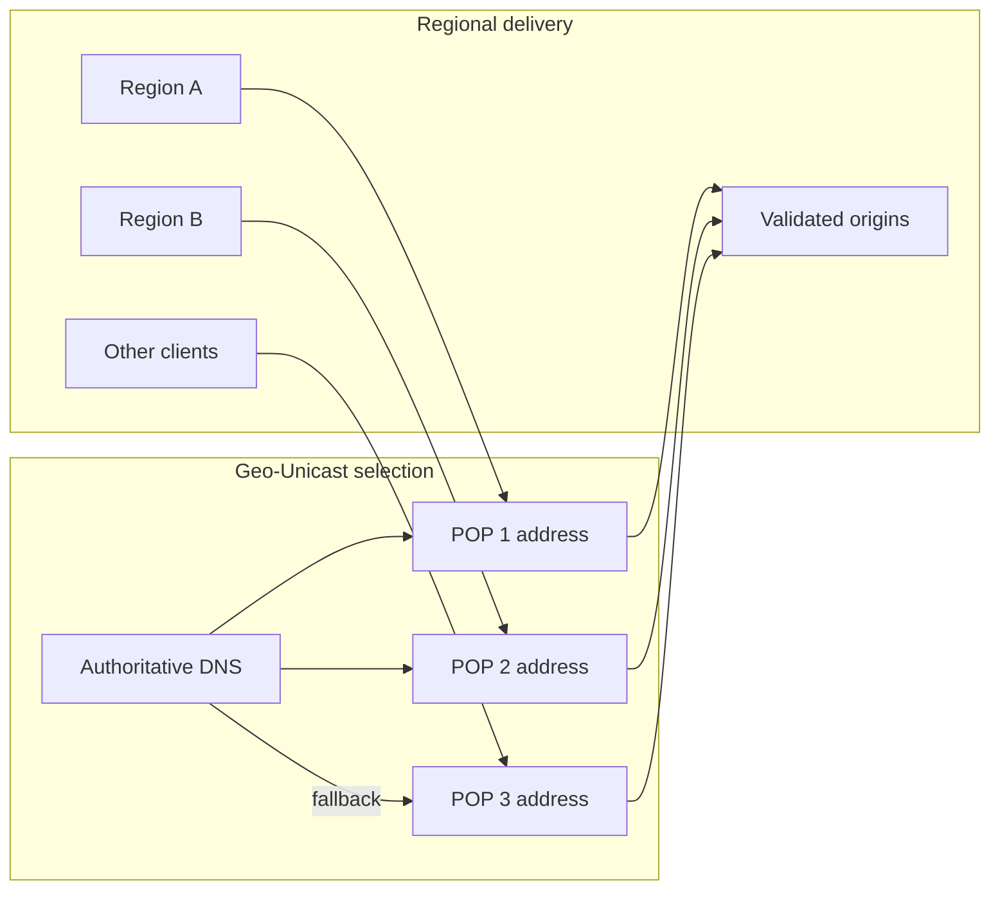
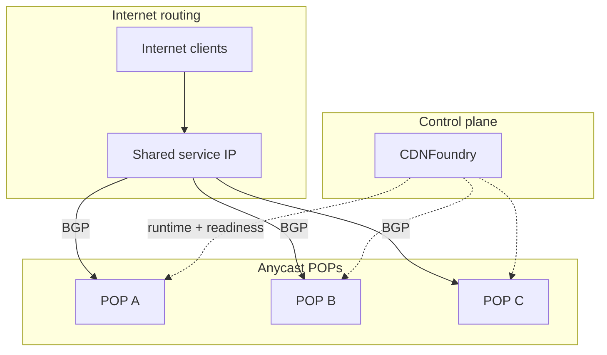

# Production reference architectures

No single layout fits every network. Start with the smallest design that gives you two independent DNS and edge failure domains and keeps internal services private. Split roles only when measurement, ownership, or failure isolation requires it.

This page helps you choose. It compares four architectures, then covers network boundaries, what to back up, and how to grow. The terms edge, pool, cell, and PoP (point of presence, one site with serving hosts) are defined in the [glossary](../reference/glossary.md).

| Architecture | Hosts | Pick it when |
| --- | --- | --- |
| A: minimum fleet | 1 control, 2 DNS and edge | You are starting out or proving demand. |
| B: separated roles | Control, telemetry, DNS, and edge hosts apart | Load or ownership needs independent scaling. |
| C: multi-POP | Edges in several locations | Measured latency or origin offload justifies more sites. |
| D: Simple Anycast | Edges sharing one address | You run BGP and can prove routing yourself. |

::: info Start small, preserve boundaries
Extra hosts do not add reliability if they share a rack, uplink, provider, route, power source, or administrator. Define your failure domains first. Then assign CDNFoundry roles to them.
:::

## Design inputs

Write down these answers before you choose:

| Input | Questions |
| --- | --- |
| Audience | Internal users, one country, regional subscribers, or global clients? |
| Traffic | Peak bandwidth, requests/s, connections, TLS handshakes, DNS QPS? |
| Content | Object sizes, cacheability, churn, personalization, upload behavior? |
| Origins | Locations, public reachability, latency, capacity, failover ownership? |
| Network | Providers, IPv4/IPv6, NAT, firewall, load balancer, BGP capability? |
| Failure target | Which host, rack, POP, or provider losses must serving tolerate? |
| Recovery | Required RPO/RTO for desired state, keys, PKI, and TLS material? |
| Operations | Who owns DNS, routing, Linux, databases, incidents, and on-call? |

Container limits in the Compose files are safety ceilings, not capacity figures. Test your own hardware with your real request mix. The [sizing guide](../deployment/sizing.md) gives a method.

## Architecture A: minimum production fleet

One control host, and two combined DNS and edge hosts in different failure domains.

Best for:

- first production deployments;
- a company, regional provider, or ISP proving real demand;
- moderate control-plane mutation volume;
- teams that prefer fewer hosts and clear recovery procedures.

Tradeoffs:

- `CONTROL` is one management failure domain;
- PostgreSQL and Valkey availability are operator-owned;
- DNS and edge share resources on each serving host;
- optional telemetry on `CONTROL` competes for host resources unless measured
  and constrained.

If `CONTROL` goes down, you cannot change configuration, but DNS and HTTP keep serving the last activated state. If one edge goes down, redundancy drops, and the other edge keeps answering DNS and HTTP.

Follow the [Production quick start](../deployment/production-quick-start.md) for
this topology.

## Architecture B: separated serving and observability roles

Separate control, telemetry, DNS, and edge hosts, so each can scale and be maintained on its own.

Best for:

- edge bandwidth or DNS load that should not compete on one host;
- a dedicated database or observability team;
- independent maintenance windows;
- deployments using owner-operated external control or telemetry data services.

Tradeoffs:

- more certificates, firewall relationships, backups, upgrades, and alerts;
- an external database endpoint is not automatically highly available;
- separating roles without separate failure domains mainly improves resource
  isolation, not site resilience.

CDNFoundry supplies role profiles, generated node bundles, and settings for external endpoints. It does not include PostgreSQL, Valkey, or ClickHouse clustering. You own the quorum, fencing, failover, consistency, and restore tests of those systems.

For the control plane itself, Architecture A or B can add a **warm standby control
node** (`cdnfoundry-fleet control add-standby`) in a second failure domain. It is a
streaming copy of both PostgreSQL databases and a Valkey replica that you promote
with one command. It is not a cluster and not automatic failover. Edge, DNS, and
HTTP serving are unchanged: they already keep serving from the last valid state
without any control node. See
[Control-plane high availability](../operations/control-plane-high-availability.md)
for the requirements, the failure behavior, and the runbooks.

## Architecture C: multi-POP private CDN

Add edge capacity in more locations. Domain state and runtime formats stay shared.

Best for:

- operators with real POPs, local transit, and on-call ownership;
- latency or origin-offload goals supported by measurement;
- service pools that need distinct geographic endpoint pairs.

Each POP should have:

- independent power, network path, firewall, and monitoring where possible;
- stable local service addresses mapped one-to-one from advertised addresses;
- outbound mTLS reachability to edge control;
- bounded cells sized from its own traffic evidence;
- a documented drain and withdrawal procedure;
- IPv4/IPv6 parity only when both paths are qualified.

Geo-Unicast picks addresses from the endpoint's country or continent and its readiness. It is not continuous, latency-based global load balancing. DNS caches delay traffic movement, so test failure and recovery for at least the effective TTL (the time resolvers keep an answer).

## Architecture D: operator-routed Simple Anycast

Simple Anycast publishes one pool address pair (IPv4 and IPv6) from several edges. You advertise and withdraw those routes with BGP, outside CDNFoundry.

Use this only when you can prove all of these:

- the same address is assigned locally at every participating gateway;
- BGP advertisements and withdrawals are correct and monitored;
- return paths, stateful firewalls, and load balancers preserve connection
  behavior;
- IPv4 and IPv6 converge independently;
- a failed or partitioned POP does not black-hole traffic;
- routing evidence is retained for release qualification.

::: danger CDNFoundry does not operate BGP
Simple Anycast records which edges belong to a pool and whether their endpoints are ready. CDNFoundry has no router credentials, does not advertise or withdraw a prefix, and cannot prove that Internet routing has converged. Routing automation and rollback are entirely yours.
:::

Use [Simple Anycast](../operations/simple-anycast.md) and its
[qualification procedure](../operations/simple-anycast-qualification.md).

## Choose a placement model

| Requirement | Prefer | Reason |
| --- | --- | --- |
| Simplest two-site deployment | Geo-Unicast/global fallback endpoints | No BGP control required |
| Country/continent DNS preference | Geo-Unicast endpoint policy | Distinct service addresses can be selected in DNS |
| One stable service address across POPs | Simple Anycast | External routing selects the site |
| Per-record geographic values without proxy | Geo-DNS | Authoritative response feature, independent of pools |
| High-risk tenant isolation | Quarantine or exceptional dedicated pool | Separate bounded placement class |
| Normal multi-tenant service | Shared pool | Bounded data-driven cells, no per-domain process |

## Network boundaries

| Flow | Direction | Exposure rule |
| --- | --- | --- |
| Browser/API HTTPS | Operator/client → `CONTROL` | Public only through the authenticated reverse proxy |
| Authoritative DNS | Resolvers → DNSdist | Public TCP and UDP 53 |
| Customer HTTP/HTTPS | Clients → edge gateway | Public mapped service listeners |
| Edge control | Edge agent → `CONTROL` | Outbound mTLS from edge |
| PowerDNS primary | Control workers → `pdns-primary` | Private control network; DNS nodes pull signed transfers from port 5300 |
| Telemetry | Edge/DNS Vector → telemetry endpoint | Bounded, authenticated/restricted where deployed |
| Databases and Valkey | Owning application roles only | Private; never general public ingress |
| Grafana | Operator → authenticated proxy/tunnel | Native port remains private or loopback |

A public or NAT address is not always a local bind address. For shared listeners behind DNAT or a firewall, bind a local private address or the wildcard. Each advertised edge service address needs an entry in the advertised-to-local gateway address map, and each must map to its own local address.

## Durable state and recovery placement

Back up and protect all of these together:

- PostgreSQL desired state and audit history;
- `APP_KEY` and artifact-signing private key;
- edge-control and internal service PKI material;
- current customer TLS private keys and chains retained outside derived edge
  snapshots;
- backup repository password and least-privilege credentials;
- exact release identifiers and restore procedures.

PowerDNS runtime rows, edge artifacts, active snapshots, cache objects, and telemetry aggregates can be rebuilt or lost without losing desired state. Do not treat a manual edit on a runtime service as the source of truth. CDNFoundry treats such an edit as drift.

## Growth path

1. Start with Architecture A and prove restoration and one-edge failure.
2. Add cells when cell pressure is the constraint.
3. Add an edge when host, address, bandwidth, or failure-domain capacity is the
   constraint.
4. Split DNS and edge roles when their resources or maintenance ownership
   conflict.
5. Split telemetry when retention and query load compete with management.
6. Move control data externally only with a tested database reliability model.
7. Adopt Anycast only after routing qualification and operational ownership
   exist.

Scale the part that is short of capacity: workers, DNS, ClickHouse, edges, or cells. Do not add per-domain containers or a second control backend to fix a bandwidth or cache problem.

## Architecture review checklist

- [ ] At least two authoritative DNS instances occupy distinct failure domains.
- [ ] Every production pool has qualified capacity after losing one intended
  failure domain.
- [ ] Internal databases, APIs, metrics, and Grafana remain private.
- [ ] Public/NAT addresses are separated from local bind and service-map data.
- [ ] Control, runtime, telemetry, and routing ownership are explicit.
- [ ] Origin capacity includes cache-miss and retry amplification scenarios.
- [ ] Backup scope includes encryption, signing, PKI, and TLS recovery material.
- [ ] RPO/RTO and restore evidence exist for operator-owned data services.
- [ ] IPv4, IPv6, UDP/TCP DNS, TLS, cache, and failure paths are tested where
  advertised.
- [ ] You accept that a saturated uplink needs help from your upstream provider. CDNFoundry's protection is bounded per client, domain, and cell and does not scrub volumetric attacks.

Continue with [Production best practices](../operations/production-best-practices.md),
[Topology and Compose roles](../deployment/topology.md), and
[Scaling](../operations/scaling.md).
