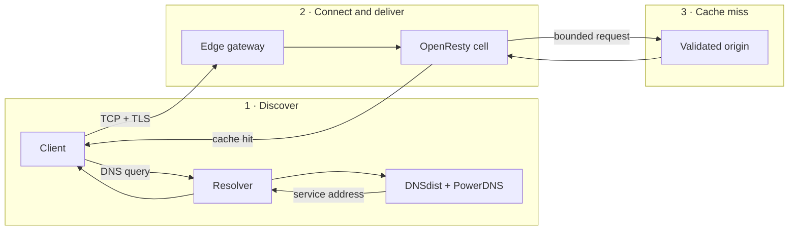

# CDN fundamentals

A content delivery network (CDN) is a layer of servers between your visitors
and your application. The application is called the **origin**. The CDN answers
DNS queries, accepts HTTP and HTTPS connections, serves cached responses when
it may, and sends everything else to the origin you configured.

A CDN is more than a cache. It also does DNS, TLS, routing, proxying, security
checks, monitoring, and failure handling. Read this page first if you are new
to CDNs. It uses CDNFoundry's names for each part. See the
[glossary](../reference/glossary.md) for short definitions.

::: info CDNFoundry vocabulary
CDNFoundry calls a physical or virtual edge host an **edge**. It calls a
resource-limited OpenResty runtime on that host a **cell**. It calls a service
class that spans selected edges a **pool**. PostgreSQL stores what the operator
asked for. The DNS and edge runtimes serve the result after it is activated.
:::

## Why use a CDN?

| Goal | How a CDN helps | Important limit |
| --- | --- | --- |
| Lower latency | Serves cacheable content from a closer edge | A cache miss still reaches the origin |
| Reduce origin load | Reuses eligible responses and bounds upstream concurrency | Uncacheable or constantly changing traffic still consumes origin capacity |
| Centralize TLS | Selects and renews certificates at the edge | Private keys and issuance state become critical to back up |
| Apply consistent policy | Enforces request, cache, and security rules before the origin | It cannot fix unsafe logic inside the origin |
| Improve resilience | Keeps serving cached content and the last valid configuration during some failures | It cannot survive the loss of every edge, route, or upstream link |
| Observe traffic | Produces limited DNS and HTTP telemetry | Telemetry can be dropped so that serving continues |

## The request journey

An HTTPS request goes through three steps:

### 1. DNS chooses a service address

The client usually asks a recursive resolver. The resolver asks the
authoritative nameservers, which hold the real DNS records. It keeps the answer
for the record's TTL (time to live). CDNFoundry publishes only addresses that
belong to eligible pool endpoints with a ready listener.

DNS and HTTP caching are separate. A DNS TTL says how long a resolver may reuse
an address. An HTTP cache lifetime says how long an edge may reuse a response.

### 2. The edge accepts and identifies the connection

For HTTPS, the client sends the hostname it wants in the TLS Server Name
Indication (SNI) field, before any HTTP data. The edge gateway combines the
destination address with the validated Host and SNI values to pick a cell. The
cell then picks the certificate and the domain policy from its active runtime
data.

The edge refuses unknown destinations and unknown hostnames. A public address
is a shared service endpoint. It does not mean one domain owns a container.

### 3. The cell applies policy and uses the origin when needed

The cell checks the client address, maintenance state, security rules, method
and size limits, cache policy, and origin policy. It then returns a cached
response or opens a limited connection to the configured origin.

The control plane (the Laravel application) is not involved at this point. An
edge that already has its configuration keeps serving if the control plane is
down.

## Cache outcomes

| Outcome | Meaning | Typical cause |
| --- | --- | --- |
| Hit | A fresh eligible object was returned locally | A previous request populated the cache |
| Miss | No usable object existed, so the edge contacted the origin | First request, expiry, purge, or eviction |
| Bypass | Policy deliberately skipped cache lookup or storage | Development mode, method, authorization, or response rules |
| Stale | An expired object was used under an allowed failure policy | Origin failure within a configured stale window |

Caching is safe only when the cache key includes every request property that
changes the response. CDNFoundry builds one key the same way for cache lookup
and for URL purge. A full purge raises a counter (an epoch) so old objects stop
matching. It does not scan and delete files.

::: warning Cache is not the source of truth
The origin holds the real content. Do not use an edge cache as the only copy
of customer data, uploads, or generated files. Plan backups for the origin
separately.
:::

## Origins

The origin is the application or storage server that produces a response when
the edge has none cached. A CDN must not let a configured origin point back into
its own management network.

CDNFoundry therefore requires one explicit origin for each proxied hostname. It
rejects loopback, link-local, cloud metadata, multicast, internal platform,
edge-service, and proxy-loop destinations. It checks DNS resolution again before
each connection, because a hostname can resolve to a different address after
you save it. See [Proxy and origins](../guides/proxy-and-origins.md).

## TLS and certificates

TLS encrypts the connection from the client to the edge and proves the server's
identity. It does not encrypt the edge-to-origin connection by itself. Configure
an HTTPS origin when that connection must be protected too.

CDNFoundry supports:

- managed certificates, issued with the ACME DNS-01 challenge after an active
  domain first gets a proxied hostname;
- uploaded certificates, which it checks (certificate, chain, private key,
  names, and expiry) before use;
- encrypted storage of private keys, and signed delivery to the assigned cells;
- keeping the current valid certificate when renewal or activation fails.

DNS-only domains need no edge certificate. See [TLS](../guides/tls.md).

## Traffic placement

Placement answers two questions:

1. Which public service address should DNS return?
2. Which bounded runtime should serve the connection arriving at that address?

Geo-Unicast gives different clients different edge addresses, based on where
they are. Simple Anycast publishes one shared address that you announce from
several sites. CDNFoundry tracks endpoint readiness and places traffic on
cells. It does not configure BGP routers and cannot prove that Internet routes
have converged.

Geo-DNS is a separate record feature. It returns DNS values you define by
country or continent. It is not an HTTP load balancer or a health checker. See
[Geo-DNS](../guides/geo-dns.md).

## Control plane versus data plane

| Plane | When it is used | CDNFoundry components |
| --- | --- | --- |
| Control | People make and inspect changes | Laravel, Filament, API, PostgreSQL, Horizon, scheduler |
| DNS data | A resolver asks an authoritative question | DNSdist, PowerDNS, local MMDB |
| HTTP data | A client makes an HTTP/HTTPS request | Edge gateway, OpenResty cells, cache |
| Observability | Events and metrics are processed after the request is served | Vector, ClickHouse, Prometheus, Alertmanager, Grafana |

When the control plane accepts a change, it has only saved what you asked for.
That is not proof the change is live. Workers then build a candidate from the
latest revision, validate it, activate it in one step, and record the
acknowledgement. If a candidate fails, the previous valid runtime stays active.

## What a CDN cannot guarantee

::: danger Know the protection boundary
A CDN on your own hosts cannot absorb more traffic than its hosts, transit
provider, firewall, or uplink can carry. CDNFoundry limits connections and
rates per client, domain, and cell. It does not scrub volumetric DDoS traffic
upstream.
:::

A CDN also cannot by itself:

- fix an origin application that is wrong or slow;
- replicate your database or keep origin data safe;
- undo a wrong change at your registrar or parent zone;
- make two servers in one rack fail independently;
- know where a client is when its recursive resolver hides that;
- replace capacity measurement, incident response, or tested recovery.

## Common terms

| Term | Meaning in this documentation |
| --- | --- |
| Origin | The upstream application you configured for a hostname |
| Edge | One enrolled host running the CDNFoundry edge agent |
| Cell | A resource-limited OpenResty runtime slot with a fixed name |
| Pool | A service class with its own cells and endpoints |
| POP | Point of presence: a site you define, which is also a failure domain |
| Desired state | Configuration saved in PostgreSQL |
| Active state | The last validated runtime that is serving now |
| Revision | Version number of a desired-state change; it only goes up |
| Reconciliation | Background work that makes the runtime match desired state |
| TTL | Time to live: how long a DNS answer or HTTP response may be reused |
| Purge | A request to stop using cached copies. It does not delete origin content |

## Continue learning

1. Read [How CDNFoundry works](how-cdnfoundry-works.md) to follow one domain from setup to serving.
2. Follow [Using CDNFoundry](../getting-started/using-cdnfoundry.md) for common operator and domain-user tasks.
3. Read [Production reference architectures](../architecture/production-reference-architectures.md) before you choose hosts and networks.
4. Use the [Production quick start](../deployment/production-quick-start.md) after you have chosen a design.
