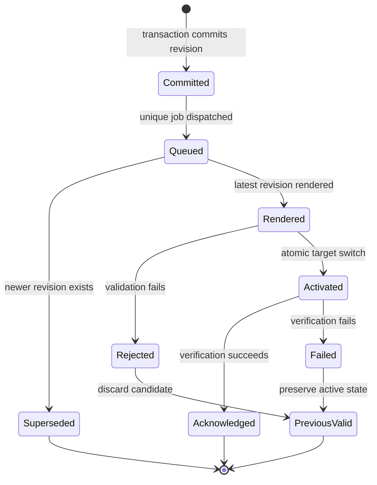

# Desired state and reconciliation

The diagram shows the life of one change. PostgreSQL is the source of truth
(*desired state*) for domains, DNS records, platform identity, the DNS primary,
edges, pools, cells, placements, cache and security settings, certificates,
operations, and the audit history. Everything that runs is derived from it and
can be rebuilt:

- The PowerDNS database holds the rendered zones.
- Edge artifacts and agent snapshots are built from domain revisions.
- OpenResty files and cached content are local to each edge.
- ClickHouse holds telemetry and aggregates. It never makes serving decisions.

## Mutation sequence

A change that reaches DNS or an edge follows these steps in order:

1. CDNFoundry checks who you are and what you may do. The panel and API use the same rules.
2. It validates the input and its size limits.
3. It locks the row when two changes could collide.
4. It saves the desired state, raises the revision, and writes an audit record.
5. After the save, it queues one unique or merged job.
6. The worker skips the job if a newer revision exists.
7. The worker builds the new state the same way every time and computes a checksum.
8. It validates the new state and switches to it in one atomic step.
9. It verifies the result or waits for the runtime to acknowledge it.
10. It records success, or a failure you can see.

An HTTP request never waits for DNS, edge, TLS, purge, or backup work. It returns
`202 Accepted` with an operation ID.

::: warning Accepted is not activated
`202 Accepted` means the desired state is saved and an operation exists. Poll the
operation and the deployment status before you treat the runtime as changed.
:::

## Failure guarantee

A failed new state never replaces the last valid one.

- DNS deployments keep their active records and checksum.
- The edge agent checks the artifact signature, checksum, schema version,
  compatibility range, and compiled runtime before it switches directories.
- Managed TLS keeps the current valid certificate when issuance fails.
- If ClickHouse is unavailable, serving continues. Analytics can have gaps.

## Coalescing and lanes

Repeated work for the same domain, or for the whole platform, is merged into one
job. Horizon runs the `interactive`, `dns`, `edge`, `verification`, `tls`, `purge`,
and `bulk_maintenance` queues separately, each with its own worker limit. A slow
DNS host, a nameserver check, or a large import cannot stall edge deployment.

The database transaction never waits on an external network. The desired state, the
new revision, the audit entry, and the operation are committed first. If a newer
revision arrives while a job runs, one more job follows.

See [Revisions and operations](revisions-and-operations.md) for what clients should
do, and [CLI and scheduler](../reference/cli-and-scheduler.md) for the scheduled
reconciliation jobs.
