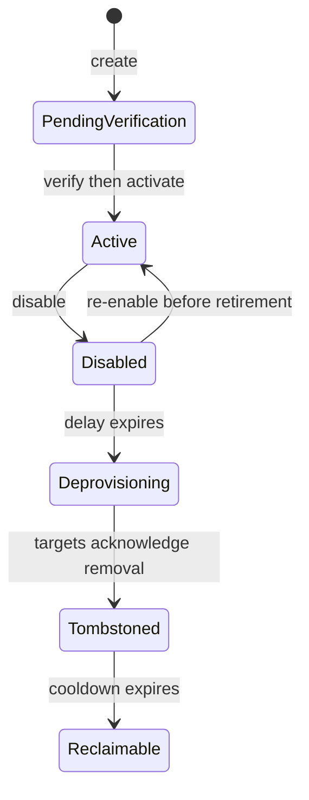

# Domains and DNS concepts

A new domain has no origin. Its stored lifecycle state is `pending_verification`,
`active`, `disabled`, or `deprovisioning`. The diagram also shows the steps after
removal.

- Nameserver verification runs in the background. A domain can be activated only
  after its delegation is verified.
- A disabled domain keeps serving its last valid DNS and edge state for the
  *deprovision delay*. The default is 7 days, and you can set 1 to 365.
- After the delay, jobs publish tombstones (removal markers) and wait until every
  target acknowledges them.
- The name then stays reserved for the *reclaim cooldown*. The default is 7 days,
  and you can set 1 to 365.

Both values are in **Platform settings**, in the DNS lifecycle group.

## Record modes

Each record uses one of three modes:

- `dns_only` publishes the record content as you entered it, after validation.
- `proxied` works only for `A`, `AAAA`, and `CNAME` records and needs one safe origin.
- `geo_dns` picks an answer by country, then continent, then a default.

CDNFoundry manages SOA serials and the platform nameserver identity. Domain users
cannot create, change, or remove apex NS records that delegate the zone.
Administrators can manage them where policy allows.

## Proxied publication

A proxied subdomain gets a CNAME to the hostname of its assigned pool. The apex
(for example `example.com` itself) cannot be a CNAME. Its A and AAAA answers come
from the ready cells of the assigned pool. Other apex records, such as MX and TXT,
stay as they are.

Each edge and pool pair needs one public endpoint with an IPv4 address, an IPv6
address, or both. Several private cells can serve one endpoint. Cells do not own
public addresses. The platform DNS zone lists an endpoint only when it is enabled,
has a fresh heartbeat, is not draining, is ready, and has an acknowledged gateway
revision. When a domain moves, the target placement activates before the source
starts to drain.

::: warning Disable is not deletion
Disabling keeps the last valid state for the delay. Final removal uses tombstones
and a name cooldown. This stops stale agents and late jobs from bringing back a
former owner's domain.
:::

## Who manages what

Domain users manage records only in zones assigned to them. The platform SOA, the
nameserver identity, and delegation NS records are for administrators. The content
of a proxied record is managed by the platform, because it points to ready edge
capacity. The origin is yours to set.

## DNS request path

A public DNS query reaches DNSdist on UDP or TCP port 53. DNSdist picks a private
PowerDNS backend. PowerDNS reads its own PostgreSQL database and a local, validated
GeoIP file (MMDB) for Geo-DNS. No query calls Laravel or an outside GeoIP service.

See [Authoritative DNS](../guides/dns.md), [DNS records](../reference/dns-records.md), and
[Geo-DNS](../guides/geo-dns.md).
