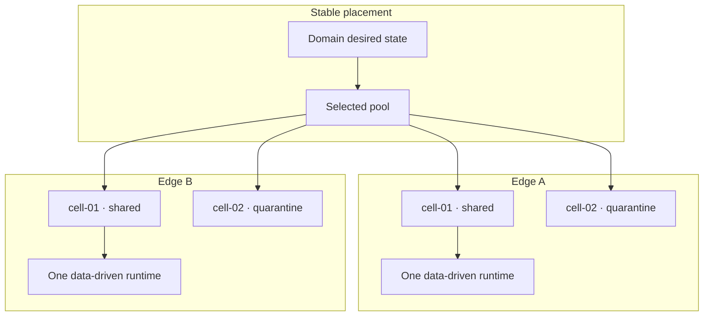

# Edges, pools, and cells

An **edge** is one enrolled host with one agent identity. A **pool** is a stable
service class. Its kind is `shared`, `reserved`, `quarantine`, or `dedicated`.
Use `dedicated` only for exceptions. A **cell** is a resource-limited OpenResty
runtime slot with a fixed name. The name does not change when you assign the
cell to a pool or remove it.

## Cell slots on an edge

The production Compose file runs eight cell slots on each edge host:
`cell-01` through `cell-08`. A new edge gets eight slots, and the count cannot
be changed after creation. The API accepts only 8, and the panel shows the
field read-only. Each slot has its own host ports, runtime and cache paths,
status, capacity, and resource limits. At the start:

- `cell-01` belongs to the pool `shared-default`.
- `cell-02` belongs to the pool `quarantine-default`.
- `cell-03` to `cell-08` are unassigned. They hold an empty runtime until you
  assign them to a pool.

Assigning a cell to a pool never changes its name or storage paths. A cell
status is one of: assigned, unassigned, ready, degraded, drained, or stopped.
An assigned cell whose runtime is missing becomes degraded. An unassigned cell
whose runtime is missing stays stopped.

### Resource limits

Compose sets these limits on every cell:

| Resource | Limit |
| --- | --- |
| Memory | 512 MiB |
| CPU | 0.5 |
| Processes | 128 |
| Request temporary storage (memory-backed) | 64 MiB |
| Logs (memory-backed) | 16 MiB |

OpenResty starts one worker per started CPU of the container limit, between one
and eight. It does not count the host's cores. Cached objects are stored on the
cell's own named volume.

The edge agent runs as a separate container. It is read-only and non-root, with
limits of 256 MiB and 0.25 CPU. The agent handles identity, artifact
validation, atomic runtime files, acknowledgements, and control tasks. It does
not proxy visitor traffic and has no container-engine socket. Drain, undrain,
and restart controls use authenticated private endpoints on each cell.

## Enrollment

Fleet enrolls an edge when you add a PoP. It runs `cdnf:edges:enroll` with the
edge name, country, and continent. The command assigns the first two cells to
the default pools and returns the edge UUID and a bootstrap token. An
administrator can also create an edge in the panel or through the API. CDNFoundry
shows the UUID and token once. The token is valid for 24 hours.

The agent opens an outbound connection to the mutual-TLS edge-control endpoint
and sends a certificate signing request (CSR). When this succeeds, the agent
stores its issued identity and no longer needs the token.

The identity certificate uses the edge UUID as its common name and has no IP
address in its subject alternative names. It does not depend on public pool
endpoint addresses.

An exact retry of a registration can reuse the pending key and CSR. A different
CSR with the same used token is rejected. Rotating an identity invalidates the
old certificate and creates a new one-time token.

## Artifact activation

The agent polls a manifest that starts at its active sequence. Each response
lists up to 500 artifact entries. The agent checks the Ed25519 signatures and
SHA-256 checksums, builds the runtime JSON for each pool, and switches the
active directory in one step. A full recovery snapshot is compressed with gzip.
The agent accepts at most 96 MiB for that download.

The agent stores acknowledgements locally and retries them. The runtime status
it reports drives listener readiness, capacity, summaries of passive origin
failures, and security events.

## Placement

A pool serves an edge only through the cells you assign to it. On each edge
that takes part, a normal domain gets one lasting cell, chosen by rendezvous
hashing. Adding an unrelated domain or cell keeps existing assignments, so
cache stays where it is. Reserved and dedicated pools can use two or three
replicas per edge. Shared and quarantine pools keep a single copy. Every pool
also sets a maximum number of domains per cell and a minimum number of ready
cells.

A domain has one active pool. During a move it also has one target pool. Only
the active and target cells receive the domain's signed artifact.

A move goes target first:

1. The target cells build, activate, and acknowledge the current revision.
2. CDNFoundry sees that the target listeners are ready.
3. DNS publishes the target addresses.
4. The source stays active for the drain time, then drains. The default is 300
   seconds. The setting is "Placement drain time (seconds)", from 30 to 86,400.

This order never withdraws the only valid route. If the target fails, the
source stays active.

::: warning Protection boundary
Cell limits on CPU, memory, processes, connections, and request rate contain
application-level load. They cannot scrub volumetric traffic once a host or its
uplink is saturated.
:::

See [Edges and placement](../guides/edges.md) and [Edge-agent API](../reference/api/edge-agent.md).
