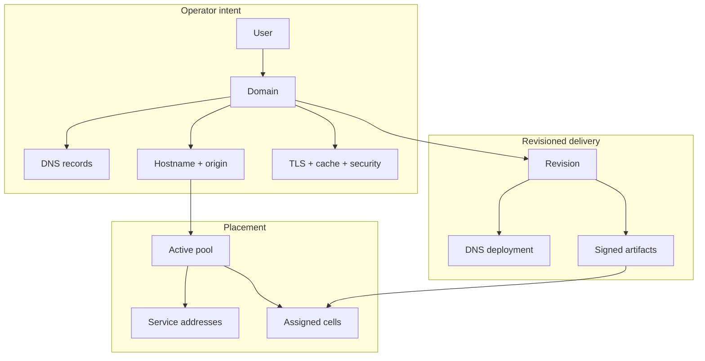
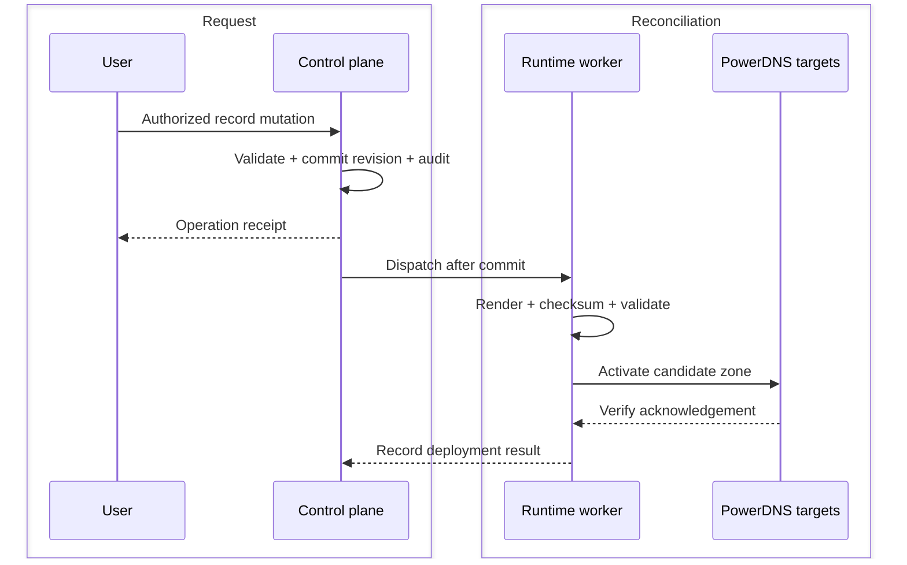
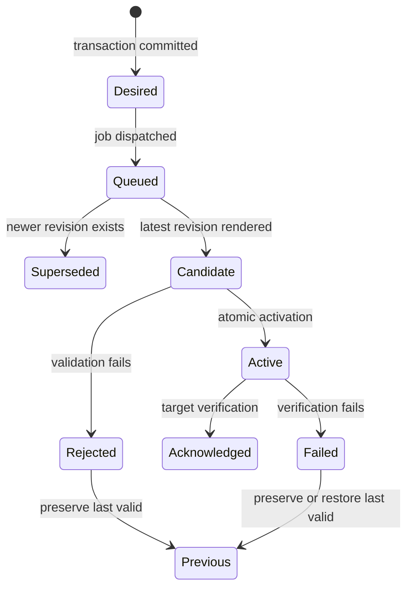

# How CDNFoundry works

CDNFoundry is a private CDN. A control plane (a Laravel application) stores
what you want. Separate DNS and HTTP **data planes** answer visitors. Administrators
and domain users save the configuration they want, called **desired state**.
Background workers turn the latest revision into validated DNS or edge runtime
state. Visitor traffic uses that runtime and never calls Laravel.

::: info The central mental model
**Save your change, watch its operation, check the acknowledgement, then test
the public path.** A saved form or a `202 Accepted` response does not mean DNS
or the edge has activated the change.
:::

## Object relationships

- A **domain** is the unit of access control and lifecycle.
- A **record** is DNS-only, proxied, or Geo-DNS.
- A **pool** is a service class. It decides which cells may serve a domain.
- An **edge** is an enrolled host. A **cell** is one resource-limited runtime slot on it.
- A **service endpoint** links a public address to a ready gateway listener on
  one edge and pool.
- A **revision** is the version of the configuration that each target must
  acknowledge.

## A domain's journey

### 1. The administrator prepares platform DNS

The administrator sets the platform zone, the authoritative nameservers, their
glue addresses, the proxy hostname, and the SOA policy. The administrator
registers each PowerDNS target as a DNS cluster with a source-restricted API.
CDNFoundry tests the cluster in the background. The administrator enables it
only after the test passes.

You must still add glue records and delegation at your registrar or parent zone.
CDNFoundry cannot do that.

### 2. The administrator prepares edge capacity

The administrator creates pools, enrolls each edge, assigns cells to pools,
and creates public service endpoints. An edge uses its one-time token to get a
mutual TLS (mTLS) identity. It then pulls signed artifacts and tasks over an
outbound connection to the control plane.

Cells keep fixed names such as `cell-01`. A normal domain is data inside a
shared runtime. Creating a domain does not create a container or an Nginx
server block. See [Edges, pools, and cells](edges-and-cells.md).

### 3. A domain is created and delegated

CDNFoundry validates and normalizes the name, creates the desired DNS state, and
sets the domain to pending verification. The owner then delegates the domain to
the platform nameservers. CDNFoundry checks the delegation in the background.
After it passes, an administrator activates the domain.

A DNS-only domain needs no origin. Creating a domain does not start certificate
issuance.

### 4. Records are added

A DNS-only record is validated and written into the derived PowerDNS data.
A Geo-DNS record is written as a limited set of country, continent, and default
answers. A proxied record needs a safe, explicit origin. DNS then publishes the
platform pool addresses, not the origin address.

The DNS workflow is:

CDNFoundry must see every required target acknowledge the revision. If
rendering or activation fails, the previous valid zone stays active.

### 5. Proxying activates TLS and edge state

When an active, verified domain first gets a proxied hostname, managed TLS can
start DNS-01 issuance. Certificates, origin policy, cache policy, security
policy, and placement become part of the signed edge state.

The edge agent checks the signature, checksum, schema, and version
compatibility. It builds a candidate, validates it, and switches the active
directory in one step. It keeps the previous runtime state so it can go back.

### 6. A client request is served

1. DNS returns the address of a pool endpoint whose listener is ready.
2. The client connects to the edge gateway at that address.
3. The gateway checks the destination plus Host and SNI, and picks an assigned cell.
4. OpenResty picks the domain's certificate and policy from its active runtime data.
5. Security checks and request limits run before cache and origin handling.
6. A cache hit is answered locally. An eligible miss goes to the validated origin.
7. The edge sends redacted telemetry to Vector after it has served the request.

Laravel, PostgreSQL, ClickHouse, and Grafana are not part of this path.

## How changes become active

Operations show this progress to users and API clients. Poll the operation and
check each target's deployment state. For changes that visitors see, also test
the real DNS, TLS, and HTTP path from outside your management network.

::: warning Acknowledgement has a scope
A DNS acknowledgement shows that a target accepted the zone revision. An edge
acknowledgement shows that the agent activated an artifact. Neither proves that
parent delegation is correct, that Internet routing works, that recursive caches
have updated, or that the origin is correct.
:::

## Failure behavior

| Failure | What continues | What pauses or degrades |
| --- | --- | --- |
| Control application unavailable | Active DNS and HTTP runtime | UI, API changes, and new reconciliation |
| PostgreSQL or Valkey unavailable | Active DNS and HTTP runtime | Desired-state access, queues, and management |
| One DNS target unavailable | Other authoritative targets | Failed target deployment and redundancy |
| Invalid DNS candidate | Previous active zone | The new revision stays failed or pending |
| Invalid edge artifact | Previous active runtime | New edge revision is rejected |
| Origin unavailable | Eligible cached or stale responses | Cache misses and uncacheable requests |
| Certificate renewal failure | The current valid certificate, until it expires | Future certificate readiness |
| Vector or ClickHouse unavailable | DNS and HTTP serving | Complete telemetry and analytics |
| One edge or POP unavailable | Other qualified capacity | Traffic that still uses old DNS answers or routes can fail until caches or routes update |

## Who does what?

### Administrators

Administrators manage the platform identity, DNS clusters, users, domains, edge
enrollment, pools, endpoints, and global settings. They also own operations,
capacity, backups, and incident response.

### Domain users

Domain users see only the domains assigned to them. They manage records,
origins, TLS, cache, security, analytics, and usage for those domains. They
cannot change the platform identity or another user's domains.

### API clients

API tokens (Laravel Sanctum) follow the same access policies as the panels.
Send an `Idempotency-Key` with each change, keep the operation IDs, page lists
with cursors, and handle the stable error codes.

### Edge agents

Agents pull their configuration. They authenticate with a short-lived mTLS
identity, verify the signed desired state, activate it locally, and report
health and acknowledgements. An agent receives only the runtime data and
certificates that its own cells need to serve their domains.

## Safe operating loop

For every production change:

1. Check the current desired state, active state, and health.
2. Make one small change that someone can review.
3. Save the operation ID and the expected revision.
4. Wait until every required target acknowledges.
5. Test DNS and HTTP from outside, over IPv4 and IPv6.
6. Watch errors, cache, origin, security, and capacity signals.
7. Keep or restore the previous valid state if the test fails.

Next, read [Using CDNFoundry](../getting-started/using-cdnfoundry.md),
[Data flows](../architecture/data-flows.md), and
[Desired state and reconciliation](desired-state.md).
