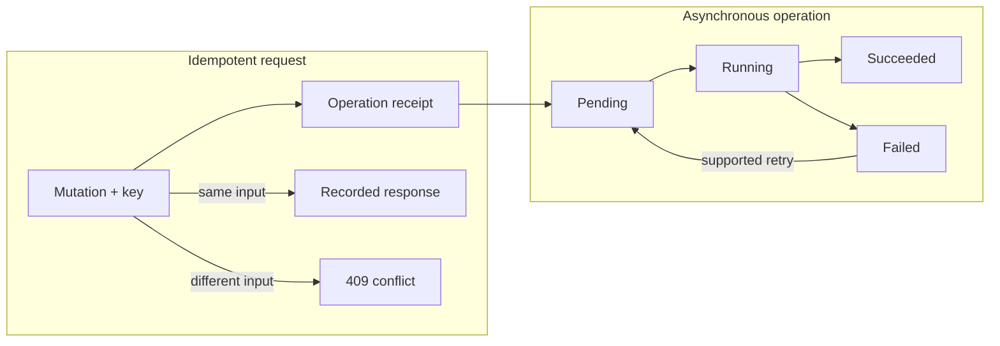

# Revisions and operations

::: warning Accepted is not active
`202 Accepted` means the work was recorded or queued. Do not report success until
the operation has finished and every DNS host, edge, TLS, cache, or purge target
has acknowledged the new revision.
:::

A revision is a number that only goes up and is never reused. DNS and edge
deployments store the desired revision and the active revision separately. This
shows you which work is pending and which state is the last valid one.

## Operations

A long change creates an operation and returns its UUID. Poll
`GET /api/operations/{operation}` until the status is `succeeded` or `failed`.
While it runs, the status is `pending` or `running`. In the admin panel, open
**Operate → Operations**.

- Administrators can list all operations, read failures, and retry supported types,
  such as `usage.rebuild` (`POST /api/admin/operations/{operation}/retry`).
- A failed operation counts as an active health problem until it is resolved. It
  resolves by itself when a later operation of the same type succeeds for the same
  domain (or, for a global operation, at all). An administrator can also
  **acknowledge** it (`POST /api/admin/operations/{operation}/acknowledge`, or the
  Acknowledge action on the Operations page). Acknowledging keeps the record and its
  error, records who did it in the audit log, and stops the failure from raising
  Degraded in the admin dashboard, Grafana, and alerts. Retrying clears the
  acknowledgement, so a new failure alarms again.
- Every request that changes state or queues work writes an audit entry with the
  actor and the operation ID.
- A domain user can read an operation only through its domain. Every user assigned
  to the domain can read all of that domain's operations, including a merged
  operation that another member started. Any other operation returns `403`.
- Operations that belong to no domain, such as global reconciles, are for
  administrators only.
- The database allows only one unfinished `dns.zone_reconcile` and one unfinished
  `edge.domain_reconcile` per domain.

### Retries and DNS outages

A DNS operation becomes `failed` only when its retry window ends. If a DNS host is
unreachable, the job retries after 10, 30, 60, 120, and then 300 seconds, for up to
30 minutes. The operation stays `running` and shows the last error. If the outage
ends inside the window, the operation finishes as `succeeded`.

A scheduled check (`cdnf:dns:repair-drift`, every five minutes) compares what each
DNS host serves with the desired state. It queues a reconcile for any difference. A
host that was down longer is repaired when it comes back.

A finished operation does not prove that every target has changed. Read the
operation and the deployment status for the domain together.

| Evidence | What it proves |
| --- | --- |
| HTTP `200` or `201` | A change that needs no background work is done |
| HTTP `202` and operation ID | The work was saved |
| Operation `succeeded` | The job's completion condition passed |
| DNS active checksum | One DNS host activated the new zone |
| Edge acknowledgement | One agent and cell activated the sequence |
| Runtime probe | The real listener serves the expected behavior |

## Idempotent requests

Changing requests accept an `Idempotency-Key` header. It must be a UUID. Send the
same key when you retry. The same method, path, and payload replays the earlier
response for 24 hours and sets `Idempotency-Replayed: true`. The same key with
different input returns `409 idempotency_conflict`. A key that is not a UUID
returns `422 invalid_idempotency_key`.

CDNFoundry never stores a plaintext token in a saved response. A token is shown
once, even if the request carried a key.

## Rollback

To roll back a domain's proxy configuration, choose a retained, validated edge
revision (`POST /api/domains/{domain}/rollback`). Rollback creates a new desired
revision and new artifacts. It does not lower the revision number and does not
restore a database backup. Only the fields you own are restored, and CDNFoundry
validates them again against the current rules. If an old revision no longer
passes, CDNFoundry refuses it as a whole.

Retention is set in **Platform settings**, in the Configuration history group. By
default CDNFoundry keeps every validated revision from the last 1 day, and at least
10 revisions per domain whatever their age.

A full cache purge is different. It raises the cache epoch. It does not scan a disk.
