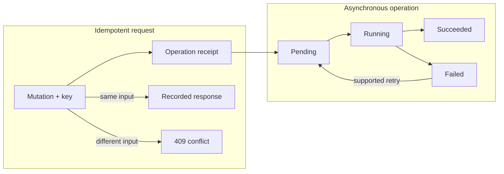

# Revisions and operations

::: warning Accepted is not active
`202 Accepted` proves that bounded work was recorded or queued. Do not announce
success until the operation and every relevant DNS, edge, TLS, cache, or purge
acknowledgement reaches the intended revision.
:::

Each domain revision is monotonic. DNS and edge deployments record desired and
active revisions separately so operators can see pending work and last-valid
state. Revision numbers are never reused.

## Operation receipts

Long-running changes create an `operations` row and return its UUID. Poll
`GET /api/operations/{operation}` until the status is `succeeded` or `failed`.
Administrators can list all operations, inspect failures, and retry supported
types. A user can read an operation only through its domain: every user assigned
to the domain can read every operation of that domain, including a coalesced
operation another member started, and a request for any other operation
answers `403`. Operations that belong to no domain, such as global
reconciles, are administrator-only. The domain is stored as a typed column on
the operation, and the database allows only one unfinished `dns.zone_reconcile`
and one unfinished `edge.domain_reconcile` per domain.

A DNS operation is marked `failed` only when its retry window ends. While a DNS
host is unreachable the job retries with backoff (10, 30, 60, 120, then 300
seconds) for up to 30 minutes, the operation stays `running` with the last
error visible, and an outage that ends inside the window finishes
`succeeded`. A scheduled drift check (`cdnf:dns:repair-drift`, every five
minutes) later compares what each DNS host serves with desired state and queues
a reconcile for any difference, so a host that was down longer is repaired once
it returns.

Operations are not a promise that every external target will succeed
immediately. The operation response and the domain-specific deployment endpoint
together show control-plane completion and target acknowledgement.

| Evidence | What it proves |
| --- | --- |
| HTTP `200` or `201` | Synchronous control-state action completed |
| HTTP `202` and operation ID | Work was durably accepted |
| Operation `succeeded` | The job's completion condition passed |
| DNS active checksum | One DNS cluster activated the candidate |
| Edge acknowledgement | One agent/cell activated the sequence |
| Runtime probe | The real listener serves expected behavior |

## Idempotent requests

Mutating account and administrator routes use the `idempotent` middleware.
Supply a UUID in `Idempotency-Key` when retrying is possible. The same method,
path, and normalized payload replays the prior response for 24 hours and sets
`Idempotency-Replayed: true`. Reusing the key with different input returns
`409 idempotency_conflict`.

Plaintext tokens are never stored in an idempotency response. Token creation is
therefore a one-time secret boundary even when the request carries a key.

## Rollback

Edge configuration rollback selects a retained validated revision. Rollback
creates a new desired revision and new artifacts; it does not decrement the
revision counter or restore a database backup. Retention keeps every revision
inside the configured time window and at least the configured minimum number per
domain, while preserving active and relevant rollback points.

Cache policy rollback uses the same mechanism. Full cache purge is different:
it increments the cache epoch instead of scanning a filesystem.
