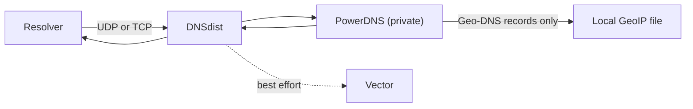
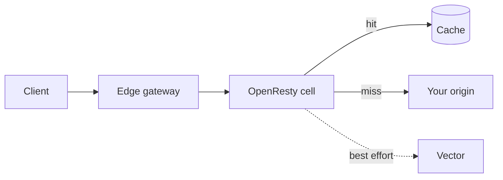
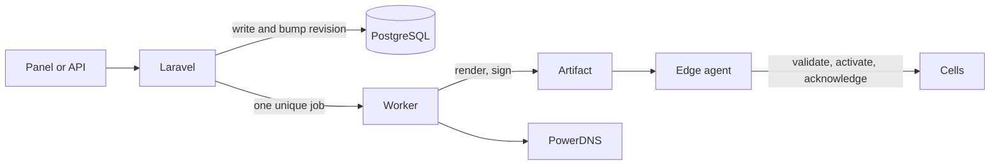
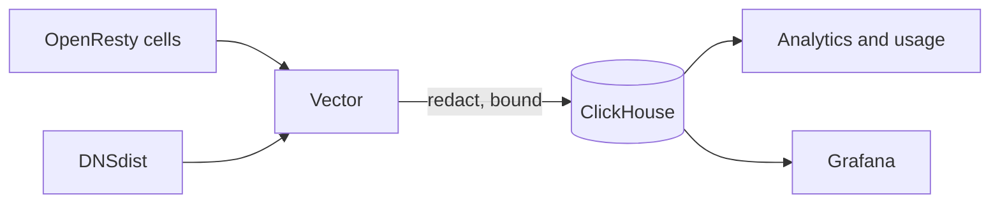

# How it works in four diagrams

CDNFoundry has four paths. Each one is short. Read them in order, or jump to
the one you need.

| Path | Starts at | Ends at | Laravel involved? |
| --- | --- | --- | --- |
| [A DNS query](#a-dns-query) | A resolver | A DNS answer | No |
| [An HTTP request](#an-http-request-through-a-pop) | A client | A response | No |
| [A configuration change](#a-configuration-change) | The panel or API | Every PoP | Yes |
| [Telemetry](#telemetry) | A cell or DNS node | ClickHouse | No |

## A DNS query

1. A resolver sends the query to DNSdist. It is the only public DNS endpoint.
2. DNSdist asks a private PowerDNS server.
3. For a Geo-DNS record, PowerDNS reads a GeoIP file on the same host.
4. DNSdist returns the answer and sends a copy of the event to Vector.

**Check it worked:** `dig @<your DNS host> www.example.com` returns an answer
with the `aa` flag.

## An HTTP request through a PoP

1. DNS gave the client the address of a PoP.
2. The gateway sends the connection to the right cell by host name.
3. The cell picks the certificate and applies the domain's security rules.
4. A cached copy is returned at once. Otherwise the cell asks your origin.
5. The cell sends one redacted event to Vector.

**Check it worked:** the response carries an `X-CDNF-Cache` header, and a
second request for the same URL is a hit.

## A configuration change

1. You save a change. Laravel checks permission and input.
2. Laravel writes the new desired state and raises the revision in one
   transaction.
3. After the commit, one background job is queued. The page returns `202` with
   an operation ID.
4. The worker builds the DNS zone and the signed edge artifact from the latest
   revision. It skips work for an older revision.
5. Each edge agent pulls the artifact, checks its signature and checksum,
   switches to it in one step, and reports back.
6. A bad artifact is rejected, and the PoP keeps serving the last good one.

**Check it worked:** the operation shows as succeeded, and each PoP reports the
new revision.

## Telemetry

1. Cells and DNS nodes send events to Vector on the same host.
2. Vector removes cookies, authorization headers, bodies, and query strings,
   and limits field sizes.
3. Vector writes to ClickHouse. The panel and Grafana read from it.

Telemetry never slows DNS or HTTP. If its buffers fill, events are dropped and
traffic keeps flowing.

**Check it worked:** a request you just made appears in the domain's logs
within a minute.

## Go deeper

- [Data flows](../architecture/data-flows.md) has the sequence diagrams.
- [Revisions and operations](revisions-and-operations.md) explains operation
  states.
- [Edges and cells](edges-and-cells.md) explains PoPs, pools, and cells.
