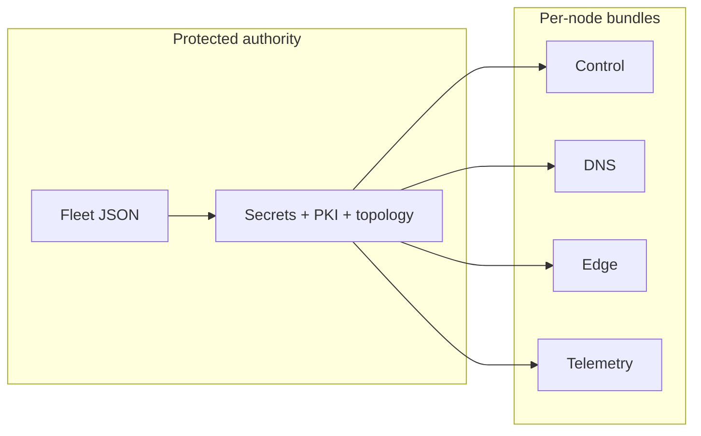

# Production fleet configuration reference

This page lists every field of the Fleet setup file and what a rendered bundle contains. For the steps, see the [Fleet operator guide](production-fleet-operator-guide.md). For every command and option, see the generated [Fleet CLI reference](../reference/fleet-cli.md).



Copy `deploy/production/examples/starter-fleet.json` or `multi-region-fleet.json` to a protected local `fleet.json`, and change your data there. The files in the repository are templates. Do not edit the scripts or the generated Compose files to configure a fleet.

## Common command options

These options work before or after a command name.

| Option | Default | Purpose |
| --- | --- | --- |
| `--vault` | `~/.config/cdnfoundry-fleet/fleet.db` | Encrypted Fleet state |
| `--state-dir` | none | Plain state directory that replaces the vault. For development and tests only, because secrets are not encrypted |
| `--output-dir` | `~/.config/cdnfoundry-fleet/bundles` | Where Fleet writes the host bundles |
| `--repo-root` | The checkout that holds the script | Where Fleet reads `compose.prod.yml` and the deployment files |
| `--config` | none | JSON input for `setup` and the node commands |
| `--non-interactive` | off | Never prompt. Fail when an answer is missing |
| `--dry-run` | off | Check the input. Write no state and no bundles |
| `--yes` | off | Answer yes to confirmations |

The vault passphrase comes from a prompt, `CDNF_FLEET_PASSPHRASE`, or `CDNF_FLEET_PASSPHRASE_FILE`.

## Setup config schema

Fleet rejects any field that is not listed on this page.

```json
{
  "preset": "control-monitoring",
  "global": {
    "operator_domain": "ops.example.com",
    "platform_domain": "example.net",
    "release": "RELEASE_TAG_OR_COMMIT",
    "acme_email": "operations@example.com",
    "alert_webhook_url": "https://alerts.example.com/cdnfoundry",
    "ipv6": false
  },
  "nodes": [],
  "features": {
    "monitoring": {"mode": "disabled", "host": null},
    "logs": {"mode": "disabled", "host": null, "endpoint": null},
    "backups": {"mode": "disabled", "repository": null, "region": "us-east-1"}
  }
}
```

### Global fields

| Field | Description |
| --- | --- |
| `operator_domain` | Domain for the control panel, `edge-control`, and node names. Host it at an independent DNS provider |
| `platform_domain` | Domain that holds the platform nameserver names |
| `release` | Exact tag or commit label. Moving names such as `latest`, `main`, and `master` are rejected |
| `acme_email` | Contact address for certificate issuance |
| `alert_webhook_url` | An `https://` URL that receives every alert. Alertmanager does not start without one |
| `ipv6` | `true` plans IPv6 on every node. Use a JSON boolean |

The global fields may also sit at the top level of the file.

### Presets

| Preset | Result |
| --- | --- |
| `control-only` | Control node, monitoring disabled |
| `control-monitoring` | Control node with colocated monitoring |
| `dedicated-monitoring` | Control node plus a monitoring-role node. A non-interactive run needs that node in `nodes` |
| `custom` | Features come from `features` or later commands. This is the default when you give no preset |

A `features.monitoring` entry in the file overrides the preset.

## Node object

| Field | Required | Description |
| --- | --- | --- |
| `name` | yes | Lowercase letters, digits, and hyphens. Starts with a letter. 2 to 63 characters |
| `role` | yes | `control`, `dns`, `edge`, `dns-edge`, or `monitoring` |
| `region` | yes in the CLI | Routing and operations label |
| `location` | yes in the CLI | Site label |
| `hostname` | no | Defaults to `NAME.OPERATOR_DOMAIN` |
| `public_ipv4` | yes | Public or routed IPv4 address, used for inventory, allowlists, and certificates |
| `public_ipv6` | no | IPv6 service address |
| `bind_ipv4` | no | Local IPv4 listener address. Defaults to `0.0.0.0` |
| `bind_ipv6` | no | Local IPv6 listener address. Defaults to `::` on a new node in a fleet with `ipv6` set to `true`, otherwise none |
| `monitor_ipv4`, `monitor_ipv6` | no | Private addresses Prometheus uses to reach the node. IPv4 falls back to `public_ipv4` |
| `log_ipv4`, `log_ipv6` | no | Private address of the node as a log source |
| `release` | no | Release for this node only. Defaults to the global release |
| `extra_env` | no | Environment overrides for this node. Fleet always writes them to `.env.prod`, even when Compose has a default |
| `enabled` | no | `false` leaves the node out of rendering and monitoring targets |
| `draining` | no | `true` keeps the node but removes it from preferred routing |
| `health` | no | Object with `failure_threshold` (3), `success_threshold` (2), and `stale_after_seconds` (90) |

Each hostname, public address, monitoring address, and log address must be unique across the fleet.

On `setup` and `update-node`, a field you leave out keeps its saved value. An explicit JSON `null` clears `public_ipv6`, `bind_ipv6`, `monitor_ipv4`, `monitor_ipv6`, `log_ipv4`, or `log_ipv6`. A `null` `bind_ipv6` stays off even in a dual-stack fleet. `::` is only the default when the field is absent on a new node. If you run `setup` again without `--acme-email`, Fleet keeps the saved contact. A different contact is rejected.

Example:

```json
{
  "name": "pop-singapore",
  "role": "dns-edge",
  "region": "asia",
  "location": "singapore",
  "hostname": "pop-singapore.ops.example.com",
  "public_ipv4": "192.0.2.40",
  "public_ipv6": "2001:db8::40",
  "bind_ipv4": "0.0.0.0",
  "bind_ipv6": "::",
  "monitor_ipv4": "10.30.0.40",
  "release": "RELEASE_TAG_OR_COMMIT",
  "extra_env": {},
  "enabled": true,
  "draining": false
}
```

Boolean fields must be JSON `true` or `false`, not strings or numbers. IPv4 fields need IPv4 and IPv6 fields need IPv6. Fleet shows `extra_env` values as `<redacted>` in `status`, and writes them to Compose env files as literal text, including dollar signs.

## Edge registration

Do not put bootstrap tokens in a version-controlled setup file. The control plane shows a one-time window with exactly these two lines:

```dotenv
EDGE_ID=11111111-2222-3333-4444-555555555555
EDGE_BOOTSTRAP_TOKEN=the-one-time-token
```

Paste them into the host's mode `0600` `.env.prod`, then start the edge profile:

```bash
sudo docker compose --env-file .env.prod --profile edge up -d
```

The edge name and the Fleet node name do not have to match. `bootstrap` does this for you. `configure-edge-registration` and `clear-edge-bootstrap-token` store and remove the pair in the vault for your own automation. The admin panel does not show them.

These optional edge settings go in the node's `extra_env`:

| Key | Use |
| --- | --- |
| `EDGE_GATEWAY_ADDRESS_MAP` | For NAT or a load balancer: maps each advertised address to its own private listener. A directly assigned address needs no map |
| `EDGE_GATEWAY_REQUIRE_ADDRESS_MAP` | `true` requires an explicit map for every address |
| `EDGE_HOST_GATEWAY_IPV4` | For a host where Docker writes `invalid IP` for `host-gateway`. Set it to the private IPv4 gateway of the host's `cdnfoundry_edge` network. Fleet then adds an `extra_hosts` entry to `edge-agent`. Edge and dns-edge nodes only. Check it again if you recreate the Docker network, and do not copy it between hosts |

Other host overrides, such as runtime versions, MMDB settings, and gateway capacity, also belong in `extra_env`.

## Control database selection

Embedded PostgreSQL is used unless the control node sets either:

```json
"extra_env": {
  "DB_HOST": "postgres.internal.example",
  "DB_PORT": "5432",
  "DB_SSLMODE": "verify-full"
}
```

or a non-empty `DB_URL`. A `DB_HOST` of `control-db` means embedded.

Replace the generated password with the real one using `set-secret --secret control-db-password --from-file FILE`. This keeps it out of command arguments. In remote mode, the control bundle has no `control-db` service and no volume for it.

## Feature objects

### Monitoring

```json
{"mode": "disabled", "host": null}
```

- `disabled`: no telemetry stack and no node exporters.
- `colocated`: the telemetry stack runs on the control node.
- `dedicated`: the telemetry stack runs on the monitoring-role node named in `host`.

### Logs

```json
{"mode": "centralized", "host": "monitoring-1", "endpoint": null}
```

- `disabled`: no log collector.
- `centralized`: every enabled node runs a collector with a generated Vector configuration. Fleet creates one shared log token.
- `host` is a node name and is required for `centralized`.
- `endpoint`: optional explicit Loki URL. Without it, Fleet uses `loki` on the log host itself and `https://telemetry.OPERATOR_DOMAIN:8444` for other nodes.

### Backups

```json
{
  "mode": "all-stateful",
  "repository": "s3:s3.example.com/cdnfoundry-production",
  "region": "us-east-1"
}
```

Modes are `disabled`, `control`, and `all-stateful`. The renderer treats the two enabled modes the same way.

## Exit codes

| Code | Meaning |
| --- | --- |
| `0` | Success |
| `2` | Command-line usage error |
| `3` | Invalid topology or config, or a failed `doctor` check |
| `4` | Missing, locked, or inconsistent Fleet state |
| `5` | Compose, PKI, file-copy, or bundle rendering failure |
| `6` | An action failed on a node (`bootstrap`, `upgrade`, `apply-config`, `backup-now`, `restore`) |
| `130` | You interrupted the command |

## Generated bundle contract

Every rendered node directory holds:

```text
.env.prod
compose manifest        # only this role's services
README.md
validate.sh
start.sh
stop.sh
pki/
secrets/
generated/              # when the role needs it
docker/...              # only runtime files the selected services mount
```

A control node whose PowerDNS password rotation is pending also gets `reconcile-pdns-password.sh`, its Python helper, and the pending password file. See [Rotate the PowerDNS database password](production-fleet.md#rotate-the-powerdns-database-password).

`start.sh` picks the Compose profiles from the node's role. On `edge` and `dns-edge` nodes it reads `EDGE_ID` through Compose. A `dns-edge` node without an `EDGE_ID` starts DNS and prints that enrollment is pending. After you set `EDGE_ID`, the same script also starts the edge services. A value that is not a UUID fails before any migration or start. You do not edit the script or upload a second bundle. Fleet reads environment files as data and never sources them as shell.

## Security properties

- State directories use mode `0700`.
- State, secrets, environment files, manifests, and private keys use mode `0600` when rendered and transferred.
- On the control node, `start.sh` sets `pki/edge-identity-ca.key` and `docker/pdns/primary.conf` to owner `root`, group `82`, mode `0640`, so the application's PHP-FPM worker and PowerDNS can read them. On DNS nodes, it does the same for `docker/pdns/pdns.conf`. Activation needs root. The PowerDNS service gets group `82` and keeps its non-root user.
- Node bundles are built in a temporary directory and swapped in at once.
- A normal render does not rotate secrets.
- PowerDNS database credentials exist only for the control node. Each DNS node has its own API key.
- CA private keys stay in the vault. The control bundle also holds the edge identity CA key, because the control service needs it.
- Every operator-set Compose value is in the node's `.env.prod`. `compose.prod.yml` has no fallback values for deployment settings.
- Each service lists the environment variables it may use. Fleet does not use a shared `env_file`, because that would give every container every credential. Compose reads values from `--env-file .env.prod`.

## Validation and repeated setup

`setup` checks the complete proposed plan before it writes anything. If you run it again with a changed operator domain, platform domain, release, ACME email, or address-family mode, it fails with a clear error. It never ignores the change. For an upgrade, change a node's release with `update-node`. A change to a global DNS, PKI, or topology value needs a planned migration, with the existing state and recovery material kept.

Fill every required `CDNF_*_IMAGE` value from the [verified manifest](../operations/software-supply-chain.md#populate-fleet-image-references), or use `set-release`. A release label alone is not enough: `validate.sh` rejects images that are not pinned by digest before it starts any container. The role still decides which services run.

If a durability check fails after the swap, keep both the active bundle and the recovery generation that Fleet names. Investigate before you delete anything or replace the CA.
