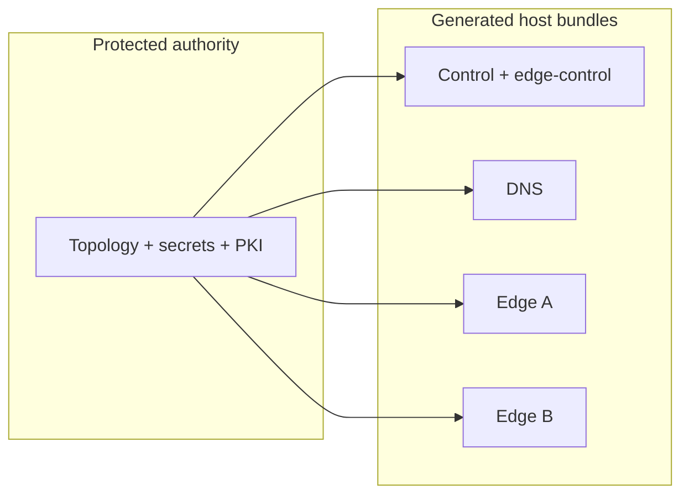

# Production fleet operator guide

This guide shows how to run a fleet with the Fleet CLI (`scripts/cdnfoundry-fleet`). You will create a plan, render one bundle per host, check the bundles, deploy them, and keep the fleet up to date. For the design behind these steps, see the [Fleet reference](production-fleet.md). For every option, see the [Fleet CLI reference](../reference/fleet-cli.md) and the [configuration reference](production-fleet-config-reference.md).

**You need:** a workstation with Python 3, PyYAML, and OpenSSL, a checkout of CDNFoundry at an exact release, and root SSH access to your hosts. Docker Engine with Compose v2 is needed on the hosts, not on the workstation.



Each bundle is a security boundary. It holds only the services, files, and secrets that its host needs. Never copy a bundle, `.env.prod`, `pki/`, or `secrets/` from one node to another. Never add a shared `env_file` to a Compose service: it would give every container every credential.

## Start from an exact release

Do not run production from a moving branch. Check out a release tag or commit:

```bash
git clone https://github.com/vaheed/CDNFoundry.git cdnfoundry
cd cdnfoundry
git checkout --detach RELEASE_TAG_OR_COMMIT
git rev-parse --verify HEAD
```

Expected: the last command prints the commit you chose.

Images must be pinned by digest. There are two ways to set them:

- Run `set-release` (see [Deploy with Fleet](#deploy-with-fleet)). Fleet builds the release from your checkout and then writes the `CDNF_*_IMAGE` values for you.
- By hand, copy the verified digests into each node's `extra_env`, as in [Software supply chain](../operations/software-supply-chain.md#populate-fleet-image-references).

Without digests, `render` still works for offline checks, but a bundle's `validate.sh` rejects any image that is not pinned by digest.

## Where Fleet keeps its files

Fleet keeps its state in one encrypted file, the vault. The default is `~/.config/cdnfoundry-fleet/fleet.db`. The default bundle directory is `~/.config/cdnfoundry-fleet/bundles`. Change them with `--vault` and `--output-dir`.

The first command that creates the vault asks for a passphrase of at least 12 characters. There is no recovery without it. In a script, set `CDNF_FLEET_PASSPHRASE` or `CDNF_FLEET_PASSPHRASE_FILE`. See [Fleet engine, vault, and local web](../operations/fleet-engine.md#the-vault).

`--state-dir DIR` replaces the vault with a plain, unencrypted directory. It is for development and tests only. The quick starts use it to keep their commands short. In production, leave it out.

Everything Fleet creates holds secrets. State directories use mode `0700`, and state, secrets, environment files, and keys use mode `0600`.

## What Fleet creates

Fleet writes two things:

- **Fleet state**: the topology, feature modes, release identifiers, credentials, certificate authorities, node certificates, and a history of earlier states.
- **Node bundles**: one directory per host. It holds the generated Compose manifest (only that role's services), `.env.prod`, only the runtime files those services mount, the node's `pki/` and `secrets/`, generated monitoring and logging files, `validate.sh`, `start.sh`, `stop.sh`, and a `README.md`.

Hosts do not need a repository clone. Each one receives only its bundle.

## Set up a fleet

Use `setup`. It creates the state if it does not exist, adds nodes, validates the plan, and renders bundles.

<DocTabs :labels="['Fleet CLI (interactive)', 'Fleet CLI (config file)']">
<template #tab-1>

Run `setup` in a terminal with no options:

```bash
./scripts/cdnfoundry-fleet setup
```

Expected: Fleet asks for the vault passphrase, the operator domain, the platform domain, and the release. It then offers a topology menu (control plus monitoring, control only, dedicated monitoring, or custom), and asks for the control node and optional DNS or edge nodes. It ends with `Fleet validation passed` and the list of bundles.

Without a terminal, `setup` fails with a message to use `--non-interactive --config FILE`.

</template>
<template #tab-2>

Copy an example from `deploy/production/examples/` and edit it ([schema](production-fleet-config-reference.md#setup-config-schema)):

```bash
install -m 0600 deploy/production/examples/starter-fleet.json ./fleet.json
./scripts/cdnfoundry-fleet --config fleet.json --non-interactive --dry-run setup
./scripts/cdnfoundry-fleet --config fleet.json --non-interactive setup
```

Expected: the dry run prints lines that start with `Dry run, not persisted:` and a JSON status of `validated`, and writes nothing. The real run prints `Fleet validation passed (N node(s)).`, lists the bundles, and ends with a JSON status of `configured`.

A one-host check without a file:

```bash
./scripts/cdnfoundry-fleet --non-interactive setup \
  --operator-domain ops.example.com --platform-domain example.net \
  --release RELEASE_TAG_OR_COMMIT --preset control-monitoring \
  --control-ipv4 192.0.2.10
```

</template>
</DocTabs>

You can repeat `setup`. It updates the nodes named in the file and adds the missing ones. Secrets stay the same. If you change an existing global value (operator domain, platform domain, release, ACME email, IPv6 mode), `setup` refuses. Use `update-node --release` for a planned release change.

### Control plus monitoring

The preset `control-monitoring` sets monitoring to `colocated`. The control node then runs the `control` and `telemetry` profiles, and Prometheus targets cover every enabled host. To turn it on for an existing fleet:

```bash
./scripts/cdnfoundry-fleet configure-monitoring --mode colocated --non-interactive
./scripts/cdnfoundry-fleet render
./scripts/cdnfoundry-fleet status
```

Expected: `status` prints `Monitoring: colocated`. The control bundle's Compose manifest now lists `grafana`, `prometheus`, `clickhouse`, `loki`, and `node-exporter`.

## Command map

| Goal | Command |
| --- | --- |
| Create the plan and bundles in one step | `setup` |
| Create the state only | `init` |
| Add, change, or remove a host | `add-node`, `update-node`, `remove-node` |
| Import credentials from an old `.env` file | `adopt-existing` |
| Set monitoring, central logs, or backups | `configure-monitoring`, `configure-logs`, `configure-backups` |
| Store an edge ID and bootstrap token by hand | `configure-edge-registration`, `clear-edge-bootstrap-token` |
| Replace or rotate a secret | `set-secret`, `rotate-secret` |
| Show the plan | `status`, `status --json`, `list-nodes`, `show-start-order` |
| Check the workstation and the nodes | `doctor` |
| Check or generate bundles | `validate`, `render` |
| Record how to reach a node | `public-key`, `node-ssh` |
| Adopt the release | `set-release` |
| Install and start a node | `bootstrap` |
| Change release or config on running nodes | `upgrade`, `apply-config`, `rollback` |
| Look for known vulnerabilities | `security` |
| Back up and restore | `backup-now`, `restore`, `vault-backup`, `vault-restore` |
| Standby control node | `control add-standby`, `switchover`, `demote`, `promote`, `rejoin`, `remove-standby`, `refresh-ingress`, `status`, `check` |
| Local web page on 127.0.0.1 | `web` |

Every command has help, for example `./scripts/cdnfoundry-fleet render --help`.

## Check your tools

Run this before setup and after you update the checkout:

```bash
./scripts/cdnfoundry-fleet doctor
```

Expected: lines that start with `OK`, then `Doctor result: ready`. `doctor` checks that `compose.prod.yml`, Python, and OpenSSL are present, and that the state is valid. Docker is reported but not required on the workstation. When a vault exists, `doctor` also connects to each node over SSH and checks it. Any failed check gives exit code 3.

## Node roles

### Control

Runs the Laravel application (`core`, `web`, `horizon`, `scheduler`), Caddy, Valkey, the migrations, and the `edge-control` mTLS endpoint. It also runs the hidden PowerDNS primary with its own `pdns-db`. By default it runs an embedded PostgreSQL (`control-db`). With colocated monitoring it also runs the telemetry stack.

### DNS

Runs the PowerDNS secondary (`pdns-auth`) with a local SQLite store and no database service, DNSdist, and the GeoIP updater. Its API key is unique to the node. It pulls zones from the control host's primary.

### Edge

Runs the edge agent, the gateway, and the OpenResty cells. It receives the edge server CA, a node certificate, and the `edge-control` URL.

### DNS-edge

Runs the DNS and edge services on one host.

### Monitoring

Runs the telemetry stack when monitoring mode is `dedicated`. It does not run a control database. The control node needs an externally reachable `DB_HOST`, or you set `GRAFANA_POSTGRES_HOST` on the monitoring node. Without one, `render` fails. The bundle keeps the helper that creates the read-only Grafana role and its views before Grafana starts.

## PKI layout

Fleet uses two certificate authorities. See [Certificate trust](production-fleet.md#certificate-trust) for what each one signs.

CA private keys stay in the vault. Every bundle receives the edge server CA certificate and its own node certificate. Key delivery depends on the role:

- Control and DNS-only bundles include their node private key.
- Edge and DNS-edge bundles do not. The edge listener key, the edge recovery key, and (on DNS-edge) the node key live in `/dev/shm/cdnfoundry`, which is memory, owned by UID 10101 with mode `0400`. Host swap must be off. Memory does not survive a reboot, so the files must be restored after every boot.
- Only the control bundle includes the edge identity CA private key.

When you use `bootstrap`, Fleet issues these files, keeps them in the vault, turns swap off, and writes them again on every deploy. If you deploy by hand, run `scripts/issue-edge-listener-material.sh` (see the [starter quick start](production-quick-start.md)) and copy the files yourself. The recovery key is stable: store it with your backups, because losing it loses the encrypted edge state on that host. Do not reuse the node key as the edge listener key.

Activation needs root on the host. `start.sh` fixes file permissions for the container readers:

- Control: `pki/edge-identity-ca.key` and `docker/pdns/primary.conf` become owner `root`, group `82`, mode `0640`, so the application's PHP-FPM worker and PowerDNS can read them. `secrets/metrics-token` and `secrets/edge-proxy-secret.conf` get the same ownership and mode, and `secrets/valkey.conf` gets group `1000`.
- DNS: `docker/pdns/pdns.conf` gets owner `root`, group `82`, mode `0640`.

Keep each bundle directory at mode `0700`. Re-rendering does not rotate a stored credential. To rotate the PowerDNS database password, see [Rotate the PowerDNS database password](production-fleet.md#rotate-the-powerdns-database-password).

Key environment paths in a bundle:

```text
EDGE_IDENTITY_CA_CERTIFICATE=./pki/edge-identity-ca.crt
EDGE_IDENTITY_CA_PRIVATE_KEY=./pki/edge-identity-ca.key
EDGE_CONTROL_SERVER_CERTIFICATE=./pki/node.crt
EDGE_CONTROL_SERVER_PRIVATE_KEY=./pki/node.key
EDGE_CONTROL_CA_CERTIFICATE=./pki/edge-server-ca.crt
EDGE_RUNTIME_TLS_CERTIFICATE=/dev/shm/cdnfoundry/edge-runtime.crt
EDGE_RUNTIME_TLS_PRIVATE_KEY=/dev/shm/cdnfoundry/edge-runtime.key
EDGE_STATE_ENCRYPTION_KEY_FILE=/dev/shm/cdnfoundry/edge-state-encryption.key
```

The edge recovery key is 32 random bytes written as 64 hex characters. The agent keeps encrypted recovery state in the `edge-agent-state` volume. The cells and the agent reject a disk-backed key mount.

## Edge registration and mTLS enrollment

An edge in the control plane and a node in Fleet are two records. Their names can differ. The edge ID and one-time token link them.

<DocTabs :labels="['Fleet CLI', 'Admin panel']">
<template #tab-1>

`bootstrap` enrolls the edge for you. It creates the edge, assigns it to the default `shared` pool, creates its service endpoint from the node's public addresses, and gives the host its edge ID and token.

```bash
./scripts/cdnfoundry-fleet bootstrap --node edge-frankfurt --country DE --continent EU
```

Expected: Fleet prints the plan and asks for confirmation. After the health gate passes, the edge appears under **Infrastructure → Edges**. See [Fleet engine](../operations/fleet-engine.md#adding-a-node).

For hand-run automation, `configure-edge-registration --node NODE --edge-id UUID --bootstrap-token-file FILE` stores the pair in the vault, and `clear-edge-bootstrap-token --node NODE` removes the token afterward. Render and deploy the node to apply them.

</template>
<template #tab-2>

<div class="steps">

1. In **Infrastructure → Edges**, create the edge. Copy the two lines from the one-time **Enroll this edge** window. The window cannot be opened again.

2. On the prepared host, put the two values in `.env.prod`:

   ```dotenv
   EDGE_ID=11111111-2222-3333-4444-555555555555
   EDGE_BOOTSTRAP_TOKEN=the-one-time-token
   ```

3. Keep the file at mode `0600`, then start the edge profile:

   ```bash
   cd /opt/cdnfoundry
   sudo chmod 0600 .env.prod
   sudo docker compose --env-file .env.prod --profile edge up -d
   ```

</div>

Expected: after the first heartbeat, the edge shows as registered in the panel. The token is then spent. Blank it in `.env.prod`.

The generated `start.sh` reads `EDGE_ID` through Compose. If `EDGE_ID` is set, it starts the edge profile too. If it is empty, it starts only the other profiles and prints that enrollment is pending. It never edits `.env.prod`.

</template>
</DocTabs>

The agent creates its private key on the host and keeps the issued identity in the `edge-agent-state` volume. Never copy or delete that volume.

A directly assigned public address needs no `EDGE_GATEWAY_ADDRESS_MAP`. For NAT or a load balancer, set the map once in the node's `extra_env`, from each advertised address to its own private listener. Set `EDGE_GATEWAY_REQUIRE_ADDRESS_MAP=true` only if you want every address mapped explicitly. See [Services and ports](../reference/services-and-ports.md).

## Rotate an edge identity

Rotate when an agent's identity or its saved state is lost or may be stolen. Rotation revokes the old certificate at once. It is not a renewal with overlap.

<div class="steps">

1. Open the edge under **Infrastructure → Edges** and choose **Rotate identity**. Read the warning, tick the confirmation, and choose **Revoke identity and issue token**. Do this only when you can reach the edge host.

2. Copy the new two lines from the window that follows.

3. Replace `EDGE_ID` and `EDGE_BOOTSTRAP_TOKEN` in the host's `.env.prod`, then start the edge profile again:

   ```bash
   sudo docker compose --env-file .env.prod --profile edge up -d
   ```

</div>

Expected: Compose recreates the agent. It keeps the old identity until the new certificate is issued, then replaces it. The edge shows as registered again.

Until then the agent cannot send heartbeats or receive configuration. DNS, the gateway, and the cells keep serving their last valid state. If you leave the window before you save the token, rotate again and use only the newest token. Blank the spent token afterward.

## Embedded or remote control PostgreSQL

Embedded PostgreSQL is the default. The control bundle includes `control-db`, and `start.sh` waits for `control-db` and Valkey before it runs the migration.

For an external database, set connection values on the control node and replace the generated password with the real one from a protected file:

```bash
./scripts/cdnfoundry-fleet update-node --node control-1 \
  --extra-env DB_HOST=postgres.internal.example \
  --extra-env DB_PORT=5432 \
  --extra-env DB_SSLMODE=verify-full \
  --non-interactive

./scripts/cdnfoundry-fleet set-secret --secret control-db-password \
  --from-file /root/cdnfoundry-postgres-password --non-interactive
```

A non-empty `DB_URL` also selects remote mode. Keep a URL that holds a password out of version control and shell history.

In remote mode, the renderer drops `control-db`, its volume, and everything that depends on it. `start.sh` waits only for Valkey. If telemetry runs on the control host and you set `DB_HOST`, Grafana's database provisioning and data source use the same host, port, and SSL mode unless you set them yourself.

Before you render, make sure the external service has:

- the database and the application role the project expects;
- TLS, with hostname verification where supported;
- network rules that allow only the exact sources;
- room for connections from the web app, Horizon, the scheduler, migrations, and Grafana provisioning;
- backups with point-in-time recovery and a tested restore.

## Validate and render

```bash
./scripts/cdnfoundry-fleet validate
./scripts/cdnfoundry-fleet render
```

Expected: `validate` prints `{"status": "valid"}` and replaces nothing. `render` prints `{"status": "rendered", ...}` with the bundle paths.

`validate` renders into a temporary directory. `render` builds a full new generation, then swaps it into place and keeps the previous one. Add `--node NAME` to either command to work on one host.

Fleet checks generated configuration only. It does not check public DNS, TLS, registrar delegation, account access, or customer traffic. Follow the [starter quick start](production-quick-start.md) for that. Keep host-local Compose overrides (for example a resolver workaround) in your own inventory, because Fleet does not import them. Merge them into a new bundle and validate before you swap it in.

## Deploy with Fleet

Fleet can install, start, upgrade, and roll back nodes over SSH. It uses one key for the whole fleet.

<div class="steps">

1. Print the Fleet public key and add it to `/root/.ssh/authorized_keys` on every host.

   ```bash
   ./scripts/cdnfoundry-fleet public-key
   ```

2. Record how to reach each node. This also pins the host key.

   ```bash
   ./scripts/cdnfoundry-fleet node-ssh --node edge-frankfurt --host 203.0.113.30
   ```

3. Adopt the release. Fleet builds it from your checkout, pins the published image digests, and signs it with its own key.

   ```bash
   ./scripts/cdnfoundry-fleet set-release
   ```

4. Install and start a node. Fleet shows a plan and asks you to confirm.

   ```bash
   ./scripts/cdnfoundry-fleet bootstrap --node edge-frankfurt --country DE --continent EU
   ```

</div>

Expected: Fleet installs the prerequisites, pulls and checks the images, uploads and validates the bundle, starts it with `start.sh`, and runs the health gate. If the run fails, run the same command again. It continues after the last finished step. See [Fleet engine](../operations/fleet-engine.md) for upgrades, `apply-config`, and `rollback`.

## Transfer a bundle by hand

Use this when you do not use `bootstrap`, for example for a host Fleet cannot reach. Archive one node on the workstation:

```bash
tar --numeric-owner --owner=0 --group=0 \
  -C ~/.config/cdnfoundry-fleet/bundles \
  -czf /tmp/edge-frankfurt.tar.gz edge-frankfurt
```

On the target host:

```bash
install -d -m 0700 /opt/cdnfoundry.new
tar -xzf /tmp/edge-frankfurt.tar.gz --strip-components=1 -C /opt/cdnfoundry.new
cd /opt/cdnfoundry.new
# Apply retained host-local overrides before validation.
if [ -f secrets/metrics-token ]; then
  sudo chown 0:82 secrets/metrics-token
  sudo chmod 0640 secrets/metrics-token
fi
sudo ./validate.sh
cd /opt
mv cdnfoundry cdnfoundry.previous 2>/dev/null || true
mv cdnfoundry.new cdnfoundry
cd /opt/cdnfoundry
sudo ./start.sh
```

Expected: `validate.sh` ends without an error. `start.sh` ends with a `docker compose ps` table in which every long-running service is `healthy` or `running`.

Never copy the whole vault or another node's bundle. Do not replace `start.sh` with a plain `docker compose up` on the control host, because `start.sh` sets the file permissions that the application needs. If `core` says it cannot read `pki/edge-identity-ca.key`, run `sudo ./start.sh` again, then check that `stat -c '%u:%g %a %n' pki/edge-identity-ca.key` prints `0:82 640`.

`validate.sh` runs the pinned Caddy image's checker on each Caddyfile in the bundle, and rejects any image that is not pinned by digest. Treat any error as a failed bundle and do not activate it. The check container is short-lived and starts no dependencies. Docker can still create the bundle's network or empty volume metadata.

If `log-collector` exits with code `78` and says `LOG_AUTH_TOKEN` is missing, check that `.env.prod` has a non-empty `LOG_AUTH_TOKEN` and that the rendered `log-collector.environment` takes it from Compose interpolation. Do not put the token into the Compose file. Render again, upload the corrected bundle, and recreate only `log-collector`. Its `operational-vector-data` volume keeps the buffered logs.

## Docker log retention on existing hosts

Every production service uses Docker `json-file` logging with 10 MB per file and three files. Fleet puts this in each bundle. Docker applies new logging options only when it creates a container, so an existing container keeps its old options until it is recreated.

After you render and validate a new bundle, roll it out one host at a time (see [Fleet engine](../operations/fleet-engine.md#upgrades)). To check a host, inspect `HostConfig.LogConfig` in `docker inspect CONTAINER`.

Before you start, check free disk space. Copy any log evidence you need off the host, because recreating a container removes its old JSON log. Do not run `docker compose down --volumes` or prune named volumes. If a wave fails, roll back.

## Remote metrics reachability

A monitoring bundle attaches Prometheus to the private service networks and to the outbound `egress` network. The private networks stay internal, and Fleet publishes no Prometheus port. Without outbound access, the local data source can look healthy while every remote scrape fails.

After activation, run the Prometheus query `up`. Every expected remote node, DNSdist, gateway, and collector target must be present and equal to 1. A healthy data source alone proves nothing.

If a bundle was rendered before this attachment existed, add a `prometheus` entry to the host-local Compose override that keeps its existing networks and adds `egress`. For the starter control bundle the networks are `telemetry`, `control`, `dns-private`, and `egress`. Other layouts keep their own networks. Validate Compose, then recreate only Prometheus, and keep its volume and image digest. New renders include this already.

Keep metrics listeners limited to the monitoring source. Do not open them to the Internet to work around a routing problem.

## Updating the fleet

Add a host:

```bash
./scripts/cdnfoundry-fleet add-node \
  --node edge-tokyo --role edge --region asia --location tokyo \
  --public-ipv4 192.0.2.80 --non-interactive
```

Change a release or an address:

```bash
./scripts/cdnfoundry-fleet update-node \
  --node edge-tokyo --release RELEASE_TAG_OR_COMMIT --public-ipv4 192.0.2.81 \
  --non-interactive
```

To clear an optional address, set it to JSON `null` in the node object of a `--config` file for `setup` or `update-node`. Leaving a field out keeps its value. Editing state alone does not change running listeners or external DNS: render, validate, and roll out the new bundle, and keep the old config for rollback.

Then render only that host:

```bash
./scripts/cdnfoundry-fleet validate --node edge-tokyo
./scripts/cdnfoundry-fleet render --node edge-tokyo
```

Expected: a changed hostname or public address makes Fleet issue a new certificate for that node, with the new names.

## Render and recovery guarantees

Setup checks the full plan before it saves any node. `render` builds a complete new generation, flushes it to disk, and swaps it in with Linux `renameat2` exchange. If any node fails to render, every active bundle stays as it was. `<output-dir>.previous` holds the full previous generation, and each node also keeps a `NODE.previous` directory. A render writes only local files. Deploying to a host is a separate step.

Use a Linux filesystem that supports same-filesystem rename and directory flush. If the exchange is not supported, Fleet stops with an error and does not move the active bundle. If archiving fails after the swap, keep the `.candidate-*` directory that Fleet names: it holds the previous generation. Do not delete recovery files while you diagnose an interrupted render.

Fleet will not create a CA when only the key or the certificate exists. Restore the matching pair from backup. A reused CA or node certificate must verify, match its key, and have at least 24 hours left. Otherwise you must plan a PKI recovery. Fleet never silently replaces trust. Keep the CA keys, the application encryption key, the artifact signing key, and the TLS material together with your database backup.

Fleet keeps literal dollar signs, quotes, and backslashes in generated environment values through Compose and `adopt-existing`. `status --json` shows `extra_env` values and feature endpoints and repositories as `<redacted>`, because they can hold credentials. Read the vault locally if you need an exact value, and keep it out of logs and tickets. A dry run creates no lock file and changes no permissions.

## Troubleshooting

### Setup prints only initialization output

You ran `init`, which creates the state and secrets but adds no nodes and renders nothing. Run `setup` instead.

### No questions appear

Interactive mode needs a terminal. In CI or a pipe, give every value with `--non-interactive --config FILE`. Fleet also needs the vault passphrase from `CDNF_FLEET_PASSPHRASE` or `CDNF_FLEET_PASSPHRASE_FILE`.

### I cannot find control plus monitoring

Choose **Control + monitoring on the same host** in the wizard, or run `configure-monitoring --mode colocated --non-interactive` and confirm it with `status`.

### State already exists

`setup` reuses existing state and never rotates secrets. Look at it with `status`.

### A required variable is missing

The renderer derives the needed variables from the final, filtered Compose file. Add a value to a node's `extra_env` only when the repository adds a new required variable that Fleet does not know. Keep secrets out of version-controlled config files.

### Compose input contains `!reset` or `!override`

Fleet reads both Docker Compose tags.

### Docker is not on the workstation

You can still render and run the Python checks. Run each bundle's `validate.sh` on a host that has Docker Compose v2 before you activate it.

### Another Fleet process is running

Fleet holds a lock while a command runs. Wait for the other command, or find and stop it. Do not delete the lock file while it runs.

### Exit codes

`0` is success. `2` is a usage error. `3` is an invalid plan, config, or a failed `doctor` check. `4` is missing, locked, or inconsistent state. `5` is a Compose, PKI, file, or render failure. `6` is an action that failed on a node. `130` means you interrupted it.

## Related pages

- [Production quick start: three nodes](production-quick-start.md)
- [Production quick start: multi-region fleet](production-quick-start-multi-region.md)
- [Production fleet reference](production-fleet.md)
- [Fleet configuration reference](production-fleet-config-reference.md)
