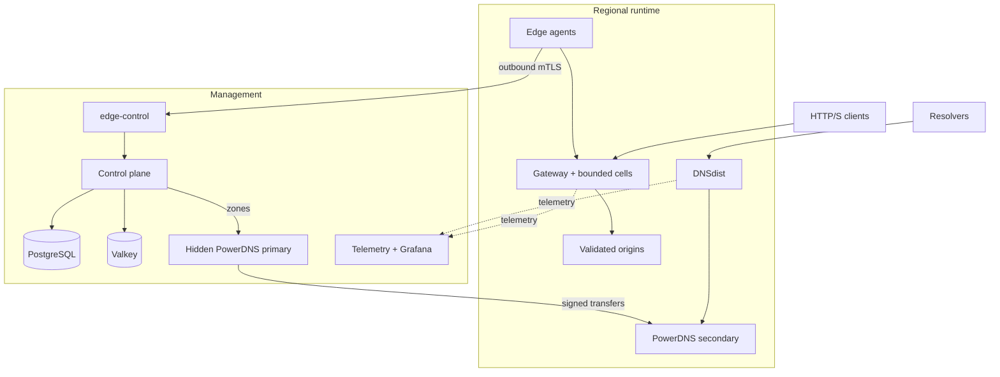
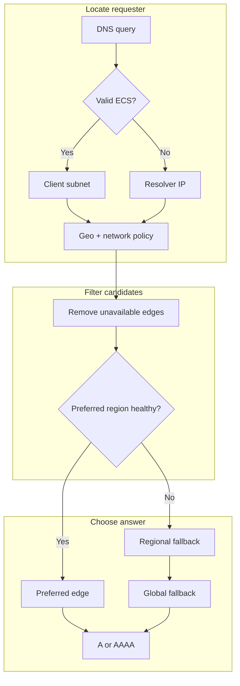
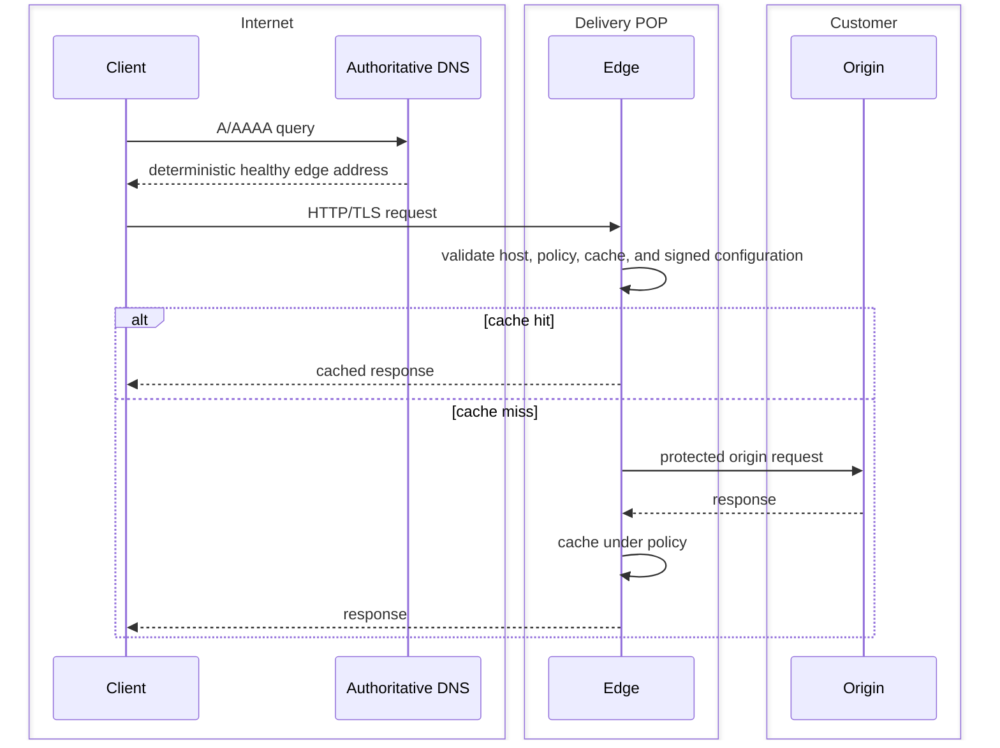
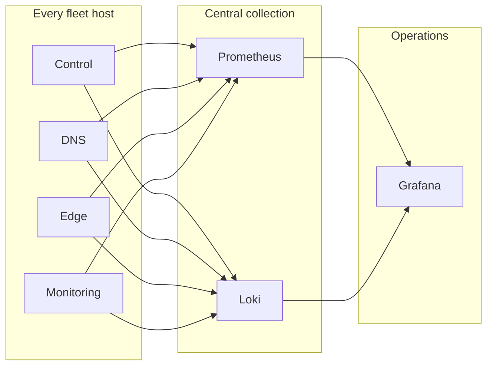
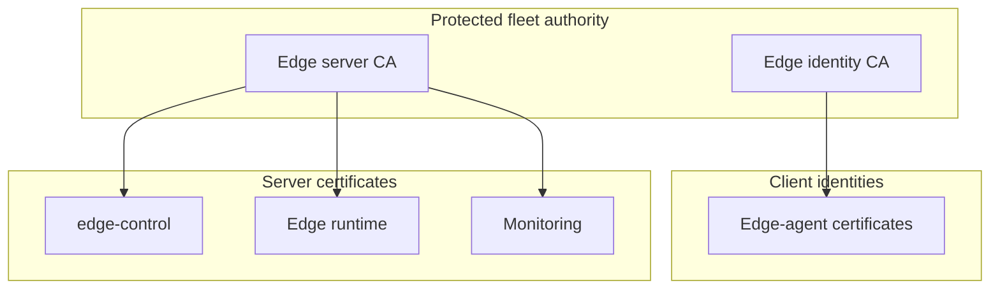
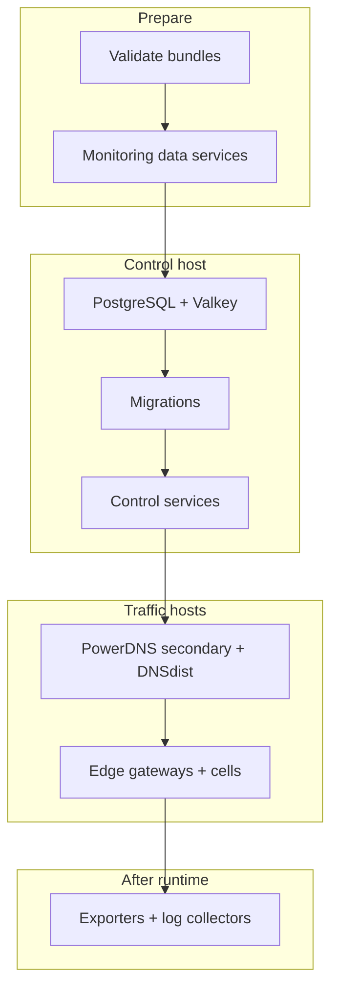
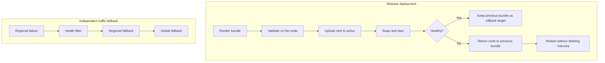

# Production fleet reference

This page explains how a production fleet is built. Read it before you plan hosts, open firewall ports, or rotate a secret. For the commands, see the [Fleet operator guide](production-fleet-operator-guide.md). For every option and JSON field, see the [Fleet configuration reference](production-fleet-config-reference.md).

## How the fleet is built

A fleet is a set of hosts. Each host has one role: `control`, `dns`, `edge`, `dns-edge` (both), or `monitoring`. [Fleet](../operations/fleet-engine.md), the infrastructure tool, runs on your workstation. It keeps the plan, the secrets, and the certificate authorities in an encrypted vault. For each host it writes one private bundle that holds only what that role needs. Docker Compose runs the bundle on the host.

- The control host runs the hidden PowerDNS primary (`pdns-primary`) with its own PostgreSQL (`pdns-db`). It never uses the control-plane application's database.
- Each `dns` or `dns-edge` host runs a PowerDNS secondary (`pdns-auth`) with a local SQLite store and no database service. It pulls its zones from the primary over TSIG-signed transfers (transfers signed with a shared key). See [DNS nodes](../operations/dns-nodes.md).
- The control host has its own `PDNS_DB_PASSWORD` and `PDNS_API_KEY`. Each DNS host has its own `PDNS_API_KEY`.
- A feature you turn off (monitoring, central logs, backups, IPv6) adds no variables or secrets to any bundle.
- A DNS or edge host keeps serving its last valid state when the control plane or a region is down.

## Global topology



::: danger Keep management DNS independent
Publish the names under your operator domain (`control`, `edge-control`, `telemetry`, `grafana`, and each node name) at an independent external DNS provider. CDNFoundry's PowerDNS holds derived state for the platform zone and customer zones. If it also served your management names, you could not reach the control plane to repair it.
:::

## DNS and geo-routing flow



ECS (EDNS Client Subnet) lets a resolver pass the client's network to the authoritative server. When it is missing or invalid, the answer uses the resolver address. A and AAAA health are judged separately. DNS TTLs make global changes eventual, not instant. See [Geo-DNS](../guides/geo-dns.md) for the settings.

## Edge request flow



## Monitoring and logging flow



Prometheus scrapes every enabled host. Each host's log collector (a Vector instance) sends logs to Loki with a bounded disk buffer and retries. Fleet creates one log token for the whole fleet and puts it in every bundle that runs a collector. If you turn central logs off, the collector and the token leave the bundles. See [Monitoring](../operations/monitoring.md) and [Operational logging](../operations/operational-logging.md).

## Certificate trust



Fleet creates two certificate authorities (CAs), each valid for 10 years:

- The **edge identity CA** signs edge-agent identities. Only the control bundle receives its private key, because the control service issues the identities.
- The **edge server CA** signs one certificate for every node. That certificate is valid for 825 days. Each node gets its own certificate, and the server CA certificate. The server CA private key stays in the vault.

Fleet reissues a node certificate when the node's hostname, public addresses, or (on control) the `edge-control` name change. Fleet refuses to start if only one half of a CA pair exists, if a reused pair does not match, or if it expires in less than 24 hours. Restore the matching pair from backup. See [Certificates](certificates.md).

## Fleet startup order



Run `show-start-order` to list your own nodes in this order. Fleet also writes `STARTUP-ORDER.md` in the bundle directory. The control host starts `control-db` and Valkey, runs the application migration, starts `pdns-db`, then runs the PowerDNS migration. A DNS host has no database to migrate.

This is service order only. It does not mean you can create dependent settings early. After the DNS services are healthy, register and test the DNS clusters in the panel, enable them, and only then apply the platform DNS identity.

A `dns-edge` host starts DNS first. Its edge services start only after you set its `EDGE_ID` (see [Enroll an edge by hand](production-fleet-operator-guide.md#edge-registration-and-mtls-enrollment)). When Fleet runs `bootstrap`, it enrolls the edge for you.

## Upgrade, rollback, and regional failure



`upgrade`, `apply-config`, and `rollback` do this, one node at a time. See [Fleet engine](../operations/fleet-engine.md#upgrades) for the plan, the health gate, and what a rollback cannot undo.

::: danger Never delete volumes
Do not run `docker compose down -v` or prune named volumes during a rollback or a credential recovery. Volumes hold the databases, the edge identity, and the logs.
:::

## Fleet state and secret distribution

The vault records global settings, nodes, addresses, feature modes, release identifiers, secrets, certificate authorities, and the last validation and render times. Fleet takes a lock before it changes the state, so two commands cannot write at once. Fleet keeps the 20 most recent previous states.

Fleet puts a secret in a bundle only when a service in that bundle uses it. Node secrets are:

| Node role | Secrets |
| --- | --- |
| `control` | `pdns-db-password`, `pdns-api-key` |
| `dns`, `dns-edge` | `pdns-api-key` |
| `edge`, `dns-edge` | `edge-status-token`, and the one-time `edge-bootstrap-token` while an edge is enrolling |

Global secrets (application key, artifact signing key, database, Valkey, ClickHouse, Grafana, metrics, telemetry, log, and backup credentials) are shared by the nodes whose services need them. Only the control host has a PowerDNS database password.

## Primary database lifecycle

The control host runs the PowerDNS database. These steps happen on its first start and on every later start:

1. `pdns-db` starts from the host's persistent PostgreSQL volume.
2. The start script runs `ensure-pdns-runtime.sh` inside `pdns-db`. It creates the pinned PowerDNS schema if it is missing and sets the `pdns` role password to the one in the bundle. This repairs an interrupted first start without deleting data.
3. `pdns-migrate` applies the maintained PowerDNS runtime migrations.
4. `pdns-primary` connects to host `pdns-db`, database `pdns`, user `pdns`, with that password.
5. A normal render never creates a new password.

DNS hosts keep a local SQLite store that the primary rebuilds, so they need none of this.

For an existing installation, run `adopt-existing --env-file .env.prod` with the existing environment file. Fleet stores `PDNS_DB_PASSWORD` for that node without printing it. It does not delete the old volume.

### Rotate the PowerDNS database password

Rotation has three phases and runs on the control node:

<div class="steps">

1. Prepare a pending password. The active one does not change.

   ```sh
   cdnfoundry-fleet rotate-secret --node control-1 --secret pdns-db-password --phase prepare
   ```

   Expected: JSON with `"status": "prepare"`.

2. Render the control bundle, upload it, and on the control host run the reconcile script as root.

   ```sh
   sudo ./reconcile-pdns-password.sh
   ```

   Expected: `Local PostgreSQL, PowerDNS configuration, and .env.prod now use the pending password.`

3. Commit the rotation, then render again.

   ```sh
   cdnfoundry-fleet rotate-secret --node control-1 --secret pdns-db-password --phase commit
   ```

   Expected: JSON with `"status": "commit"`.

</div>

The script takes a lock, so two rotations cannot run together. It stages `.env.prod` and `docker/pdns/primary.conf` before it changes PostgreSQL. It keeps a private copy of the old environment file as `.env.prod.before-pdns-rotation`. It then recreates only `pdns-primary`, with `--no-deps`, and leaves `pdns-db` and its volume alone. The PowerDNS configuration stays `root:82`, mode `0640`.

If the script stops half way, keep the pending file and run the same script again. It accepts a password that was already applied. If the new service does not become healthy, fix its health and run the script again. Do not abort the rotation or restore an old bundle after the database password has changed, because the database and the application would then disagree. Commit only after PowerDNS is healthy. Move the before-rotation backup out of the bundle before the next rotation. Use `--phase abort` only to remove a pending value that no host has applied.

## Geo-routing policy

Live Geo-DNS answers come from the platform's DNS settings and the edge health data, as described in [Geo-DNS](../guides/geo-dns.md). Fleet also writes a record of the intended decision order to `generated/geo-routing-policy.json` in the monitoring host's bundle. No runtime service reads that file. It lists every edge with its region, addresses, draining state, and health thresholds, and this order:

```text
valid ECS client subnet
→ resolver IP fallback
→ country and ASN policy
→ health filtering
→ preferred healthy edge IP
```

The default health thresholds in that file are three failures before removal, two successes before return, and 90 seconds before health data counts as stale. Tune them to your probe interval and DNS TTL.

## MMDB (GeoIP database) behavior

The MMDB files hold the GeoIP data used for country and ASN answers. The `mmdb-updater` service runs in the `dns` and `edge` profiles and fills the `mmdb` volume. By default it downloads the `dbip-npm` database once a day: it reads the SHA-512 that the npm registry publishes for the package, refuses the file if it does not match, and only then activates it. PowerDNS reloads the new file within a minute. Until a verified database is installed, the node serves an empty placeholder and every Geo-DNS record answers its default value (the file `FALLBACK_IN_USE` marks that state in the `mmdb` volume). The autonomous-system database has no verified default source, so events carry ASN 0 until you set `MMDB_ASN_DOWNLOAD_URL` with a checksum. A bundle contains only the Compose files, volumes, and variables that its role uses, so a control or monitoring host has no MMDB settings.

To check a rendered bundle on the control machine:

```bash
# Run on the workstation against a rendered bundle.
cd ~/.config/cdnfoundry-fleet/bundles/NODE_NAME
grep -Rni -- 'mmdb\|geoip' ./*.yml .env.prod generated 2>/dev/null || true
```

Expected: matches only for `dns`, `edge`, and `dns-edge` nodes. Then check on the target host that the `mmdb` volume holds a database and that the consuming service reports a successful load.

## Monitoring modes

- `disabled`: no monitoring stack, no node exporter, no monitoring credentials in any bundle.
- `colocated`: the monitoring services run on the control host. Prometheus targets cover every enabled host.
- `dedicated`: the monitoring services run on the monitoring-role host you name. The control host must have an externally reachable PostgreSQL endpoint, so Fleet can set up the read-only Grafana role. Rendering fails without it.

Fleet regenerates the Prometheus target files when you add, change, disable, or remove a node. Render the monitoring host again to apply them.

### Set up a dedicated monitoring host

A `monitoring`-role host always runs the whole telemetry stack (Prometheus, Grafana, Loki, ClickHouse, Vector). Grafana reads the control database, so the monitoring host must reach PostgreSQL over a **private** network. A control node installed by Fleet keeps its database on a private Docker network, so you must make it reachable first. Use a private LAN or a WireGuard tunnel as in [Set up control-plane HA step by step](../operations/set-up-control-plane-ha.md) (step 2). Never publish PostgreSQL on a public address.

1. Connect the control and monitoring hosts privately. Below, the control host has `10.77.0.1` and the monitoring host `10.77.0.2`.
2. Make PostgreSQL on the control host reachable on its private address only. One way is a small forwarder container that publishes the port on that address only:

   ```sh
   docker run -d --name cdnf-pg-forward --restart unless-stopped \
     -p 10.77.0.1:5432:5432 alpine/socat TCP-LISTEN:5432,fork,reuseaddr TCP:control-db:5432
   docker network connect cdnfoundry_control cdnf-pg-forward
   ```

   Create the container first, connect it to the network, then start it. The control network is internal, so a container that is only on it cannot publish a port. Check `docker port cdnf-pg-forward`: it must print `5432/tcp -> 10.77.0.1:5432`. Only the tunnel or LAN can reach that address. If you can, run PostgreSQL with TLS and leave `DB_SSLMODE` at its default instead.
3. Add the host and tell Fleet where PostgreSQL is:

   ```sh
   cdnfoundry-fleet add-node --node monitoring-1 --role monitoring --region eu --location fra \
     --public-ipv4 203.0.113.40 --hostname monitoring-1.example.com
   cdnfoundry-fleet node-ssh --node monitoring-1 --host 203.0.113.40
   cdnfoundry-fleet update-node --node monitoring-1 \
     --extra-env GRAFANA_POSTGRES_HOST=10.77.0.1 \
     --extra-env GRAFANA_POSTGRES_SSLMODE=disable --extra-env DB_SSLMODE=disable
   cdnfoundry-fleet configure-monitoring --mode dedicated --host monitoring-1
   cdnfoundry-fleet render
   cdnfoundry-fleet bootstrap --node monitoring-1
   ```

   Leave out the two `SSLMODE` settings when your PostgreSQL endpoint has a certificate that Fleet's `verify-full` default accepts. `render` fails with `Dedicated monitoring requires an externally reachable control PostgreSQL endpoint` while `GRAFANA_POSTGRES_HOST` is not set, and with `has the monitoring role, but monitoring is colocated` while the mode is still `colocated`.
4. Check it: `cdnfoundry-fleet watch` shows the host `online`, and Grafana answers on the monitoring name.

The Grafana ClickHouse plugin is downloaded from `grafana.com` the first time the stack starts. If your network blocks that host, download the pinned version once from a machine that can, unpack it into the `grafana-plugins` volume, and the start step finds it present. To remove the host, run `configure-monitoring --mode colocated`, then `remove-node`, then clean the host as described in [Removing a node](../operations/fleet-engine.md#removing-a-node).

## Backup modes

- `disabled`: no backup settings or credentials.
- `control`: set up backups of the control plane (application database and control state).
- `all-stateful`: accepted as a setting name. Fleet currently writes the same backup settings for it as for `control`.

Backups must be encrypted, stored off the host, and tested by a restore. Back up the vault too, with `vault-backup`. See [Backup and recovery](../operations/backup-and-recovery.md).

## IPv4 and dual stack

To plan IPv6, run `setup --dual-stack` (or `"ipv6": true` in the JSON), then give each node `public_ipv6` and, if needed, `bind_ipv6`. With `bind_ipv6` set, Fleet publishes IPv6 next to IPv4 for these services:

- DNS: `dnsdist` and the primary's transfer port 5300;
- control ingress: `caddy` (80, 443, and 8444) and `edge-control` (8443, so a PoP with only IPv6 can still enroll and sync);
- `telemetry-gateway` and `edge-gateway`.

The Docker daemon on the host must have IPv6 enabled.

A new IPv6 nameserver address is not saved until it answers. In the admin panel, open **Infrastructure → System DNS identity**. Through the API, use `PATCH /api/admin/system/settings/dns` (or check first with `POST /api/admin/system/settings/dns/validate`). When you enter a new IPv6 address, the control plane asks up to three registered edges with a fresh heartbeat to send a SOA query for the platform zone to that address over IPv6. The first save fails with a message on the address. Save again after the probe answers. An answer counts for 24 hours. Addresses you saved earlier are not probed again.

On a new installation, save IPv4 first, because the zone must be served before an address can answer for it. Set up firewalls, glue records, health probes, monitoring, and routing for each address family separately. An edge can be healthy for A and unhealthy for AAAA without leaving both.

## Hardware sizing

CDNFoundry publishes no throughput numbers, because capacity depends on your hardware and traffic. Use the [sizing guide](sizing.md) for starting layouts, the limits the software sets, and a method to measure your own hosts.

## Firewall requirements

| Destination | Port | Allowed sources |
| --- | --- | --- |
| DNSdist on DNS hosts | UDP and TCP 53 | Internet |
| Edge HTTP and HTTPS | TCP 80 and 443 | Internet or your customer networks |
| Control panel and API | TCP 80 and 443 | Your operators and the public sources you choose |
| Edge control (mTLS) | TCP 8443 | Edge node addresses only |
| DNS primary transfers | TCP and UDP 5300 | DNS node addresses only |
| Node exporter | TCP 9100 | Monitoring host or private monitoring network only |
| PostgreSQL, Valkey, ClickHouse, Loki ports | service-specific | Local Docker network or exact private peers only, never the Internet |
| SSH | TCP 22 or your port | Administrative bastions or VPN only |

Publish NS and glue records for every unicast DNS host, and allow both UDP and TCP on port 53. The full listener list is in [Services and ports](../reference/services-and-ports.md).

## Multi-region reference topology

The shipped example `deploy/production/examples/multi-region-fleet.json` has one control node, three monitoring nodes, four DNS nodes, and ten edge nodes, with dedicated monitoring and central logs on `monitoring-1`. Its locations are placeholders (`site-a` and so on). Copy it and edit it on your workstation:

```bash
install -m 0600 deploy/production/examples/multi-region-fleet.json ./fleet.json
./scripts/cdnfoundry-fleet --config fleet.json --non-interactive --dry-run setup
```

Expected: lines starting with `Dry run, not persisted:` and a JSON status of `validated`. Replace the documentation IP addresses before a real setup. See the [multi-region quick start](production-quick-start-multi-region.md).

## Troubleshooting

### PowerDNS cannot authenticate

On the control host, confirm that `pdns-db` and `pdns-primary` are in the same bundle and that PowerDNS points to `pdns-db`.

```bash
cd /opt/cdnfoundry
docker compose --env-file .env.prod config | grep -A12 -E 'pdns-db:|pdns-primary:'
docker compose --env-file .env.prod ps
docker compose --env-file .env.prod logs --since 15m pdns-db pdns-primary
```

Do not print the password. Use `adopt-existing` to import a password that is already deployed, or use the rotation above. Do not delete the database volume.

### Compose asks for another role's variables

Render the node again and inspect it. The node's generated Compose manifest holds only the services for its role and enabled features. `.env.prod` holds only the variables that file uses.

### A bundle render fails

The active bundle stays unchanged until the new one is complete. Fix the error, run `validate`, and render again. The previous bundle stays in `NODE.previous`.

### A removed node still shows in monitoring

Render the monitoring host again. Prometheus targets come from the current enabled nodes.

### Fleet reports another process

Another Fleet command holds the state lock. Wait for it to finish. Do not delete the lock file while it runs.

## Deployment runbooks

- [Three-node production quick start](production-quick-start.md)
- [Multi-region fleet quick start](production-quick-start-multi-region.md)
- [Production fleet operator guide](production-fleet-operator-guide.md)
