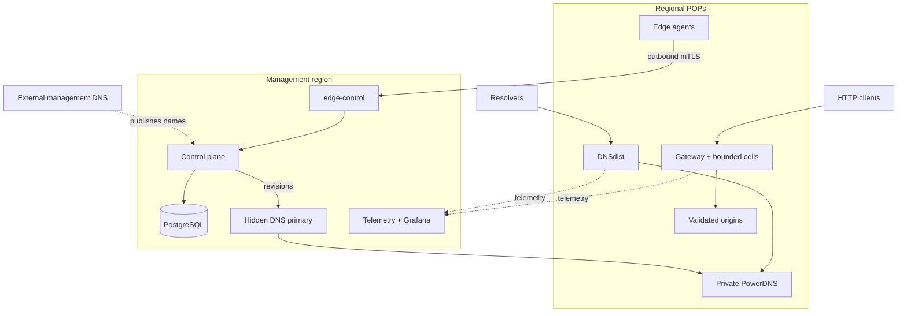

# Production quick start: multi-region fleet

You will deploy a fleet with separate control, DNS, edge, and monitoring hosts in
several regions, from one JSON topology file and Fleet.

**You need:** the [starter fleet quick start](production-quick-start.md)
completed once (or read in full), a verified release, and hosts in separate
failure domains. The same rules for secrets, certificates, zone transfers,
migrations, enrollment, backups, and acceptance checks apply here.



::: danger Keep management DNS outside CDNFoundry
Publish `control.<operator-zone>`, `edge-control.<operator-zone>`, and
`telemetry.<operator-zone>` at an independent DNS provider. Do not put the
operator zone in CDNFoundry PowerDNS. That PowerDNS holds derived platform and
customer data. You must be able to find and repair CDNFoundry even when it is
down.
:::

The example file models one control node, four authoritative DNS nodes, ten edge nodes, and
three monitoring-role nodes. "Multi-region" describes how the nodes are spread over
failure domains. It is not a special runtime mode and not a size limit.

## 1. Check out a fixed source revision

Run this on your administration host. Expect the last `git rev-parse` to print
the same 40 characters you typed:

```bash
git clone https://github.com/vaheed/CDNFoundry.git cdnfoundry
cd cdnfoundry
read -r -p 'Verified release source commit (40 hex characters): ' CDNF_SOURCE_COMMIT
[[ "$CDNF_SOURCE_COMMIT" =~ ^[0-9a-f]{40}$ ]] || exit 1
git checkout --detach "$CDNF_SOURCE_COMMIT"
git rev-parse --verify HEAD
sudo ./scripts/install-production-prerequisites.sh
```

## 2. Write your topology file

```bash
install -m 0600 deploy/production/examples/multi-region-fleet.json ./fleet.json
```

Edit `fleet.json`. Replace the operator and platform domains, the release, the
ACME contact email, every documentation address, and every hostname, region, and
location. The example addresses are documentation ranges and cannot serve
traffic.

Set `monitor_ipv4` and `log_ipv4` to private addresses if monitoring traffic must
not use public paths. The example's control node already uses a
remote PostgreSQL: its `extra_env` sets `DB_HOST`, `DB_PORT`, and `DB_SSLMODE`. Point
them at your database, or remove them to use the embedded one. For a remote
database, set its password with `set-secret --from-file FILE
--secret control-db-password`. Never put the password in the JSON. See the
[Fleet operator guide](production-fleet-operator-guide.md#embedded-or-remote-control-postgresql).

Validate without writing anything:

```bash
python3 -m json.tool fleet.json >/dev/null
./scripts/cdnfoundry-fleet --config fleet.json --non-interactive --dry-run setup
```

Expect the dry run to report `validated`. Next, follow
[release verification and image projection](../operations/software-supply-chain.md#populate-fleet-image-references)
to create `fleet.verified.json`. Then create the Fleet state and every node
bundle from that file:

```bash
sudo ./scripts/cdnfoundry-fleet \
  --config fleet.verified.json \
  --state-dir /var/lib/cdnfoundry-fleet \
  --output-dir /var/lib/cdnfoundry-fleet/bundles \
  --non-interactive \
  setup
```

## 3. Roll out in dependency order

Copy each node's bundle to its host, as the starter quick start describes. Then
start the hosts in this order. Do not start all hosts at once.

<div class="steps">

1. Start `control-1`. This starts its MMDB updater, databases, migrations, control
   services, and health checks. Expect `sudo ./start.sh` to finish with healthy
   services.
2. Start the dedicated monitoring host. Check that Prometheus, Grafana,
   ClickHouse, Loki, and log ingestion work.
3. Start all four DNS nodes. In the administrator panel, register the DNS primary,
   test it, and enable it. Apply the platform DNS identity (nameservers and glue)
   only after that, and wait until every DNS node acknowledges it. Check UDP and
   TCP answers before you delegate any domain.
4. In **Infrastructure → Edges**, create each edge. Paste its two-line UUID and
   token block into `.env.prod` on the matching prepared host. Then run
   `sudo docker compose --env-file .env.prod --profile edge up -d`, one host at a
   time. The edge name in the panel can differ from the Fleet node name.
5. Check that each agent saved its identity and sent a fresh heartbeat. You do
   not need to rerender or copy the bundle again. For later whole-host starts, run
   `sudo ./start.sh`. It reads the host's enrollment through Compose and adds the
   edge profile when an `EDGE_ID` is set.
6. Test regional fallback, draining, node loss, a control-plane outage, a
   restart, telemetry loss, and a rollback to the previous bundle.

</div>

Before you drain a source, make sure the target is valid and serving. The
generated `.env.prod` is the source of truth for every role bundle. Do not add
deployment defaults to the Compose file, and do not edit rendered manifests on a
host.

## Next

- [Production fleet configuration reference](production-fleet-config-reference.md): every JSON field.
- [Production fleet operator guide](production-fleet-operator-guide.md): lifecycle commands.
- [Production setup after quick start](production-setup-after-quick-start.md): first administrators, first domain, and daily checks.
