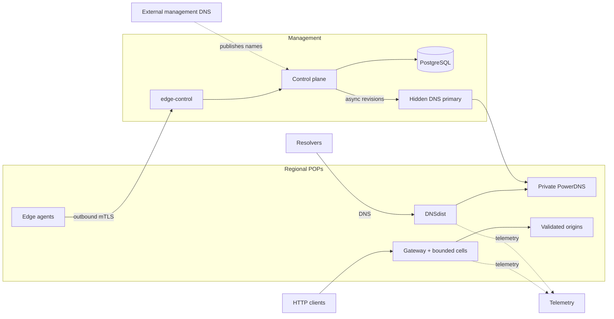

# Production quick start: starter fleet

This page installs the smallest practical production fleet. You use a JSON file that describes your hosts. Fleet, the infrastructure tool, turns it into one deployment bundle per host. You then start each bundle, configure DNS and edges in the admin panel (or the API), and prove that traffic works.

The fleet has three hosts:

- one **control node**: the control plane, with monitoring and operational logs on the same host;
- two **PoPs** (points of presence, regional sites), each running DNS and edge together, in separate failure domains.



Only DNSdist is public on port 53. PowerDNS and its database stay private. See the [glossary](../reference/glossary.md) for terms such as edge, origin, and PoP.

::: danger Keep management DNS independent
`ops.example.com` (the operator zone) and `example.net` (the platform zone) are separate on purpose. Host the `control`, `edge-control`, `telemetry`, and `grafana` records of the operator zone with an independent external DNS provider. Never host or delegate the operator zone in CDNFoundry's own PowerDNS. That database is derived runtime state. Using it for management names creates a bootstrap loop and can break control, recovery, and DNS reconciliation.
:::

## What you need

- Three Linux hosts: one control node and two PoPs.
- A management DNS suffix (for example `ops.example.com`) hosted with an independent DNS provider.
- A platform zone (for example `example.net`) that CDNFoundry will serve. Registrar access to create nameserver glue for it.
- A separate, disposable customer zone with registrar access. It must not be the platform zone.
- An email address for ACME (the protocol for automatic certificates).
- A working origin you own. Note its scheme, host or IP, port, Host header, and HTTPS SNI (the server name sent in the TLS handshake).
- A notifier URL (`https://`) that receives alerts.

Keep IPv6 disabled until it is routable end to end.

Fleet does not create panel users, register DNS clusters, enroll edge identities, change registrar delegation, or prove public traffic readiness. You do those in steps 5 to 9.

## The steps at a glance

1. Prepare the hosts and verify a release.
2. Create the topology file and the management DNS records.
3. Generate state and bundles, and issue edge listener material.
4. Validate every bundle before transfer.
5. Start the control plane and create the first administrator.
6. Start authoritative DNS on both PoPs.
7. Configure DNS desired state in the panel or the API.
8. Enroll and start the edge role on both PoPs, then configure pools.
9. Run the acceptance and recovery checks.

## 1. Prepare the hosts

Each host needs Docker Engine, Docker Compose v2, Python 3, PyYAML, OpenSSL, outbound HTTPS, synchronized clocks, and private administrative access. Open only the listeners listed in the [Production fleet reference](production-fleet.md#firewall-requirements).

On an administrative workstation or the future control node, clone an immutable release or commit and install the prerequisites:

```bash
git clone https://github.com/vaheed/CDNFoundry.git cdnfoundry
cd cdnfoundry
read -r -p 'Verified release source commit (40 hex characters): ' CDNF_SOURCE_COMMIT
[[ "$CDNF_SOURCE_COMMIT" =~ ^[0-9a-f]{40}$ ]] || exit 1
git checkout --detach "$CDNF_SOURCE_COMMIT"
git rev-parse --verify HEAD
sudo ./scripts/install-production-prerequisites.sh
```

Take the commit from a signed release manifest. Never deploy from a moving branch or a mutable image tag. Publishing a release alone does not qualify a staging install or prove production readiness.

Then follow [release verification and Fleet image projection](../operations/software-supply-chain.md#verify-a-release). It produces `fleet.verified.json`, which carries the verified `@sha256` reference of all seven release components. You use that file in step 3. No published tag or example digest is assumed here.

**Check:** `git rev-parse --verify HEAD` prints the commit you selected. If no signed manifest exists for that commit, stop. A source build cannot replace release evidence.

## 2. Create the topology file and management DNS records

### 2.1 Create the topology file

Copy the starter example to a file outside the repository-managed path:

```bash
install -m 0600 deploy/production/examples/starter-fleet.json ./fleet.json
```

Edit `fleet.json` and replace every example value:

- `operator_domain`: the independently hosted management suffix.
- `platform_domain`: the customer-facing CDN platform suffix.
- `release`: the exact checked-out 40-character commit SHA.
- `acme_email`: a monitored certificate contact.
- `alert_webhook_url`: the `https://` notifier that receives every alert and the always-firing `Watchdog` alert. It is optional: leave it empty to install without notifications and set it later (Fleet web **Config** page, or `cdnfoundry-fleet alert-webhook --url`), then deploy the configuration.
- `management_networks`: the CIDRs of the operator networks that may open the administrator panel, the administrator API, Horizon, and Grafana. Everyone else gets `403`. The customer panel (`/app`), the customer API, and the status page stay open to everyone. Leave it empty only for a first trial; set it later with `cdnfoundry-fleet management-networks --networks`.
- Each node's `hostname`, `public_ipv4`, region, and location.
- The matching verified image reference in each node's `extra_env` for every `CDNF_*_IMAGE` key, from `release-manifest.json`. The projection in step 1 fills these in `fleet.verified.json`.
- `public_ipv6` and `bind_ipv6`, only for dual stack.

Keep `public_ipv6`, `bind_ipv6`, `monitor_ipv6`, and `log_ipv6` in every node object. Set unavailable paths to JSON `null`. Set the global `ipv6` to `true` only after the AAAA records, host routes, firewalls, and external reachability are ready.

The checked-in addresses are RFC documentation ranges and cannot serve traffic.

If a DNS host has a loopback resolver such as Ubuntu's `127.0.0.53:53`, set `bind_ipv4` to the node's assigned local service address. Binding `0.0.0.0:53` would conflict with that resolver. Leave the resolver in place. Behind NAT, use the local interface address, not the advertised one.

Validate the JSON and run a dry run, which changes nothing:

```bash
python3 -m json.tool fleet.json >/dev/null
./scripts/cdnfoundry-fleet --config fleet.json --non-interactive --dry-run setup
```

**Check:** the dry run prints `Dry run, not persisted:` before each message, and its JSON status is `validated`, not `configured`. A dry run does not prove signatures, public DNS or TLS reachability, or production readiness. Use `fleet.verified.json` for the real setup in step 3.

### 2.2 Publish the management DNS records

Before you start the control bundle, create these records at the independent DNS provider that hosts `operator_domain`. In the starter topology the first four names point to the control node, because control, edge-control, telemetry, and Grafana share it. Each PoP management name points to its own host: its own host.

| Name | Record | Value |
| --- | --- | --- |
| `control.ops.example.com` | `A` | control node `public_ipv4` |
| `edge-control.ops.example.com` | `A` | control node `public_ipv4` |
| `telemetry.ops.example.com` | `A` | control node `public_ipv4` |
| `grafana.ops.example.com` | `A` | control node `public_ipv4` |
| `pop-1.ops.example.com` | `A` | first PoP `public_ipv4` |
| `pop-2.ops.example.com` | `A` | second PoP `public_ipv4` |

If the control node has a `public_ipv6`, publish matching `AAAA` records. Otherwise publish none. Replace the example names with names under your `operator_domain`.

Caddy, the reverse proxy on the control node, obtains public certificates for these names. TCP ports 80 and 443 must reach the control node. Never point these records at a PoP address.

```bash
dig +short A control.ops.example.com @1.1.1.1
dig +short A edge-control.ops.example.com @1.1.1.1
dig +short A telemetry.ops.example.com @1.1.1.1
dig +short A grafana.ops.example.com @1.1.1.1
```

**Check:** each command prints the control node address. If one prints nothing, wait and retry. Do not continue until all four resolve. A Caddy container can be healthy while certificate issuance fails.

## 3. Generate protected state and bundles

```bash
sudo install -d -m 0700 /var/lib/cdnfoundry-fleet
sudo ./scripts/cdnfoundry-fleet \
  --config fleet.verified.json \
  --state-dir /var/lib/cdnfoundry-fleet \
  --output-dir /var/lib/cdnfoundry-fleet/bundles \
  --non-interactive \
  setup
```

Fleet creates secrets and the private PKI once, validates the whole topology, renders the bundles atomically, and prints the start order. Each node bundle holds its filtered Compose manifest, a complete `.env.prod`, the runtime files it needs, certificates, secrets, and operator scripts.

**Check:** the command exits successfully and `bundles/control-1`, `bundles/pop-1`, and `bundles/pop-2` exist under the output directory. If it fails, correct the topology and run it again. Setup creates secrets and the PKI once and reuses them on later runs.

Never commit `fleet.json`, Fleet state, generated bundles, `.env.prod`, or private keys.

### Issue the edge listener material

Each combined DNS and edge bundle needs a serving certificate for its edge listener and a stable recovery key in `/dev/shm/cdnfoundry/`. Fleet does not create them. Issue them from the fleet's edge-server CA on the workstation that holds the state. Run this once per PoP, changing the hostname, address, and output path:

```bash
sudo ./scripts/issue-edge-listener-material.sh \
  --state-dir /var/lib/cdnfoundry-fleet \
  --hostname pop-1.ops.example.com \
  --public-ipv4 198.51.100.20 \
  --output /root/cdnfoundry-edge-material/pop-1
```

The output directory gets `edge-runtime.crt`, `edge-runtime.key`, and `edge-state-encryption.key`. Copy these three files, plus the node key from `pki/nodes/<pop>/node.key` in the state directory, to the PoP's `/dev/shm/cdnfoundry`. Set owner UID 10101 and mode `0400`. Keep these keys on tmpfs and disable host swap. See [edge key provisioning](production-fleet-operator-guide.md#pki-layout).

**Check:** the three files exist in the output directory. Rerunning the script never rotates an existing key. Keep the recovery key with your Fleet state backup. Losing it loses the encrypted edge state on that PoP.

## 4. Validate every bundle before transfer

```bash
sudo ./scripts/cdnfoundry-fleet \
  --state-dir /var/lib/cdnfoundry-fleet \
  --output-dir /var/lib/cdnfoundry-fleet/bundles \
  validate
sudo ./scripts/cdnfoundry-fleet --state-dir /var/lib/cdnfoundry-fleet status
sudo ./scripts/cdnfoundry-fleet --state-dir /var/lib/cdnfoundry-fleet show-start-order
```

**Check:** `validate` reports no error for any node, and `show-start-order` lists the control node first.

Then review each bundle's `README.md` and run its validator from the protected bundle directory, on the workstation and again on the destination host. The bundle deliberately leaves out the private files from step 3, so provision them on the validation host first, at the paths in the bundle README. If the bundle has a `secrets/metrics-token` file (control or monitoring roles), set its ownership first:

```bash
if [ -f secrets/metrics-token ]; then
  sudo chown 0:82 secrets/metrics-token
  sudo chmod 0640 secrets/metrics-token
fi
sudo ./validate.sh
```

A fresh render creates the token with mode `0640` but the rendering user as owner. The validator requires `root:82`. Keep the bundle directory mode `0700` and do not widen other secret permissions.

`validate.sh` parses every Caddyfile in the node with the pinned Caddy image, and checks Compose interpolation, file permissions, certificate chains, and image values. It may pull a missing pinned image and run a short-lived container, but it starts no application service. All values come from the bundle's own `.env.prod`. Production Compose has no defaults for deployment values.

**Check:** `./validate.sh` exits with status 0. If it fails, read its message, fix the file or permission it names, and run it again.

## 5. Start the control plane

Transfer `bundles/control-1` over an authenticated channel to `/opt/cdnfoundry` on the control host. Preserve file modes. Do not place the bundle in a public or shared directory.

The bundle directory is root-owned with mode `0700`. Run the commands from a root shell (`sudo -i`) and leave it with `exit` when you finish. Do not loosen permissions just to run Compose as your SSH user.

```bash
cd /opt/cdnfoundry
# Apply the metrics-token ownership step from step 4 if that file is present.
sudo ./validate.sh
sudo ./start.sh
docker compose --env-file .env.prod ps
```

`start.sh` must run as root. It changes the edge identity CA signing key from the transfer-safe root-only mode to owner `root`, group `82`, mode `0640`. Group 82 is the PHP-FPM worker in the core image. Without this change, `core` refuses to start. Other private keys stay mode `0600`. The script also restores read access to non-secret files under `docker/` and `generated/`, in case the transfer narrowed them. It never widens `.env.prod`, `pki/`, or `secrets/`.

The control bundle starts `mmdb-updater` (the GeoIP database updater) before services that use GeoIP data. Migrations run only through the generated `start.sh` and tools workflow. Container startup never migrates the database.

Container health is not the end of this step. Check that Caddy has a certificate and the public endpoint answers over TLS:

```bash
curl --fail --show-error https://control.ops.example.com/api/health
curl --fail --show-error https://control.ops.example.com/api/ready
curl --fail --show-error https://grafana.ops.example.com/api/health
docker compose --env-file .env.prod logs --since 10m --no-color caddy
```

**Check:** the three `curl` commands succeed. `/api/ready` returns `ready` with status 200, or `not_ready` with status 503.

**If it fails:** a browser error such as `ERR_SSL_PROTOCOL_ERROR` usually means no certificate yet. Recheck the control-host `A` and optional `AAAA` records, inbound TCP 80 and 443, and the Caddy log for ACME errors. Do not go on to the PoPs until the control health request succeeds.

### Create the first administrator

Run this inside the control container. Choose the name and email. The command prompts for the password twice without placing it in shell history:

```bash
docker compose --env-file .env.prod exec core \
  php artisan cdnf:admin:create \
  --name='Operations Administrator' \
  --email='admin@example.com'
```

Use a unique, monitored email and a password of at least 12 characters.

**Check:** the command prints `Administrator admin@example.com created.` A duplicate or invalid email, a short password, or a confirmation mismatch creates no user. Do not use Tinker or insert the user into PostgreSQL. The command applies validation, password hashing, and audit logging.

Create the bootstrap administrator only once. Add other administrators and domain users in **Customers → Users**, so normal authorization and auditing apply.

### Sign in at the right URL

The two panels have different login pages:

- administrators: `https://control.ops.example.com/admin/login`;
- domain users: `https://control.ops.example.com/app/login`.

Use your own `control.<operator_domain>` name. **Check:** after you sign in at `/admin`, you see the CDNFoundry operations overview. If the browser shows a certificate warning, do not bypass it. Return to the DNS, firewall, and ACME checks above.

An administrator cannot sign in at `/app/login`, and a domain user cannot sign in at `/admin/login`. The form shows the same generic credentials error for a wrong password and for a valid account on the wrong panel. Before you reset a password, confirm the URL, the user type, and that the account is active. A domain user without assigned domains can sign in and sees an empty state.

## 6. Start authoritative DNS on both PoPs

Transfer `bundles/pop-1` and `bundles/pop-2` to `/opt/cdnfoundry` on their hosts, preserving file modes. On each PoP, provision the tmpfs keys from step 3 and apply the metrics-token step from step 4, then run:

```bash
cd /opt/cdnfoundry
sudo ./validate.sh
sudo ./start.sh
docker compose --env-file .env.prod ps
```

A combined bundle has no edge UUID or bootstrap token yet. So `start.sh` starts only the `dns` profile: the PowerDNS secondary and DNSdist. The secondary creates its SQLite store on first start. The control host's start already applied the separate PowerDNS migration and started the hidden primary. The edge profile starts in step 8.

Open the firewall:

- public UDP and TCP 53 on each PoP;
- TCP and UDP 5300 on the control host, only from the PoP addresses. The PoPs pull zones from the hidden primary there.

Then check that DNSdist answers over both UDP and TCP:

```bash
# Use the PoP's actual bind_ipv4.
read -r -p 'PoP bind IPv4: ' CDNF_DNS_BIND
dig @"$CDNF_DNS_BIND" example.net SOA +norecurse +time=3 +tries=1
dig +tcp @"$CDNF_DNS_BIND" example.net SOA +norecurse +time=3 +tries=1
```

**Check:** both commands return an answer from DNSdist. Before any zone is published, this proves reachability only, not a working zone. The node holds no zones until you register the primary in step 7.

**If it fails:** check that no other service holds port 53 and that `bind_ipv4` is the local address (step 2.1). Do not delegate a customer zone yet.

## 7. Configure DNS desired state

You now register the hidden DNS primary, set the platform nameserver identity, and add a test customer zone. DNSdist stays the only public authoritative endpoint. Follow the order below. Each step writes desired state, queues an operation, and returns before DNS changes.

### 7.1 Create and enable the DNS primary

<DocTabs :labels="['Admin panel', 'API']">
<template #tab-1>

1. Open **Infrastructure → DNS primary** and create the cluster disabled.
2. Set the API URL to `http://pdns-primary:8081`.
3. Enter the control host's `PDNS_API_KEY`.
4. Set the transfer endpoint to the control host's public IP and port `5300`, for example `192.0.2.10:5300`.
5. Test it, then enable it.

</template>
<template #tab-2>

`POST /api/admin/dns/clusters` creates the cluster disabled and queues a test. Then call `POST /api/admin/dns/clusters/{id}/test` if you need to retry, and `POST /api/admin/dns/clusters/{id}/enable` once the test succeeds. Fields are in the [API setup sequence](#api-setup-sequence).

</template>
</DocTabs>

**Check:** the test succeeds before you enable. Do not apply the platform identity until the primary is healthy. Once enabled, the PoPs pull every zone from it. See [DNS nodes](../operations/dns-nodes.md).

**If it fails:** do not enable the cluster and do not delegate the customer zone. Both PoP DNS runtimes must already be healthy from step 6.

### 7.2 Set the platform DNS identity

<DocTabs :labels="['Admin panel', 'API']">
<template #tab-1>

1. Open **Infrastructure → System DNS identity**.
2. Enter `example.net`, `ns1.example.net`, `ns2.example.net`, and their A glue addresses (AAAA is optional).
3. Click **Validate and preview**. A **Review and save DNS identity** window opens with the normalized identity, the glue addresses, the hidden primary it is written to, and the timers.
4. Nothing is saved yet. Review the window, then click the red _Save DNS identity and queue update_ button.

</template>
<template #tab-2>

Send the payload shown below to `POST /api/admin/system/settings/dns/validate`. The reply contains `data.confirmation_token`. Then send the same payload plus that token to `PATCH /api/admin/system/settings/dns`. Poll the operation in `data.id`.

</template>
</DocTabs>

**Check:** the platform deployment acknowledges the revision, and each PoP's DNS node reports that it pulled it. Wait for both before you continue. Verify the registrar glue for the nameserver addresses.

### 7.3 Add a test customer zone and delegate it

1. Open **Customers → Domains**, choose **Add domain**, and enter the test zone. Creating it queues the initial SOA and NS deployment, then nameserver verification (the automatic check that the registrar points at your nameservers). The API call is `POST /api/domains`.
2. Wait for both cluster acknowledgements. Then query the SOA and NS answers over UDP and TCP directly at both PoPs.
3. Only after those answers are correct, set the registrar delegation to the **exact assigned nameservers shown on that customer domain**, including their claim prefix. Create glue at the registrar if required. The base `ns1.example.net` and `ns2.example.net` alone do not prove the customer claim. Keep the platform glue pointing at the PoPs.
4. Run **Verify nameservers** on the domain (`POST /api/domains/{id}/verify-nameservers`). The first automatic verification may show a failure, because you had not changed delegation yet. Wait for the new run to succeed.
5. Verification activates the domain. If it stays disabled after a verified claim, use its activation action.
6. Add the domain's first DNS-only A or AAAA record. Wait for both cluster acknowledgements and query the answer at both PoPs.

**Check:** the domain is active, and both PoPs answer the new record. A recursive `dig NS customer.test` can show child-zone answers while the registrar still has wrong names. Check the real parent delegation.

DNS setup is now complete. Do not enable proxying yet.

API automation follows the same order. Sign in with `POST /api/auth/login`, protect the returned bearer token, and send an `Idempotency-Key` on every mutation. Never store an API token in Fleet JSON.

## 8. Enroll and start the edge role on both PoPs

The PoP bundles are already on the hosts and running DNS from step 6. Do not rerender or retransfer them to enroll the edge role.

### 8.1 Create the edge records

Open **Infrastructure → Edges** and create two records. Their names do not need to match the node names in `fleet.json`. Each record shows a one-time window:

```dotenv
EDGE_ID=11111111-2222-3333-4444-555555555555
EDGE_BOOTSTRAP_TOKEN=the-one-time-token
```

Copy each block to its matching PoP. If you close the window before saving the token, use **Rotate identity** and use only the newest token. The API call is `POST /api/admin/edges`.

### 8.2 Start the edge profile

On `pop-1`, put that edge's `EDGE_ID` and `EDGE_BOOTSTRAP_TOKEN` in `/opt/cdnfoundry/.env.prod`. Keep the file private. Then start the edge profile:

```bash
cd /opt/cdnfoundry
sudo chmod 0600 .env.prod
sudo docker compose --env-file .env.prod --profile edge up -d
```

Repeat on `pop-2` with its own values. For later whole-host starts, run `sudo ./start.sh`. It reads `EDGE_ID` from Compose and includes the edge profile, with no rerender. No second bundle transfer is required. An invalid UUID or configuration fails before migrations or activation. Existing PowerDNS containers and volumes stay in place.

**Check:** in **Infrastructure → Edges**, each edge shows a fresh heartbeat. If enrollment fails, run `docker compose --env-file .env.prod logs --tail=200 edge-agent`. Fix the connectivity, CA, clock, UUID, or token error, and run the same profile command again. After a heartbeat, the token is spent. Blank it in `.env.prod`. The saved identity keeps authenticating the agent.

### 8.3 Configure service addresses

If the PoP's public service addresses are assigned directly to the host, you need no gateway map. Add the same addresses as pool endpoints and the gateway binds them. For one-to-one NAT or a load balancer, set this on the host before you add endpoints:

```dotenv
EDGE_GATEWAY_ADDRESS_MAP={"198.51.100.30":"10.30.0.30"}
```

The key is the advertised endpoint. The value is the distinct private local listener. Never use `0.0.0.0` or `::` as a service identity. Set `EDGE_GATEWAY_REQUIRE_ADDRESS_MAP=true` only if your policy requires every advertised endpoint to have an explicit translation.

In **Infrastructure → Edges**, wait for the enrollment time, a fresh heartbeat, the agent version, and a ready gateway. A new edge with no domains still activates an empty generation at sequence `0`. Do not create a placeholder domain.

### 8.4 Create and enable the service pool

Work in this order, in **Infrastructure → Service pools** or through the API:

1. Create the service pool disabled.
2. Assign the intended non-drained cells on each edge. Assign at least one before you add the endpoint, so it can activate.
3. Add each PoP's advertised endpoint. For NAT, use the public key you set in `EDGE_GATEWAY_ADDRESS_MAP`.
4. Enable the pool after every participating edge has its endpoint and enough assigned cells. Wait for the gateway to acknowledge the listener-only endpoint generation.
5. Check any other seeded pools before you proxy the first domain. Configure the ones you will use. Disable the unused, unconfigured ones so placement cannot choose them. Never disable a pool that has active domains. If the test domain landed in an empty pool, move it with `POST /api/admin/domains/{domain}/move`, body `{"pool_id": READY_POOL_ID}`. Wait for the operation and the active placement before you disable the old pool.
6. Add the validated origin and enable proxying for the test hostname. Wait for its placement and route generation to become active.

**Check:** every endpoint shows `gateway_state: ready` with a fresh acknowledgement, and no repeated candidate errors or generation-mismatch warnings appear. If you add an endpoint before assigning cells, it stays pending and out of the candidate until a cell takes part, then converges to the same generation. Bounded pool and address rules are in the [Fleet operator guide](production-fleet-operator-guide.md).

**If the gateway fails to bind port 80 or 443** with `permission denied`, that is a gateway image or release defect. The gateway runs unprivileged with only the file capability to bind low ports, and Compose adds only `NET_BIND_SERVICE`. Do not run the container privileged, as root, or with more capabilities. Keep the endpoint withdrawn until a corrected, immutable gateway image is deployed.

### 8.5 Create and assign the customer user

<DocTabs :labels="['Admin panel', 'API']">
<template #tab-1>

1. Open **Customers → Users**, choose **Create**, and enter **Name**, **Email**, a unique **Password**, and **Type = Domain user**. Save.
2. Open **Customers → Domains** and select the test domain.
3. Open its **Users** relation, choose **Attach**, pick the new account, and confirm **Attach**.

</template>
<template #tab-2>

`POST /api/admin/users` with `type: "user"`, then `POST /api/admin/domains/{domain}/users` with `{"user_id": USER_ID}`. See the table below.

</template>
</DocTabs>

Send the owner their email and password over a protected channel, with `https://control.ops.example.com/app/login`. Never send the administrator password.

**Check:** sign in separately as that user. The assigned domain is visible and administrator navigation is absent. Administrator API calls return 403.

### API setup sequence

Use the checked-out release's `docs/public/openapi.json` with the [endpoint catalog](../reference/api/endpoints.md). All paths start with `/api`. Send JSON and `Accept: application/json`. Authenticated calls need the bearer token. Use a new UUID `Idempotency-Key` for each mutation. Retry a timed-out request with the same key and the same body. Never put real passwords or tokens in command arguments, terminal output, or Fleet JSON. Use a protected request file or a client that reads secrets without echoing them.

1. `POST /auth/login` with `email`, `password`, `device_name`. Save `data.token` privately. Login works for either user type. `/admin/*` needs an administrator.
2. Run the table below in order. Keep every returned ID. Read the existing lists first, so reruns reuse desired state.
3. Poll `GET /admin/operations/{id}` as an administrator, or `GET /operations/{id}` as the authorized domain user. A `202` means queued, not done. The ID is in top-level `operation_id`, `data.operation_id`, or `data.id` when the reply is an operation object. Stop on `failed`, read its error, fix the cause, and send a new attempt with a new key. Stop polling after three minutes and report a timeout.
4. Revoke the temporary token with `POST /auth/logout` when you finish.

| Order | Request | Fields and completion check |
| --- | --- | --- |
| DNS primary, once | `POST /admin/dns/clusters` | `name`, `location`, `api_url` (`http://pdns-primary:8081`), `transfer_endpoint` (`192.0.2.10:5300`), protected `api_key`, `server_id: "localhost"`, `nameservers: [{"hostname":"ns1.example.net"},{"hostname":"ns2.example.net"}]`, `capacity_zones: 10000`; created disabled, test queued; poll top-level `operation_id` |
| Test/retry and enable | `POST /admin/dns/clusters/{id}/test`, then `POST /admin/dns/clusters/{id}/enable` | Empty objects; wait for test success before enable; wait for its reconcile operation |
| Preview platform identity | `POST /admin/system/settings/dns/validate` | Payload below; receive `data.confirmation_token`; validation alone saves nothing |
| Save platform identity | `PATCH /admin/system/settings/dns` | Same payload plus `confirmation_token`; poll operation `data.id`; require both DNS deployments |
| Customer zone | `POST /domains` | `{"name":"customer.test"}` using your actual owned zone; retain `data.id`; inspect `GET /domains/{id}` for assigned nameservers and `GET /domains/{id}/dns/deployment` for acknowledgements |
| Verify real delegation | `POST /domains/{id}/verify-nameservers` | Empty object after saving the exact assigned names at the registrar; poll `data.id`; expect `lifecycle_state: active`; never use force-verification for qualification |
| Customer user | `POST /admin/users` | `name`, `email`, `password` (12+ characters with upper/lower case and digits), `type: "user"`; retain `data.id` |
| Assign customer user | `POST /admin/domains/{domain}/users` | `{"user_id": USER_ID}`; log in separately as this user and check `GET /domains`; administrator API calls must return 403 |
| Edge, once per PoP | `POST /admin/edges` | `name`, actual `country_code` and `continent_code`, `cell_slot_count: 8`; securely retain `data.id` and one-time `data.bootstrap_token`; do the host enrollment in step 8.2 |
| Shared service pool | `POST /admin/edge-pools` | `name`, `kind: "shared"`, `routing_mode: "geo_unicast"`, `minimum_ready_cells: 1`, `replicas_per_edge: 1`, `maximum_domains_per_cell: 1000`, `cache_profile: "standard"`, `compression_profile: "standard"`, `waf_capable: false`; created disabled |
| Assign a cell on each edge | `PUT /admin/edge-pools/{pool}/cells/{cell}` | Empty object; select an unassigned, non-drained cell from `GET /admin/edges/{edge}`; poll `data.operation_id` |
| Endpoint, once per edge | `POST /admin/edge-pools/{pool}/edges/{edge}/endpoint` | `ipv4`, `ipv6: null` for IPv4-only, `withdrawn: false`; use the actual service address |
| Enable pool | `POST /admin/edge-pools/{pool}/enable` | Empty object after cells and endpoints exist; inspect `GET /admin/edge-pools/{pool}` until every endpoint has `gateway_state: ready` and a fresh acknowledgement |

Example identity payload. Replace every example domain and address:

```json
{
  "platform_domain": "example.net",
  "proxy_hostname": "proxy.example.net",
  "nameservers": [
    {"hostname": "ns1.example.net", "ipv4": "198.51.100.30", "ipv6": null},
    {"hostname": "ns2.example.net", "ipv4": "198.51.100.31", "ipv6": null}
  ],
  "soa_primary": "ns1.example.net",
  "soa_mailbox": "hostmaster.example.net",
  "soa_refresh": 3600,
  "soa_retry": 600,
  "soa_expire": 1209600,
  "soa_minimum_ttl": 300,
  "default_ttl": 300
}
```

### Add records and proxy the test hostname

For the active customer zone, create a DNS-only record with `POST /domains/{domain}/dns/records`. Check `GET /domains/{domain}/dns/deployment` and query both authoritative servers. Then turn the record into a proxied record with a validated origin, and check `GET /domains/{domain}/deployment`. `POST /domains/{domain}/dns/records/{record}/origin/test` queues an origin probe. The origin fields `host`, `port`, `scheme`, `host_header`, `sni`, `verify_tls`, `connect_timeout_ms`, `response_timeout_ms`, and `retry_count` are explicit. The API supports ports such as 8096. The browser's scheme selector picks the standard port, so check the saved port before you change it. An HTTP origin does not prove HTTPS origin connectivity.

First create the DNS-only record with the real origin address:

```json
{"type":"A","name":"@","content":"198.51.100.90","ttl":300,"mode":"dns_only"}
```

After the domain is active, update it with `PATCH /domains/{domain}/dns/records/{record}`. This example uses an HTTP origin and managed visitor-side HTTPS. These are two separate connections:

```json
{
  "mode": "proxied",
  "origin": {
    "host": "198.51.100.90",
    "port": 8096,
    "scheme": "http",
    "host_header": "origin.example.org",
    "sni": null,
    "verify_tls": true,
    "connect_timeout_ms": 3000,
    "response_timeout_ms": 15000,
    "retry_count": 1,
    "websocket": false
  }
}
```

Use the Host header your origin expects. `verify_tls` applies only when `scheme` is `https`. For an HTTPS origin, use its real port, a matching `sni`, and a valid trusted certificate with `verify_tls: true`. Visitor certificates cannot validate the origin connection. Do not create placeholder DNS records just to request certificates.

### Smoke-test TLS, cache, purge, and security

| Action | Request and body | Completion evidence |
| --- | --- | --- |
| Managed visitor TLS | `PATCH /domains/{domain}/tls` with `{"mode":"managed"}` if not already selected | `GET /domains/{domain}/tls/status` shows an active certificate covering the proxied hostname; verified HTTPS through each PoP succeeds |
| Origin probe | `POST /domains/{domain}/dns/records/{record}/origin/test` with `{}` | Operation succeeds for the selected origin scheme; HTTP success is not an HTTPS-origin pass |
| Cache state | `GET /domains/{domain}/cache` | Caching enabled, development mode off; repeated bounded GETs for a cacheable resource produce MISS then HIT after admission |
| Exact URL purge | `POST /domains/{domain}/cache/purge` with `{"type":"urls","urls":["https://www.customer.test/resource.ico"]}` | Poll `GET /domains/{domain}/cache/purges/{id}` until all edge tasks succeed, then observe fresh fetch followed by HIT |
| Full purge | Same purge endpoint with `{"type":"all"}` | Epoch advances, every edge acknowledges, and the next request fetches fresh content |
| Controlled deny | `POST /domains/{domain}/security/rules` with `{"match_type":"ip","value":"PROBE_PUBLIC_IP","action":"block","priority":100,"enabled":true}` | Wait for deployment acknowledgement; probe client denied while an independent client still serves |
| Restore | `DELETE /domains/{domain}/security/rules/{rule}` | Wait for deployment acknowledgement and verify the blocked client recovers |

Replace the sample hostnames and paths with your proxied hostname and a real resource. A new record or rule can return `201` before deployment, so check the desired and deployed revisions, not just HTTP acceptance. Purges expose their own task status instead of an operation ID. Keep the deny rule ID and remove it even if its traffic check fails. Use only your probe IP, never a broad range or a shared client address.

Wait for managed DNS-01 certificate issuance (the ACME proof that you control the name) and the acknowledged edge deployment before you claim client HTTPS works. API or panel success alone is not traffic evidence. Run the runtime checks in step 9.

### Host DNS and gateway troubleshooting

These two host-network failures have been observed. The fixes do not weaken certificate, DNSSEC, domain-claim, or image verification.

**Nameserver verification reports a DNSSEC or resolution failure.** Run:

```bash
docker compose --env-file .env.prod exec -T core delv -q CUSTOMER_ZONE -t DS
```

Compare with `delv @1.1.1.1` and `delv @8.8.8.8`, only where those resolvers are reachable and appropriate. A fully validated negative DS answer is expected for an unsigned customer zone. If Docker's inherited resolver fails but approved explicit resolvers validate, put them in a host-local `/opt/cdnfoundry/compose.override.yml` under `services.core.dns`, `services.horizon.dns`, and `services.scheduler.dns`. Validate it, then recreate those three services. The queue worker runs domain verification, so fixing only the web application is not enough.

**An enrolled edge has fresh heartbeats but the gateway stays unacknowledged.** Run:

```bash
docker compose --env-file .env.prod exec -T edge-agent cat /etc/hosts
```

An `invalid IP` entry for `host-gateway` cannot resolve. Get the real gateway with `docker network inspect cdnfoundry_edge`. Do not assume the subnet. In a host-local override, set `services.edge-agent.extra_hosts.host-gateway` to that bridge's IPv4 gateway, validate, and recreate only `edge-agent`. For the next Fleet render, also set `EDGE_HOST_GATEWAY_IPV4` to that private address in the edge node's `extra_env`. Keep the host-local override until the new bundle is validated and active. Confirm the agent can read `http://host-gateway:9105/metrics` and the endpoint becomes ready. Restrict external TCP 9105 to monitoring and control sources, allow the local bridge path, and never expose metrics publicly.

Override shapes. Use your approved resolvers and the inspected bridge address, and apply only the service that is relevant on each host:

```yaml
services:
  core:
    dns: [1.1.1.1, 8.8.8.8]
  horizon:
    dns: [1.1.1.1, 8.8.8.8]
  scheduler:
    dns: [1.1.1.1, 8.8.8.8]
```

```yaml
services:
  edge-agent:
    extra_hosts:
      host-gateway: 172.18.0.1
```

Merge with any existing override instead of overwriting it. Keep it mode `0600` in the mode-`0700` bundle directory. Before you apply it, run `sudo docker compose --env-file .env.prod config --quiet`. Then run `sudo docker compose --env-file .env.prod up -d --no-deps --wait SERVICE`, replacing `SERVICE` with `core horizon scheduler` on the control node or `edge-agent` on a PoP. Keep the previous override for rollback. Overrides are not Fleet state. Keep them in protected host inventory and reapply and revalidate them after any bundle replacement. They need no image rebuild, migration, or volume removal.

## 9. Acceptance and recovery gate

Check the public endpoints before delegating real zones or sending traffic:

```bash
curl --fail https://control.ops.example.com/api/health
curl --fail https://control.ops.example.com/api/ready
curl --fail https://grafana.ops.example.com/api/health
dig +short A control.ops.example.com @1.1.1.1
dig +short AAAA control.ops.example.com @1.1.1.1 # empty is valid when IPv6 is null
dig +tcp SOA example.net @ns1.example.net
dig SOA example.net @ns2.example.net
# Use the enrolled customer hostname, never the reserved platform namespace.
curl --fail --resolve www.customer.test:443:EDGE_IP https://www.customer.test/
```

On every node, run `docker compose --env-file .env.prod ps`. Long-running services must be healthy. Completed migration helpers may show as exited. Ports 8443, 8444, and 5300, metrics, PostgreSQL, Valkey, the PowerDNS API, ClickHouse, and Loki are restricted interfaces, not public endpoints.

**Check** each item:

- control health, queues, Scheduler, Horizon, and migrations;
- DNS answers over UDP and TCP from both public nodes;
- edge mTLS enrollment and heartbeat;
- customer HTTP and TLS service through both PoPs;
- GeoIP database (MMDB) health on control, DNS, and edge roles;
- Prometheus targets all up, including remote PoPs, plus Grafana dashboards, ClickHouse telemetry, and bounded Loki logs. Use the [remote metrics check](production-fleet-operator-guide.md#remote-metrics-reachability) if the datasource is healthy but remote scrapes fail;
- an encrypted backup and a restore rehearsal, when backups are enabled;
- a restart and a rollback to the previous bundle, without deleting volumes.

Never run `docker compose down -v`. Never regenerate application or CA keys during an ordinary upgrade. Never copy one edge identity volume to another host.

Next, continue with [Production setup after quick start](production-setup-after-quick-start.md) and the [Production fleet operator guide](production-fleet-operator-guide.md). For separated roles across several regions, use the [multi-region quick start](production-quick-start-multi-region.md).

## Set the display timezone

Panels show times in UTC until you choose a timezone. In the admin panel, open **Governance → Platform settings**, find **Display timezone** in the Display section, pick an IANA timezone such as `Asia/Tehran`, and save. The one setting applies to the admin and domain panels: charts, tables, domain details, analytics, tooltips, and date and time inputs. Reload any open page. Domain users cannot change it. Stored events, API values, and hourly query boundaries stay in UTC. External Grafana keeps its own dashboard timezone.

API alternative: `PATCH /api/admin/system/settings/display` with administrator authentication, a fresh `Idempotency-Key`, and `{"values":{"timezone":"Asia/Tehran"}}`. The reply holds the saved setting and starts no runtime operation. An invalid zone is rejected.

**Check:** reload the overview and confirm times use the new zone. A new installation may show no completed traffic bucket until the next UTC hour.
