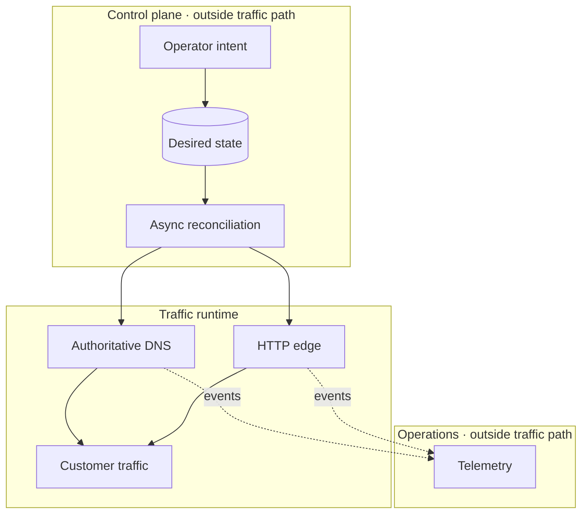
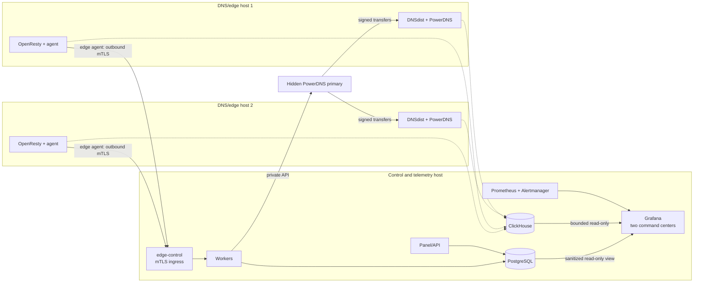

# How to build a self-hosted private CDN

A self-hosted private CDN runs its control plane, authoritative DNS, edge
proxies, cache, TLS handling, and telemetry on servers you operate. It is more
than a reverse proxy installed in several places. It also has to decide where
traffic goes, keep origins safe, keep caches consistent, apply security rules,
and survive upgrades and failures.

CDNFoundry provides these parts as one platform for organizations that run their
own servers or points of presence (PoPs, locations with edge hosts). This page
explains the design choices before you install. Terms are in the
[glossary](../reference/glossary.md).

::: info Who this is for
Use this design when a company, hosting provider, university, government
network, or ISP needs to control its own DNS and edge servers. It does not
replace upstream DDoS scrubbing or global transit.
:::

## Self-hosted CDN or managed CDN?

The choice is about who operates the system, not about proxy features.

| Requirement | Self-hosted private CDN | Managed CDN |
| --- | --- | --- |
| Infrastructure | Your servers, networks, and points of presence | Provider-owned global network |
| DNS and edge operations | Your team operates and qualifies them | Provider operates the data plane |
| Placement | Explicitly limited to capacity you deploy | Broad provider footprint |
| Data and telemetry | Remain in systems you control | Follow the provider's platform and contracts |
| Failure response | Your runbooks, spares, and transit | Provider service levels and support |
| Upstream DDoS capacity | Requires separate network or scrubbing arrangements | Often available as a provider service |

Self-hosting fits you if you already run network capacity, need control over
where traffic is served and where data stays, and can handle DNS, TLS, upgrades,
monitoring, and incidents yourself. A managed CDN is usually better if you want
broad global reach without running DNS and edge servers.

## Start with failure behavior

Do not start with requests per second. Start with this question: what happens
when each part fails?

| What fails | What should happen |
| --- | --- |
| Management application | Existing DNS and HTTP continue |
| Control database | Existing runtime continues; new changes pause |
| Queue | Existing runtime continues; deployments wait |
| One DNS server | Other authoritative servers answer |
| Edge configuration candidate | Previous valid snapshot stays active |
| Certificate renewal | Current valid certificate stays active |
| Origin | Eligible cache/stale policy may respond; failure is observable |
| Telemetry database | Serving continues; analytics becomes partial |
| One point of presence | DNS placement withdraws only failed capacity |

CDNFoundry meets these goals in two ways. It keeps what you asked for (desired
state) apart from what runs. It also keeps management out of the path of customer
requests.

## The six systems you need

### 1. A control plane

The control plane signs users in, checks permissions, validates settings,
records an audit history, increments revisions, and queues work for DNS and
edges. CDNFoundry builds it as one Laravel application with two Filament panels.
It does not split ordinary create-and-edit screens into microservices.

PostgreSQL stores desired state. Valkey stores sessions, the application cache,
and the job queue. Horizon runs separate queues (`interactive`, `dns`, `edge`,
`verification`, `tls`, `purge`, and `bulk_maintenance`). A large job in one queue
cannot use up every worker.

### 2. Authoritative DNS

The CDN must control the DNS answers for customer hostnames. DNSdist is the only
public DNS endpoint. Private PowerDNS servers answer from a database that
CDNFoundry can rebuild at any time.

DNS is responsible for:

- platform nameserver identity and glue;
- ordinary DNS-only records;
- listener-ready proxy addresses;
- country/continent/default Geo-DNS answers;
- monotonic SOA serials;
- removal of failed, drained, stale, or overloaded capacity.

A production platform needs at least two DNS servers in separate failure domains
(places that do not fail together). Test both UDP and TCP from outside.

### 3. Bounded edge runtimes

An edge must not add a process, container, server block, cache directory,
reload, or timer for each domain. CDNFoundry runs shared OpenResty cells instead.
Each cell reads its domains from data and has fixed CPU, memory, and process limits.

The Go edge agent:

- enrolls with a one-time token and then short-lived mutual TLS;
- fetches signed, revisioned artifacts;
- verifies signature, checksum, schema, and compatibility;
- compiles and validates runtime data;
- activates directories atomically;
- retains previous valid state;
- reports acknowledgement, listener readiness, and capacity.

A domain that needs isolation can move to a quarantine cell with its own limits.
A dedicated pool is possible but exceptional. It is not the default.

### 4. Origin and cache policy

Every proxied hostname has exactly one origin. CDNFoundry checks it when you save
it and again before each connection, because DNS can change in between.

CDNFoundry rejects:

- loopback and unspecified addresses;
- link-local and multicast ranges;
- cloud metadata addresses;
- internal platform and service addresses;
- edge listeners and the platform proxy hostname;
- any resolution that creates a proxy loop.

CDNFoundry limits connect and response timeouts, retries, header size, body
handling, concurrency, which objects enter the cache, and temporary storage.
Cache lookup and URL purge use the same cache key. A full purge raises a counter
(the cache epoch) instead of scanning the disk.

### 5. Certificate and security lifecycle

Managed certificates start only when an active, delegated domain first gets an
eligible proxied hostname. A DNS-only domain gets none. CDNFoundry proves control
of the name with DNS-01, so issuance does not depend on one HTTP edge.

An uploaded certificate must have:

- matching public/private key;
- valid chain;
- exact/wildcard name coverage;
- acceptable expiry;
- bounded PEM sizes;
- encrypted private-key storage.

Application security covers trusted client addresses, ordered allow and block
rules, limit profiles, method and request limits, and an emergency state that
survives restarts. These controls limit load on the application. They cannot
protect an uplink that is already full.

### 6. Independent telemetry and recovery

Vector receives OpenResty events and DNSdist dnstap data, removes sensitive
fields, limits value sizes, and writes to ClickHouse. Laravel queries limited time
ranges and never receives raw traffic. The telemetry role also runs Prometheus,
Alertmanager, and Grafana, which listens on the loopback address only. Grafana
reads Prometheus, limited ClickHouse tables, and a sanitized PostgreSQL view, each
with separate read-only credentials. See [Grafana dashboards](../operations/grafana.md).

Recovery needs more than the database:

- PostgreSQL backup;
- original Laravel encryption key;
- artifact signing key;
- edge identity and server CA material;
- Restic password and repository credentials;
- externally retained customer TLS material;
- documented immutable image versions.

PowerDNS data and edge snapshots are derived. Rebuild them by reconciling from
PostgreSQL. Do not treat a manual change on a runtime as the source of truth.

## Minimum production topology

Grafana does not listen on public addresses. Remote operators reach it through
an authenticated HTTPS proxy or a trusted tunnel that you provide. If Grafana
fails, serving, ingestion, and reconciliation continue.

This is the smallest reliable layout, not a size limit. A larger ISP can split
DNS, edge, telemetry, control workers, PostgreSQL, and Valkey onto separate hosts
with the shipped role profiles, generated bundles, and external endpoints.

## Capacity planning for an ISP

Measure each part on its own:

| Part | What to measure |
| --- | --- |
| DNS | UDP/TCP QPS, response latency, packet loss, backend health, zone count |
| Edge | requests/s, concurrent connections, TLS handshakes, bandwidth, CPU |
| Origin | connection concurrency, latency, failure rate, retry amplification |
| Cache | hit ratio, object-size distribution, churn, disk latency, evictions |
| Control | mutation rate, queue age, worker utilization, reconciliation duration |
| Telemetry | events/s, buffer use, insert latency, retention bytes, query latency |

Add capacity where the limit is. Do not add control-plane servers to fix an
edge bandwidth problem.

::: warning Validate real traffic
The CPU and memory values in the documentation are safety limits. They are not
performance promises. Test your own hardware, network cards, storage, transit,
origins, request mix, TLS rate, and IPv4 and IPv6 paths before you commit to a
capacity.
:::

## Build or adopt

If you build all of this yourself, you need:

- a domain/user/permission model;
- DNS record validation and a safe authoritative deployment mechanism;
- edge identity, signing, delivery, rollback, and readiness;
- origin SSRF and proxy-loop defenses;
- certificate automation and encrypted key handling;
- deterministic cache/purge semantics;
- security policy compilation;
- bounded telemetry schemas and queries;
- backups, migrations, health, alerts, and incident runbooks.

CDNFoundry fits when this design matches your needs and Docker Compose is an
acceptable way for you to operate. It does not include Kubernetes, billing,
reseller hierarchies, GraphQL, a plugin system, private-origin tunnels, or
automatic traffic steering between regions.

## Common evaluation questions

### Is a reverse proxy enough to build a CDN?

No. A reverse proxy can cache and forward requests. A production CDN also needs
traffic placement, authoritative DNS, certificate handling, safe origin rules,
configuration delivery, rollback, telemetry, capacity management, and recovery.

### Can a self-hosted CDN run on one server?

One server is fine for development or a trial. It is not a production CDN,
because one failure stops everything. The smallest documented production fleet
has one control and telemetry node and two DNS and edge nodes in separate failure
domains.

### Does self-hosted mean the origin can be private?

Not today. A proxied origin must resolve to an allowed public address.
CDNFoundry has no private-origin tunnels.

### Is a self-hosted CDN always cheaper?

Not always. Compare the cost of servers, transit, storage, certificates,
monitoring, on-call work, spares, upgrades, and incident response with managed-CDN
prices. Self-hosting pays off when you need the control or the placement.

## Evaluation checklist

- [ ] You control at least one platform domain and registrar glue.
- [ ] You can place two DNS/edge nodes in separate failure domains.
- [ ] You can keep PostgreSQL, Valkey, ClickHouse, and PowerDNS APIs private.
- [ ] You have exact-source firewall control.
- [ ] Public origins are acceptable for the current feature set.
- [ ] Docker Compose matches your deployment and upgrade practices.
- [ ] You can store encryption, signing, PKI, and backup secrets externally.
- [ ] You can test UDP/TCP DNS, IPv4/IPv6, HTTPS, origin, cache, and failure behavior.
- [ ] You understand that the application limits do not replace upstream DDoS scrubbing.

## Continue

1. Learn the request lifecycle in [CDN fundamentals](../concepts/cdn-fundamentals.md).
2. Compare [Production reference architectures](../architecture/production-reference-architectures.md).
3. Read the [architecture](../architecture/index.md) and [desired-state model](../concepts/desired-state.md).
4. Follow the [Production quick start](../deployment/production-quick-start.md).
5. Apply [Production best practices](../operations/production-best-practices.md)
   and [security hardening](../security/hardening.md).
6. Establish [monitoring](../operations/monitoring.md) and [backup recovery](../operations/backup-and-recovery.md).
7. Use [scaling guidance](../operations/scaling.md) after measuring the first fleet.
