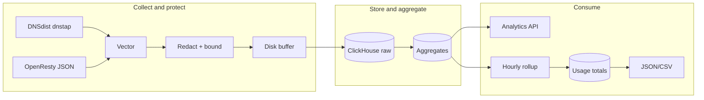

# Analytics, logs, and usage

| Data class | Contract |
| --- | --- |
| Raw logs | Domain/admin scoped, maximum 24-hour query |
| Aggregates | Bounded analytics, maximum 90-day query |
| Usage | Compact PostgreSQL rows for stable export |
| Client address | Stored in full in raw events for seven days; API, export, and UI reads mask it to the platform prefix. Hourly and daily rollups contain no client address or user agent |
| Sensitive fields | Authorization, cookies, bodies, request query strings, and referrer query strings are removed before storage |
| Ingest authenticity | Vector accepts edge events only with the node secret (HTTP `Authorization`, or the proof every cell adds to its access-log line). Forged events are dropped |

::: warning Analytics is not authoritative
ClickHouse loss can create partial intervals, but it cannot change DNS, edge
state, security decisions, certificate selection, or serving.
:::

Vector sends normalized edge and DNS events directly to ClickHouse. Laravel
queries bounded results; it does not receive raw traffic through a queue or
store it in PostgreSQL.

## Domain analytics

The `/app/analytics` page and domain API expose:

- summary;
- timeseries;
- status codes;
- cache outcomes;
- countries;
- hostnames;
- top URL paths;
- origin health;
- edge distribution;
- compression encoding, delivered/identity bytes, savings ratio, profile, and fallback;
- DNS query aggregates.

The browser page does not choose or preload the first assigned domain. Use its
searchable **Select domain** action; search results and the selected label are
policy-scoped, and telemetry queries begin only after an authorized domain is
selected.

## Administrator operations overview

The `/admin` operations overview uses complete hourly ClickHouse aggregates for
request, transfer, status-family, cache, origin-error, origin-average-latency,
and DNS-response evidence. Quick range, previous-period comparison, domain, and
edge filters are URL-persisted. A scoped drill-down opens **Traffic and
telemetry** with the same range and identifiers.

The current aggregate schema has no edge latency percentile, origin latency
percentile, or DNS latency field. The interface says **Unavailable** for those
metrics. It does not calculate overview KPIs from raw event logs.

Aggregate queries accept at most 90 days. Raw request, DNS, error, and security
logs and the unsampled compression view accept at most 24 hours. Logs use
opaque cursor pagination.

Responses label units, requested range, finalization state, and partial data.
ClickHouse failure returns HTTP 503 with `code=analytics_unavailable`. Filament
shows the outage instead of failing the serving plane.

## Privacy

Vector strips authorization, cookies, request bodies, and query strings.
Paths, user agents, referrers, errors, names, and addresses are length bounded.
Raw events keep the full client address and user agent for the seven-day TTL;
normal views and exports mask client addresses using the platform IPv4 and
IPv6 prefix settings. Long-lived rollups never hold either field.

### DNS log ownership

DNS events carry the queried zone, not a domain id. A domain user sees queries
for their own zone and its subdomains, except names under another registered
domain (including deleted ones), and only from the moment the current domain
record was created. A new owner of a name never sees the previous owner's
queries, and a parent zone never sees a child domain's queries.

Raw ClickHouse tables have a seven-day TTL. Hourly aggregates have a 400-day
TTL and daily aggregates a three-year TTL in the shipped schema. Platform
retention settings describe the policy and reporting surface; changing them
does not rewrite the static ClickHouse DDL by itself.

## Usage rollups

The scheduler finalizes the most recently complete hour after the configured
delay. `usage_rollups` stores request, DNS, ingress, and egress counts with a
stable interval and status. Rebuilding the same interval is idempotent.

Domain and administrator usage endpoints support cursor lists plus JSON or CSV
export, bounded to 10,000 rows. The export metadata includes contract version
and range. This is reporting data for an external billing system; CDNFoundry
does not implement billing.

## Telemetry loss

Each Vector ClickHouse sink has a 1 GiB disk buffer, batches up to 1,000 events,
retries delivery for a bounded duration, and drops newest events when full.
Prometheus alerts on discarded events, delivery errors, and buffer pressure.
DNS and HTTP continue serving.
