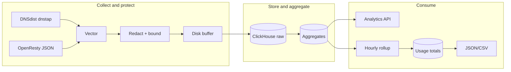

# Analytics, logs, and usage

<Screenshot name="app-analytics" alt="The Analytics page in the domain panel, with traffic for the selected domain and range." />

This page shows how to read traffic, DNS, and log data for a domain, how the platform protects privacy, and how to export usage. **You need:** access to the domain. Administrators also need the `/admin` panel for platform-wide views.

Edge servers and DNS servers send events to Vector, a log shipper. Vector removes private fields, then writes the events to ClickHouse, a column database for analytics.



| Data class | What you get |
| --- | --- |
| Raw logs | Scoped to the domain (or to the platform for administrators). One query covers at most 24 hours |
| Aggregates | Summed counts per hour. One query covers at most 90 days |
| Usage | Small hourly rows in PostgreSQL, kept for stable export |
| Client address | Stored in full in raw events for seven days; API, export, and UI reads mask it to the platform prefix. Hourly and daily rollups contain no client address or user agent |
| Sensitive fields | Authorization, cookies, bodies, request query strings, and referrer query strings are removed before storage |
| Ingest authenticity | Vector accepts edge events only with the node secret (HTTP `Authorization`, or the proof every cell adds to its access-log line). Forged events are dropped |

::: warning Analytics is not authoritative
If ClickHouse loses data, some intervals are partial. This never changes DNS,
edge state, security decisions, certificate selection, or serving.
:::

Vector sends events straight to ClickHouse. The control plane only queries
bounded results. It does not receive raw traffic and does not store it in
PostgreSQL.

## Domain analytics

Open **Analytics and logs** in the domain panel, or call the endpoints under `/api/domains/{domain}/analytics/`. They return:

- summary and time series;
- status codes and cache outcomes;
- countries, hostnames, and top URL paths;
- origin health and edge distribution;
- compression: encoding, delivered and identity bytes, savings ratio, profile, and fallback;
- DNS query aggregates;
- download and upload by edge, cell, and country (`/analytics/volume/edges`, `/cells`, `/countries`). The administrator API adds `/api/admin/analytics/volume/domains`. Download is the response sent to the client and upload is the request received, both counted at the cell. Origin-side traffic is not measured.

**Expected result:** the page starts empty. Choose **Select domain** (it reads **Switch domain** afterwards), search, and pick a domain. Queries start only after you pick one, and the search lists only domains you may see.

### Security analytics

The **Security** card on **Analytics and logs** counts every request of the chosen
domains, mitigated or not, so you can see how much of your traffic is attack
traffic and where it comes from.

| Tab | Counts requests by | Source |
| --- | --- | --- |
| Attack score | Band: not scored, 1 to 19, 20 to 39, 40 to 59, 60 to 79, 80 to 99 | Hourly rollup, 400 days |
| Actions | Allowed, blocked, or logged by a rule | Hourly rollup, 400 days |
| Countries | Country | Hourly rollup, 400 days |
| Networks | Autonomous system number | Hourly rollup, 400 days |
| Paths | Path, most mitigated first | Request events, 24 hours of the range, kept 7 days |
| User agents | User agent, most mitigated first | Request events, 24 hours of the range, kept 7 days |

Each row shows the requests, how many were mitigated, and the mitigated share.
Path and user agent have too many values for a rollup, so those two tabs read the
stored request events and cover the last 24 hours of the range.

The API serves the same numbers at
`GET /api/domains/{domain}/analytics/security/{bands|actions|countries|asns|paths|agents}`.
It takes the usual `from` and `to`; paths and agents accept at most 24 hours.

## Administrator operations overview

The `/admin` operations overview uses complete hourly ClickHouse aggregates for
requests, transfer, status families, cache, origin errors, average origin
latency, and DNS responses. The URL keeps the quick range, the comparison with
the previous period, and the domain and edge filters. Each KPI opens
**Traffic and telemetry** with the same range and identifiers.

The aggregate schema has no edge latency percentile, origin latency percentile,
or DNS latency field, so the overview does not show those metrics, and it shows
no estimated savings. It never calculates overview figures from raw event logs.

Aggregate queries accept at most 90 days. Raw request, DNS, error, and security
logs and the unsampled compression view accept at most 24 hours. Logs use
opaque cursor pagination.

Responses label units, the requested range, whether the hour is final, and
whether data is partial. If ClickHouse is down, the API returns HTTP 503 with
`code=analytics_unavailable` and the panel shows the outage. Serving is not affected.

## Privacy

Vector removes authorization headers, cookies, request bodies, and query strings.
It also limits the length of paths, user agents, referrers, errors, names, and addresses.
Raw events keep the full client address and user agent for seven days.
Views and exports mask client addresses with the platform IPv4 and IPv6 prefix
settings. Long-lived rollups hold neither field.

### DNS log ownership

DNS events carry the queried zone, not a domain id. A domain user sees queries
for their own zone and its subdomains, except names under another registered
domain (including deleted ones), and only from the moment the current domain
record was created. A new owner of a name never sees the previous owner's
queries, and a parent zone never sees a child domain's queries.

Raw ClickHouse tables keep data for seven days. Hourly aggregates keep it for 400 days
and daily aggregates for three years. These times are set in the shipped ClickHouse
schema. The platform retention settings describe the policy only: changing them
does not change the schema.

## DNS rollups are keyed by zone, not by name

The long-lived DNS rollups (400 days hourly, three years daily) are keyed by the
**served zone and its domain**, never by the name that was asked. The control plane
publishes the list of served zones to ClickHouse every minute when it changes
(and at least every twelve hours). ClickHouse matches each query name to the
longest served zone that is a suffix of it. A random-subdomain flood against a
zone therefore adds no rows. Queries for names inside no served zone, such as
`REFUSED` queries for someone else's domain, share one unattributed bucket. A
zone added in the last minute or two may fall into that bucket until the next
refresh.

To keep what is being asked visible without keeping every name, each hour and
zone also stores a bounded sketch of its 20 busiest names (`dns_top_names`).
Raw events, with the full name and a masked client address, stay for seven days.

## Usage rollups

After the configured delay, the scheduler finalizes the latest complete hour.
The `usage_rollups` table stores request, DNS, ingress, and egress counts per
hour, with a status. Rebuilding the same hour gives the same result.

To keep the control database small for years, a daily job sums old rows without changing any total: hourly rows
older than 35 days become one row per day, and daily rows older than a year become one row per month. Monthly rows are
kept for good, about 12 rows per domain and year. A summed day or month is final and is never rebuilt. The usage
endpoints return rows of any granularity, so read the `granularity` field.

Use `GET /api/domains/{domain}/usage` for a cursor-paginated list and
`GET /api/domains/{domain}/usage/export` for an export. Administrators have the same
endpoints under `/api/admin/usage`. Exports hold at most 10,000 rows and
include the contract version and range in their metadata. This is data for an external billing system.
CDNFoundry does not do billing.

## Find an attack: the reusable filters

Three log kinds stay separate. **Request logs** are in ClickHouse
(`cdnf.edge_events`, 7 days). **Host and container logs** are in Loki. **Application
audit** is `audit_logs` in PostgreSQL, shown in the panel. Filter request logs by
`hostname`, `domain_id`, `pop`, `edge_id`, `cell`, `country`, `status`,
`cache_status`, `origin_error`, `security_action`, `security_reason`,
`waf_profile`, `waf_action`, `waf_rule_id`, `request_id`, `user_agent`, and
`client_ip`. Examples that work as written (replace the values):

```sql
-- every request one WAF rule blocked, newest first
SELECT occurred_at, hostname, path, status, cell, request_id
FROM cdnf.edge_events
WHERE domain_id = 42 AND waf_action = 'block' AND waf_rule_id = 949110
  AND occurred_at > now() - INTERVAL 1 HOUR
ORDER BY occurred_at DESC LIMIT 100;

-- why a domain was refused, by reason, per edge
SELECT edge_id, security_reason, count() AS requests
FROM cdnf.edge_events
WHERE domain_id = 42 AND security_action = 'block' AND occurred_at > now() - INTERVAL 1 HOUR
GROUP BY edge_id, security_reason ORDER BY requests DESC;

-- download and upload by cell
SELECT cell, sum(bytes_sent) AS download, sum(bytes_in) AS upload
FROM cdnf.edge_volume_1m WHERE domain_id = 42 AND interval_start > now() - INTERVAL 1 HOUR
GROUP BY cell;
```

Loki: `{service="edge-agent"} |= "edge_sync_failed"`, `{service="edge-gateway"}`,
and `{host="<node>", service=~"cell-.+"}`. Identifiers are not labels: filter
them from the JSON body, for example `{service=~".+"} |= "<request id>" | json | request_id="<request id>"`.

## Failed TLS handshakes

A handshake refused by a cell (`unknown_sni`, `handshake_rate_exceeded`,
`tls_disabled`, an unusable certificate) is reported by the cell. One refused at
the gateway (`gateway_invalid_hello`, `gateway_unknown_route`,
`gateway_handshake_budget`) is reported by the edge agent, which reads the
gateway's counters about every heartbeat and sends up to 50 events per reason
per report. Both feed `tls_failures_hourly`, so a refusal shows in the rollup
within one heartbeat interval plus the two-second Vector batch. Under a flood
the rollup is a bounded sample; the exact count is the Prometheus series
`cdnfoundry_gateway_tls_handshakes_rejected_by_reason_total` on the gateway.

## Telemetry loss

Vector buffers events on disk when ClickHouse is slow or down. The edge events
sink holds up to 1 GiB. The security-event and DNS sinks hold about 256 MiB each.
Vector retries delivery for up to 300 seconds per request. When a buffer is full, it drops the newest events.
Prometheus alerts on discarded events, delivery errors, and buffer pressure.
DNS and HTTP keep serving.
