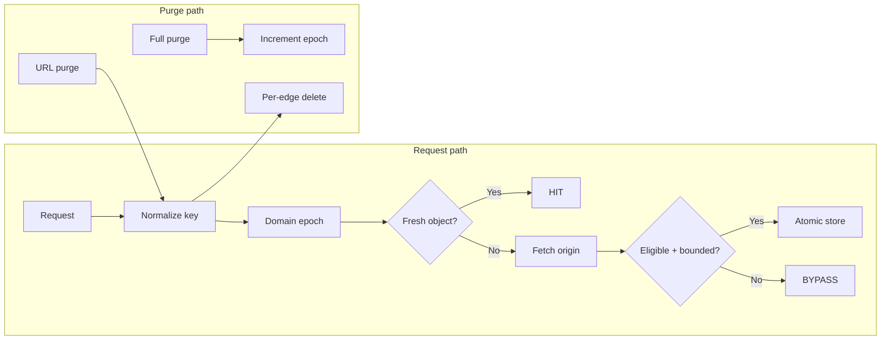

# Cache and purge

This page shows how to set the cache rules of a domain, bypass the cache for a short time, and purge cached content. **You need:** a proxied hostname on the domain. See [Proxy and origins](proxy-and-origins.md).

A cache keeps copies of origin responses on the edge. A hit is served from the copy. A miss goes to your origin. A purge removes copies.

| Concern | How it works |
| --- | --- |
| Storage | Each cell has its own persistent cache volume. Keys separate domain, policy, epoch, and URL generation |
| Key | Lookup and URL purge use the same normalized key |
| Full purge | Raises a per-domain epoch number. Nothing scans the disk |
| URL purge | One durable task per edge |
| Development mode | Bypasses the cache until a fixed time |
| Failure | The same task is retried and the backlog is visible |



::: info Purge completion
A `202` reply proves only that the purge tasks exist. Check the purge status, then
request the URL and look for a MISS.
:::

## Cache settings

Open the domain and choose **Cache settings**, or use `GET` and `PATCH` on `/api/domains/{domain}/cache`. Cache settings belong to one domain and are delivered to edges with its other configuration.

**Expected result:** the change returns an operation, and edges apply the new revision after they acknowledge it.

| Setting | Allowed values |
| --- | --- |
| enabled (**Cache enabled**) | boolean |
| edge TTL | 0–31,536,000 seconds |
| browser TTL | 0–31,536,000 seconds |
| maximum object | 1 MiB–1 GiB, capped by the pool profile |
| respect origin headers (**Respect origin cache headers**) | boolean |
| query policy | include all, ignore all, include selected, or ignore selected |
| selected query names | up to 32 distinct safe names |
| ignored cookie names | up to 32 distinct names, each 1–64 safe characters; a name ending in `*` matches every cookie that starts with it (`_ga_*`); a request whose cookies are all on this list can still be cached |
| path rules | up to 16 rules; each has a match (starts with or ends with), a path of up to 128 safe characters (a prefix starts with `/`), and an action: bypass the cache, or set the edge TTL (1–31,536,000 seconds) |
| status TTLs | approved 200, 203, 204, 206, 301, 302, and 404 map; 0 disables admission |
| admission requests | 1–10 requests before a new object is admitted |
| stale if error | 0–86,400 seconds |
| stale while revalidate | 0–86,400 seconds |
| serving mode | normal, cache-only, or stale-only |
| variants | 1–128 distinct variants per resource/minute |

Defaults are enabled, 3,600-second edge TTL, 300-second browser TTL, 100 MiB
maximum object, origin-header respect, query inclusion, no ignored cookies (every request with a cookie bypasses the cache),
approved status TTLs, two-request admission, 60 seconds of stale-if-error,
30 seconds of stale-while-revalidate, normal serving, and 32 variants.

### Analytics cookies

A request that carries any cookie is personal, so most analytics cookies would
turn every visit into a cache bypass. In **Cache settings**, **Add analytics
cookies** appends the usual cookie names of one tool to the ignored list (Google
Analytics, Meta Pixel, Hotjar, Matomo, or consent banners). Review the list before
saving: only name cookies that do not change the response. A cookie the preset
does not cover still bypasses the cache.

### Path rules

A path rule changes cache behavior for one part of the site. The first rule, in
list order, whose path matches the raw request path (query string excluded,
case-sensitive) applies:

- **Bypass cache** never stores or serves the path from the cache.
- **Set edge TTL** keeps responses for the given seconds. It replaces the origin's
  own lifetime for that path, but only for statuses the status TTL map already
  allows. A status set to 0 is still never stored.

Rules are part of the domain's cache policy, so changing one starts a new policy
generation and earlier copies are not reused. There are no wildcards and no regular
expressions.

The edge serves an expired object inside the stale-while-revalidate window while
one background refresh runs. Nginx also uses a per-key lock so that many cold
requests cause one origin fetch. The lock wait and age are capped at 65 seconds,
the same as the outer origin read deadline. A full purge changes the domain epoch,
so the edge never selects a stale object from an earlier epoch.

These requests and responses skip the cache or are not stored: requests with
authorization, unsafe methods, or any `Cookie` header that carries a name not on the domain's ignored-cookie list; responses with
`Set-Cookie`, `private`, `no-store`, or an unsupported `Vary`; range requests;
and disallowed status codes. Cache keys and URL purge use one key definition:
scheme, lowercase hostname, the raw request path, and the sorted query pairs,
then policy generation, epoch, and URL generation.

A request with a cookie is treated as personal. It is never stored, never served
from the cache, and the edge leaves the origin's own `Cache-Control` untouched on
its response; it never adds `public`. Name only cookies that do not change the
response (for example an analytics cookie) in **Ignored cookie names**. Settings
saved before this rule that listed `bypass_cookie_names` lose that list, since
it meant the opposite.

The path is taken as the client sent it and stays percent-encoded. Only the case
of escapes and escapes of unreserved characters change (`%7e` becomes `~`), so
`%2F` never merges with `/` and `/x%3Fv=1` never shares an entry with `/x?v=1`.
Query names and values are decoded (`+` is a space), sorted as strings by name
only, and encoded again. Repeated names keep the order the client sent, so
`?item=first&item=second` and `?item=second&item=first` are two objects, as an
order-sensitive origin expects, while `?b=1&a=2` and `?a=2&b=1` still share one. A request has **no cache key**, and is never
cached, when the origin could read it differently from the cache: dot segments
(`/a/../b`, including `%2e%2e`), empty segments (`//`), malformed percent
escapes, raw spaces or non-ASCII bytes in the path, or more than 128 query
arguments (counted before the query policy applies). The same URLs are
refused with `422` when you purge them. The PHP and Lua implementations are
tested against one fixture file, `tests/fixtures/cache_key_vectors.json`.

## Pool profiles and storage

An administrator selects one profile on each service pool (a group of cells that serve assigned domains). The profile goes into every assigned domain's artifact and caps the domain policy. "Cache" is the disk size per cell, "Temporary" is space for in-flight bodies, and "Inactive" is how long an unused object stays:

| Profile | Cache | Temporary | Minimum free | Inactive | Object | Admissions/s |
| --- | ---: | ---: | ---: | ---: | ---: | ---: |
| Small | 256 MiB | 64 MiB | 32 MiB | 30 min | 10 MiB | 20 |
| Standard | 1 GiB | 128 MiB | 64 MiB | 1 hour | 100 MiB | 50 |
| Large | 4 GiB | 512 MiB | 256 MiB | 6 hours | 512 MiB | 100 |
| Streaming | 8 GiB | 1 GiB | 512 MiB | 24 hours | 1 GiB | 25 |

Each cell has its own persistent cache volume. Request temporary storage is a
separate bounded filesystem. The cache keeps the minimum free space and evicts
inactive or least recently used objects. The operator must set the volume quota to the
profile size or lower. Changing a profile never creates a directory, process, or timer per domain.

Cache-only and stale-only modes still serve cache hits. A miss that would go to the origin is rejected with the reason `cache_mode_origin_disabled`. Use these modes to isolate a failing origin. The request path never calls the control plane.

## Development mode

Development mode bypasses the cache for 1 to 1,440 minutes.

Open the domain and choose **Enable development mode**, enter **Duration (minutes)** (default 30), and save. Use **Disable development mode** to end it early. Through the API, send `POST /api/domains/{domain}/cache/development-mode` with `duration_minutes`, or `DELETE` the same path.

**Expected result:** requests show a bypass until the end time. PostgreSQL stores the absolute end time and the signed artifact carries it. OpenResty checks it on every request, so bypass ends without the scheduler or control plane.

## Purge

<DocTabs :labels="['Panel', 'API']">
<template #tab-1>

Open the domain, choose **Purge cache**, then pick **Everything** or **Exact URLs**. For URLs, enter one per line.

</template>
<template #tab-2>

```sh
curl -X POST "$CDNF_URL/api/domains/42/cache/purge" \
  -H "Authorization: Bearer $CDNF_TOKEN" \
  -H "Idempotency-Key: $(uuidgen)" \
  -H "Content-Type: application/json" \
  -d '{"type": "urls", "urls": ["https://www.example.com/app.css"]}'
```

Use `{"type": "all"}` for a full purge. Follow progress with `GET /api/domains/{domain}/cache/purges/{purge}`.

</template>
</DocTabs>

**Expected result:** `202 Accepted` and a purge ID. A purge is either:

- `all`, which increments the domain cache epoch and does not scan disk;
- `urls`, which accepts 1 to 100 distinct URLs and generates exact cache keys.

The payload is limited to 128 KiB. A domain may have at most 1,000 outstanding
(pending or running) purges. The control plane creates one durable task per eligible edge and returns
`202`. The idempotency key and task ID make repeats safe.

A purge URL must be absolute, use `http` or `https`, belong to the domain, use
the default port, and carry no credentials (`user@`) and no fragment (`#`).

The agent sends the task to every matching cell. OpenResty records the new epoch
or the URL invalidations in a dedicated shared-memory dictionary (`cache_purges`,
16 MiB) that rate-limit counters cannot evict. Each URL entry holds the purge
id and expires after one year, the longest cache lifetime. The agent first writes
every URL purge to `cache-purges.json` in its state directory (at most 50,000
keys, entries older than one year dropped). A cell reports `purges_restored:
false` after it starts; the agent then replays the saved purges in batches of
100 and marks the cell restored, so purged content does not return after a
cell restart. A purge that would exceed the 50,000-key bound fails with
`cache_purge_capacity_exceeded` instead of being forgotten. Failed delivery
keeps the same task, records `last_error`, and retries with a bounded delay.
Traffic continues throughout.

**If the purge does not finish:** read the purge status and its `last_error`. Fix the edge or its connection and the retry completes the same task. If you get `cache_purge_capacity_exceeded`, the agent already holds 50,000 URL purges. Use a full purge instead.

## Storage isolation

Each cell has its own cache volume, temporary filesystem, and CPU, memory, and PID limits. Losing a cache is safe, because content comes from origins. A restart keeps content. A new volume refills on demand. A full disk in one cell does not touch another cell's storage.

Delivery compression does not vary the cache key. The cell requests identity
from the origin and stores one canonical object, then applies the pool's
bounded [compression profile](compression.md) after HIT, MISS, or stale lookup.
