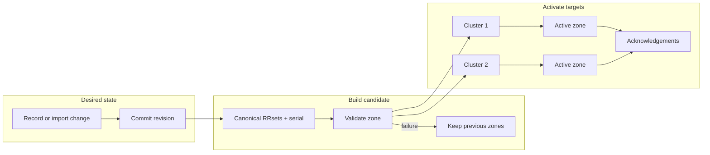

# Authoritative DNS

This page shows how to manage the DNS records of a domain, import and export a zone, and see how a change reaches the DNS servers. **You need:** an active domain. A zone is the set of records for one domain. "Authoritative" means CDNFoundry answers for the zone itself. See the [glossary](../reference/glossary.md) for other terms.

| Concern | Where it lives, and the limits |
| --- | --- |
| Desired records | Control PostgreSQL |
| Runtime records | Derived PowerDNS PostgreSQL |
| Public ingress | DNSdist only, UDP and TCP port 53 |
| Change | Each change raises the domain revision. Bulk and import changes are all-or-nothing |
| Target bounds | 16 clusters and 8 nameserver identities |
| Failure | An invalid candidate never replaces the active records |
| Query ceiling | DNSdist answers UDP queries over 500 queries/second per source IP or IPv6 /64, and over 50,000 queries/second globally, with a truncated (TC) reply so real resolvers retry over TCP instead of losing the query |
| TCP limits | 10 connections per client address, 100 queries and 30 seconds per connection, 5-second read and write timeouts |
| `ANY` queries | Truncated over UDP and answered `NOTIMP` over TCP (RFC 8482), so they cannot be used to amplify traffic |



::: danger Never expose PowerDNS directly
DNSdist is the only public authoritative listener. Keep the raw PowerDNS API
and daemon private behind the source-restricted TLS gateway.
:::

## Records

Open the domain and its **DNS records** tab (choose **Add record**), or use
`/api/domains/{domain}/dns/records`. Lists use cursor pagination with 100 rows.
Create, update, delete, and bulk requests check the final zone before they raise its revision.

**Expected result:** the change is saved, the revision rises, and the DNS servers receive it after reconciliation (see below). If validation fails, the zone is unchanged and the error names the field.

Supported types, modes, field bounds, and CNAME rules are in
[DNS record reference](../reference/dns-records.md).

Bulk input has item and payload limits, and the API rejects input over them. The platform normalizes every record before it checks duplicates and zone-wide rules. One valid bulk request makes one new revision.

## Import

`POST /api/domains/{domain}/dns/import` accepts:

```json
{
  "zone": "$ORIGIN example.com.\n@ 300 IN A 192.0.2.10\n",
  "replace_existing": false
}
```

The parser supports `$ORIGIN`, `$TTL`, comments, parenthesized multiline
records, omitted owners, relative names, common TTL suffixes, and supported
record types. Input is limited to 1 MiB and 5,000 records.

Imports over 64 KiB or 100 lines create a `dns.zone_import` operation on the `bulk_maintenance` queue and return `202`. Smaller imports apply in the request, in one transaction. A failed import leaves the previous zone and revision unchanged.

The import ignores SOA records, because CDNFoundry generates the SOA serial. The platform
zone's serial rises by exactly one when the zone content changes. It does not change when the content stays the same, so the
every-minute render does not move it.

## Export

`GET /api/domains/{domain}/dns/export` returns deterministic BIND text with
`$ORIGIN`, `$TTL`, and stable owner/type ordering. Platform-managed SOA is not
exported. Re-importing with replacement recreates the desired customer records.

## Reconciliation

Reconciliation is how a desired record becomes a live DNS answer. Each enabled, healthy DNS cluster has one deployment row per active domain.
A worker builds the records in a fixed order, compares checksums, writes or replaces
the zone on the target, checks that it is active, and records the acknowledgement. A failed
target keeps its previous active records.

Administrators can reconcile one domain (`POST /api/domains/{domain}/dns/reconcile`), all DNS zones (`POST /api/admin/dns/reconcile`), or the platform DNS
identity. Global work runs in chunks of 500 domain IDs.

A failed push is retried with backoff (10, 30, 60, 120, then 300 seconds) for up
to 30 minutes. One reconcile runs per domain at a time and the revision is
re-checked immediately before each target is changed, so an older revision never
overwrites a newer one. The operation stays `running`, with the last error
visible, until the retry window ends; only then is it `failed`.

## Customer nameserver pairs

The platform DNS identity holds two separate sets. `nameservers` are the platform
zone's own authoritative NS records. `customer_nameserver_pairs` (one to eight
pairs of two hostnames with public IPv4 and optional IPv6) are what customer
claims are delegated to. Pair hostnames are published as explicit A/AAAA records in
the platform zone, never as apex NS records and never through a wildcard. Changing
the pool is an audited, revisioned platform DNS operation; a new pair is offered to
claims only after every enabled DNS cluster's platform deployment publishes its
address records. See [Domain lifecycle](domains.md#nameserver-pairs) for
allocation, reservation and takeover.

## Drift

PowerAdmin is a diagnostic tool only. Any edit made directly on the DNS runtime is drift. Fix drift by reconciling from PostgreSQL. Never copy runtime data back into the desired state.

`cdnf:dns:repair-drift` runs every five minutes. For up to 100 deployments, oldest
check first, it compares the zone each DNS target actually serves (records and
SOA serial) with what was deployed, and what was deployed with the current
desired state. Any difference, and any failed deployment, queues one coalesced
reconcile and writes a `dns.drift_repair_queued` audit entry. A target that
cannot be reached is not treated as drift. A DNS host that was down longer than
the retry window is therefore repaired automatically once it returns.

DNSdist resolves the `pdns-auth` backend again every 15 seconds, so a recreated
PowerDNS container that receives a new address is picked up without restarting
DNSdist.
