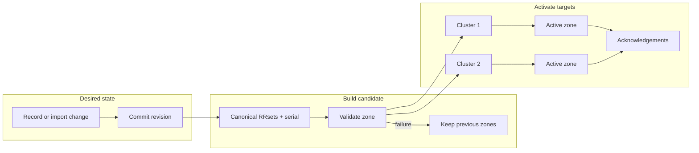

# Authoritative DNS

| Concern | Source of truth or bound |
| --- | --- |
| Desired records | Control PostgreSQL |
| Runtime records | Derived PowerDNS PostgreSQL |
| Public ingress | DNSdist only, UDP and TCP port 53 |
| Mutation | One monotonic domain revision; bulk/import is atomic |
| Target bounds | 16 clusters and 8 nameserver identities |
| Failure rule | Invalid candidate never replaces active RRsets |
| Query ceiling | DNSdist drops traffic over 500 queries/second per source IP or IPv6 /64 and over 50,000 queries/second globally |



::: danger Never expose PowerDNS directly
DNSdist is the only public authoritative listener. Keep the raw PowerDNS API
and daemon private behind the source-restricted TLS gateway.
:::

## Records

Use the domain's **DNS records** relation or
`/api/domains/{domain}/dns/records`. Lists use cursor pagination with 100 rows.
Create, update, delete, and bulk operations validate the final zone before
incrementing its revision.

Supported types, modes, field bounds, and CNAME rules are in
[DNS record reference](../reference/dns-records.md).

Bulk input is limited by controller validation and payload-size checks. Every
record is normalized before duplicates and zone-wide constraints are checked.
One valid bulk mutation creates one desired revision.

## Import

`POST /api/domains/{domain}/dns/import` accepts:

```json
{
  "zone": "$ORIGIN example.com.\n@ 300 IN A 192.0.2.10\n",
  "replace_existing": false
}
```

The parser supports `$ORIGIN`, `$TTL`, comments, parenthesized multiline
records, omitted owners, relative names, common TTL suffixes, and supported
record types. Input is limited to 1 MiB and 5,000 records.

Imports over 64 KiB or 100 physical lines create a `dns.zone_import` operation
on `bulk_maintenance` and return `202`. Smaller imports apply transactionally in
the request. A failure leaves the previous zone and revision unchanged.

SOA input is ignored because CDNFoundry owns SOA serial generation. The platform
zone's serial is stored and incremented by exactly one whenever the zone's
content changes, and it never changes when the content does not, so the
every-minute render does not move it.

## Export

`GET /api/domains/{domain}/dns/export` returns deterministic BIND text with
`$ORIGIN`, `$TTL`, and stable owner/type ordering. Platform-managed SOA is not
exported. Re-importing with replacement recreates the desired customer records.

## Reconciliation

Each enabled, healthy DNS cluster has one deployment row per active domain.
The worker renders deterministic RRsets, compares checksums, writes or replaces
the target zone, verifies active state, and records acknowledgement. A failed
target retains its previous active RRsets.

Administrators can reconcile one domain, all DNS zones, or the platform DNS
identity. Global work is chunked at 500 domain IDs.

A failed push is retried with backoff (10, 30, 60, 120, then 300 seconds) for up
to 30 minutes. One reconcile runs per domain at a time and the revision is
re-checked immediately before each target is changed, so an older revision never
overwrites a newer one. The operation stays `running`, with the last error
visible, until the retry window ends; only then is it `failed`.

## Customer nameserver pairs

The platform DNS identity holds two separate sets. `nameservers` are the platform
zone's own authoritative NS records. `customer_nameserver_pairs` (one to eight
pairs of two hostnames with public IPv4 and optional IPv6) are what customer
claims are delegated to. Pair hostnames are published as explicit A/AAAA records in
the platform zone, never as apex NS records and never through a wildcard. Changing
the pool is an audited, revisioned platform DNS operation; a new pair is offered to
claims only after every enabled DNS cluster's platform deployment publishes its
address records. See [Domain lifecycle](domains.md#nameserver-pairs) for
allocation, reservation and takeover.

## Drift

PowerAdmin is diagnostic only. Treat direct runtime edits as drift. Reconcile
from PostgreSQL rather than copying runtime data back into desired state.

`cdnf:dns:repair-drift` runs every five minutes. For up to 100 deployments, oldest
check first, it compares the zone each DNS target actually serves (records and
SOA serial) with what was deployed, and what was deployed with the current
desired state. Any difference, and any failed deployment, queues one coalesced
reconcile and writes a `dns.drift_repair_queued` audit entry. A target that
cannot be reached is not treated as drift. A DNS host that was down longer than
the retry window is therefore repaired automatically once it returns.

DNSdist resolves the `pdns-auth` backend again every 15 seconds, so a recreated
PowerDNS container that receives a new address is picked up without restarting
DNSdist.
