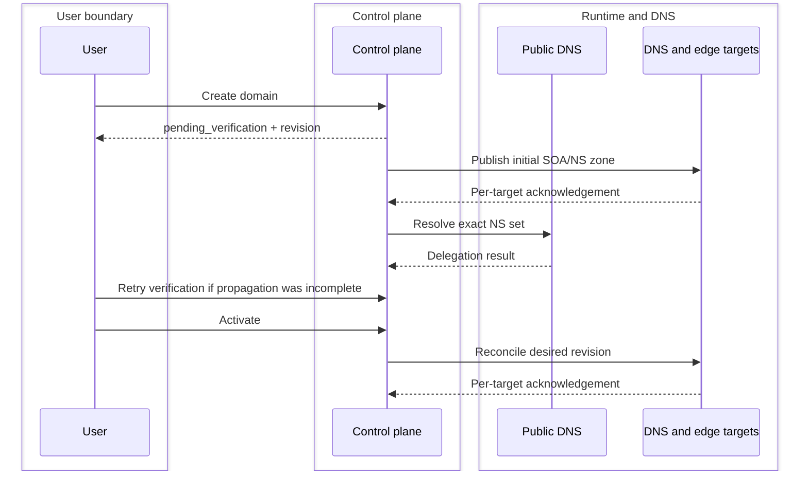

# Domain lifecycle

<Screenshot name="app-domains" alt="The Domains list in the domain panel, showing the domains assigned to the signed-in user." />

| Concern | Implemented boundary |
| --- | --- |
| Durable owner | PostgreSQL domain, deployment, and tombstone rows |
| External work | NS verification, DNS reconciliation, edge deployment |
| Completion | Operation plus target-specific acknowledgement |
| Failure | Preserve last-valid runtime and expose the failed target |
| Retirement | Delayed deprovision, acknowledged tombstones, reclaim cooldown |

::: warning Form save is not runtime activation
Inspect domain status, the operation receipt, and DNS/edge deployment state
before declaring a lifecycle change complete.
:::

## Create

`POST /api/domains` and the domain create form accept `name`. The API has a
separate display-label update. Names are normalized consistently using UTS #46
IDNA and a pinned complete Public Suffix List (ICANN and PRIVATE sections),
including wildcard and exception rules. Delegated subdomains and reverse zones
remain supported; platform and management namespaces are reserved. API and
Filament creation share a transaction and PostgreSQL name lock with finalization.
The active-name unique index remains the final duplicate guard.

Creation:

- assigns the creating domain user;
- starts at `pending_verification`;
- creates the initial revision;
- queues the nameserver pair allocation, then the initial DNS reconciliation and public nameserver verification;
- does not require an origin or certificate.

## Verify

Creation starts a seven-day pending claim for the creating user. A worker then
assigns the claim a **nameserver pair** from the platform's customer pool (see
[Nameserver pairs](#nameserver-pairs)); the assignment appears as **Assigned
nameservers** on the domain page and as `assigned_nameservers` in the API
response, and `claim_status` says what the claim is waiting on:
`awaiting_assignment`, `pending_delegation`, `expired`, `superseded`, or `owner`.
At the registrar (or parent zone for delegated children), set exactly those two
names. There is no customer TXT challenge, no wildcard record and no random
label: the pair names are ordinary hostnames with explicit A/AAAA records, and
no per-domain DNS process is created.

The worker uses BIND `delv` with its root trust anchor to validate parent discovery
and DS absence, then bounded nonrecursive `dig` queries to parent authorities.
Every parent must return the same exact delegation. Child-zone answers, shared
platform nameservers, stale previous assignments, DNSSEC failures and partial
propagation cannot activate a new claim. The unsigned runtime requires removing
stale DS records from a previous provider. The worker has a 45-second DNS budget,
a 60-second job timeout, at most 16 parent authorities and four addresses per
parent, and a 64-KiB process-output limit. DNS errors remain visible failures;
retry after correcting DNS or propagation.

Pending zones serve only SOA/NS bootstrap records. A pending child of an already
managed zone is not published, so it cannot shadow the parent's DNS records.
Verification completes before that child is activated. ACME DNS-01 remains
separate and is used only for eligible proxied hostnames after verification.

Requests coalesce through the same API/Filament verification boundary. Completion
rechecks the actor, assignment, operation, claim and lifecycle under database
locks. Disabled, deprovisioning, expired, cancelled or revoked work cannot activate.
The explicit administrator force-verification route remains audited; it is an
operator override, not evidence that public delegation was checked.

Each domain user may hold at most 20 unverified claims, including disabled or
retiring claims, and one claim per name. An unverified claim expires after seven
days even if the applicant disables it. The scheduler retires at most 500
expired claims per minute through normal asynchronous deprovisioning. Verified
owners never expire on this deadline.

### Nameserver pairs

An administrator configures the pool under **System DNS identity → Customer
nameserver pairs** (or `customer_nameserver_pairs` in the identity API): one to
eight pairs, each two distinct hostnames inside the platform domain with a
public IPv4 and an optional public IPv6 address. The pool is separate from the
platform's own apex NS set: pair hostnames get explicit A/AAAA records in the
platform zone and are never added to the apex NS RRset. When the field is
omitted, the pool defaults to the platform nameservers taken two at a time.
Offer at least two pairs, because every competing claim needs a pair different
from the current delegation.

Allocation runs in a worker, never in a web request. It reads the delegation the
parent authorities publish now (the same direct, DNSSEC-validated parent queries
verification uses; resolver caches and the child zone are never trusted) and
reserves a pair under the canonical-name lock that:

- is not the current parent delegation, so the registrar must change;
- no other live claim of the name holds (a partial unique index backs this);
- every enabled DNS cluster already publishes, so nobody is told to delegate to
  a name that does not resolve yet.

Pairs may be shared by different names. If the parent delegation cannot be
established or the parents disagree, the allocation is retried and then fails
visibly without assigning anything. If no pair is free the verification operation
fails with `nameserver_pairs_unavailable`; a reserved pair is never reused.
Request verification again later, or ask an administrator to add a pair or retire
a stale claim.

### Competing claims and takeover

Asking first does not own a name; delegating the name does. Anyone may claim a
name another user already holds or has claimed:

- the new claim gets its own pair, so a delegation left over from the previous
  owner can never verify it;
- while the claim is pending the holder stays the owner with full access, keeps
  serving its last valid DNS and edge configuration, and never learns who
  asked; the applicant sees only its own claim and pair, and the claim publishes
  no zone and changes nothing;
- a claim verifies only when the **parent delegation exactly equals** its pair,
  which only the party that controls the registrar can set;
- when a claim verifies, it takes the name in one locked transaction that
  rechecks the applicant, the claim's expiry and pair, and the verification
  operation. The previous holder loses access and every other pending claim of
  that name is retired with its operations failed, and the audit log records
  `domain.taken_over` and `domain.claim_superseded`. Nothing of the previous
  owner's records, origins, or certificates moves to the new owner; the zone is
  replaced by the new owner's first publish, and the name gets no reclaim
  cooldown because it never became free.

An expired, cancelled, failed or superseded claim never changes ownership, and
its old verification operation can no longer complete. If the registrant never
changes the delegation, the holder stays the owner.

Only an active or disabled domain holds a name, enforced by a partial unique
index; pending claims coexist and a deprovisioning domain no longer holds the
name. A name can have as many concurrent claims as there are free pairs. An
administrator can still use the audited force-verification route, which is an
operator override and not evidence that public delegation was checked.

**Disputes.** An administrator resolves a dispute or exhausted pool by adding a
pair, waiting for or forcing the expiry of stale claims (`cdnf:domains:expire-claims`),
or deleting a claim. Ownership is never moved by an administrator-only action
other than the audited force verification.

## Activate

Activation requires verified nameservers and changes lifecycle state to
`active`. DNS and edge work remain asynchronous. Use the domain status, DNS
deployment, and edge deployment endpoints to confirm acknowledgement.

## Disable

Disable stops new desired changes from representing an active customer service,
but retains last-valid runtime state for the `dns_lifecycle.deprovision_delay_days`
window. The scheduler then dispatches bounded DNS deprovisioning and final
domain retirement.

## Delete and reclaim

`DELETE /api/domains/{domain}` starts asynchronous retirement; it is not an
immediate row removal. Edge tombstones must be acknowledged before finalization.
The name is then held in `domain_name_tombstones` for
`domain_reclaim_cooldown_days`.

Never delete PowerDNS zones, edge files, or cache directories as a substitute
for this lifecycle.

## Operational proof

After activation, query every authoritative target over UDP and TCP and compare
SOA serials. Before retirement, confirm tombstones are acknowledged and the
cooldown is visible. Repair or deliberately withdraw a failed target instead
of deleting durable state.

## Upgrade and recovery for claim assignments

Claim assignments are stored in `delegation_nameservers` (the pair) and
`delegation_token`; the pool is `platform_dns_settings.customer_nameserver_pairs`.
A partial unique index allows one active or disabled domain per name and another
allows one live claim per (name, pair). Preserve these columns in backups. The 2.0
migration seeds the pool from the platform nameservers and clears earlier hex-label
assignments; domains re-read their pair, and pending claims receive a fresh one
when **Verify nameservers** is requested again. A verified domain with no stored
pair is shown the first pool pair. Before onboarding customers, deploy the platform
zone and confirm every DNS host answers for each pair hostname. No migration is
applied by web requests or image startup.

The packaged PSL snapshot and its upstream commit/checksum are in
`core/resources/data/public_suffix_list.*`. Update both from the official
[Public Suffix List](https://publicsuffix.org/list/), retain its MPL notice, and
run normalization regressions before release; workers never download it at
request time.
