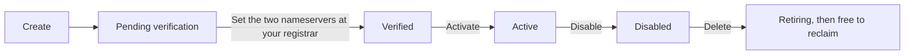

# Domains

<Screenshot name="app-domains" alt="The Domains list in the domain panel, showing the domains assigned to the signed-in user." />

A domain is the unit you own and manage: its DNS records, proxied hostnames,
certificates, and settings all belong to it. This page shows how to add one,
prove you control it, turn it on, and remove it.

**You need:** a domain name, and access to the registrar (or the parent zone, for
a subdomain) where its nameservers are set.

## The steps



Saving a change is not the same as the change being live. After each step, open
the domain's operation and check that DNS and the PoPs report the new revision.
See [Revisions and operations](../concepts/revisions-and-operations.md).

## 1. Create the domain

<DocTabs :labels="['Panel', 'API']">
<template #tab-1>

Open **Domains**, choose **Add domain**, enter the name, and save.

</template>
<template #tab-2>

```sh
curl -X POST "$CDNF_URL/api/domains" \
  -H "Authorization: Bearer $CDNF_TOKEN" \
  -H "Idempotency-Key: $(uuidgen)" \
  -H "Content-Type: application/json" \
  -d '{"name": "example.com"}'
```

The reply is `202 Accepted` with an operation ID.

</template>
</DocTabs>

**Expected result:** the domain appears as *Pending verification*, you are its
owner, and it needs no origin or certificate yet.

The name is normalized as an internationalized name (IDNA, so `münchen.de`
becomes its Punycode form) and checked against the Public Suffix List.
Platform and management names are reserved. Delegated subdomains and reverse
zones are allowed.

**If it fails:** a name that is already active or disabled for another user is a
duplicate. You can still claim it, as described in
[Competing claims](#competing-claims-and-takeover).

## 2. Set the nameservers

A worker gives your claim a pair of nameservers from the platform's pool. They
appear as **Assigned nameservers** on the domain page, and as
`assigned_nameservers` in the API. At the registrar, or in the parent zone for a
subdomain, set exactly those two names and no others.

<DocTabs :labels="['Panel', 'API']">
<template #tab-1>

Open the domain, copy the two assigned nameservers, and set them at your
registrar. Then choose **Verify nameservers**.

</template>
<template #tab-2>

```sh
curl "$CDNF_URL/api/domains/$DOMAIN_ID/status" -H "Authorization: Bearer $CDNF_TOKEN"
curl -X POST "$CDNF_URL/api/domains/$DOMAIN_ID/verify-nameservers" \
  -H "Authorization: Bearer $CDNF_TOKEN" -H "Idempotency-Key: $(uuidgen)"
```

</template>
</DocTabs>

**Expected result:** the claim status becomes `owner` and the domain is
*Verified*. The status can be:

| `claim_status` | Meaning |
| --- | --- |
| `awaiting_assignment` | No nameserver pair is assigned yet |
| `pending_delegation` | Waiting for you to set the nameservers |
| `owner` | Verified, you own the name |
| `expired` | The seven-day claim ran out |
| `superseded` | Another claim took the name |

There is no TXT challenge and no random label. The nameserver names are ordinary
hostnames with A and AAAA records.

**If it does not verify:**

1. Ask the parent zone directly, for example
   `dig NS example.com @<a parent nameserver>`. It must return exactly your two names.
2. Remove old DS records left from a previous DNS provider. CDNFoundry zones are not signed.
3. Wait for propagation, then verify again. Partial propagation never verifies.

Pending zones serve only SOA and NS records. A pending subdomain of a zone that
CDNFoundry already hosts is not published, so it cannot hide the parent's records.

### Limits

- One claim per name for each user, and at most 20 unverified claims per user.
- An unverified claim expires after seven days, even if you disable it. A
  verified owner never expires.
- The scheduler retires at most 500 expired claims a minute.
- One verification attempt has a 45-second DNS budget and a 60-second timeout.

### Automatic checks

You do not have to keep clicking **Verify nameservers**. Fleet checks a pending domain
by itself, at 1, 2, 5, 10, 15, and 30 minutes after the last attempt, then hourly for the
first day, then every six hours until the claim expires. When the nameservers match,
the domain verifies and activates, and you get a notification.

An active domain is checked again every 12 hours. If the parent zone shows different
nameservers on three checks in a row, an hour apart, the domain becomes **Pending
verification** with a "nameservers changed" notice. Its zone and edge settings stay in
place, and it is never removed for this. Set the assigned nameservers again and it
verifies and activates on its own. A lookup failure never counts as a change.

The domain page shows when it was last checked, when the next check is due, and the
nameservers that were seen.

## 3. Activate

<DocTabs :labels="['Panel', 'API']">
<template #tab-1>

Open the verified domain and choose **Activate**.

</template>
<template #tab-2>

```sh
curl -X POST "$CDNF_URL/api/domains/$DOMAIN_ID/activate" \
  -H "Authorization: Bearer $CDNF_TOKEN" -H "Idempotency-Key: $(uuidgen)"
```

</template>
</DocTabs>

**Expected result:** the domain is *Active*. DNS and PoP work continues in the
background.

**Check it worked:** query each authoritative server over UDP and TCP and compare
the SOA serials: `dig @<DNS host> example.com SOA`.

**If it fails:** activation needs verified nameservers and at least one enabled,
healthy DNS cluster. Fix those, then activate again.

## Registration expiry

Both panels show when the domain registration expires, looked up from the registry (RDAP)
about once a week. The date is orange inside the warning window (30 days by default) and
red when 7 days or fewer remain or the registration has expired. You get a reminder
when the window starts and at 14, 7, 1, and 0 days. Some registries publish no RDAP
service. The panel then shows **Unknown** and nothing else changes.

## Disable and delete

**Disable** keeps the last valid DNS and edge state for the window set by
`dns_lifecycle.deprovision_delay_days`. After that, the scheduler removes the
zone in bounded steps and retires the domain.

**Delete** is in the **Domain actions** menu on the domain page, and in the API as
`DELETE /api/domains/{domain}`. It asks for confirmation and states the delay before
the zone is removed. It starts retirement in the background. It does not remove the row at
once. Each PoP must acknowledge its tombstone first, and the name then stays
reserved for `domain_reclaim_cooldown_days` before anyone can reclaim it.

::: warning Never remove runtime files by hand
Do not delete PowerDNS zones, edge files, or cache directories to retire a
domain. Use disable and delete.
:::

## Competing claims and takeover

Asking first does not give you a name. Delegating it does.

- Anyone can claim a name that another user holds. The new claim gets its own
  nameserver pair, so a delegation left by the old owner can never verify it.
- While the claim is pending, the holder keeps full access and keeps serving. The
  holder never learns who asked. The applicant sees only their own claim, and
  the claim publishes no zone.
- A claim verifies only when the parent delegation equals its pair exactly. Only
  whoever controls the registrar can set that.
- When it verifies, the claimant takes the name in one locked step. The previous
  holder loses access. Their records, origins, and certificates do not move to
  the new owner. The audit log records `domain.taken_over`.
- A claim that expired, was cancelled, failed, or was superseded never changes
  ownership.

If no free pair is left, verification fails with `nameserver_pairs_unavailable`.
Ask an administrator to add a pair or retire a stale claim.

## For administrators

### Nameserver pairs

Set the pool under **System DNS identity → Customer
nameserver pairs**, or with `customer_nameserver_pairs` in the identity API. Use
one to eight pairs. Each pair is two different hostnames inside the platform
domain, with a public IPv4 address and optionally an IPv6 address. Offer at
least two pairs, because every competing claim needs a pair different from the
current delegation. A pair is reserved only when it is not the current
delegation, no other live claim holds it, and every enabled DNS cluster already
publishes it.

### Disputes

Add a pair, expire stale claims with `cdnf:domains:expire-claims`,
or delete a claim. An administrator cannot move ownership, except with the
audited force-verify action. Force-verify is an override. It is not evidence
that public delegation was checked.

### Backups

Keep the `delegation_nameservers` and `delegation_token` columns and
`platform_dns_settings.customer_nameserver_pairs` in your backups. Before you
onboard customers, deploy the platform zone and confirm every DNS host answers
for each pair hostname.

### Public Suffix List

A snapshot ships in `core/resources/data/public_suffix_list.*`.
Workers never download it at request time. To update it, replace both files from the
official [Public Suffix List](https://publicsuffix.org/list/), keep its MPL notice,
and run the normalization tests before release.
