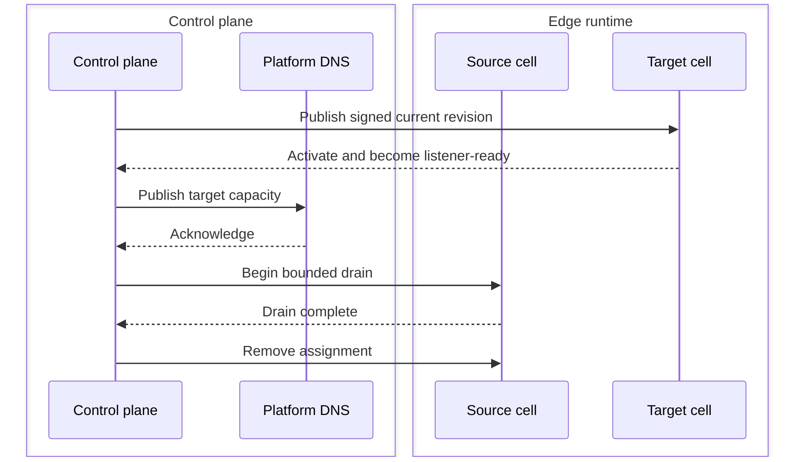

# Edges and placement

<Screenshot name="admin-edges" alt="The Edges list in the admin panel, showing each PoP with its status, location, heartbeat, and version drift." />

An edge is one point of presence (PoP): a host that serves traffic through bounded cells (OpenResty containers). This page shows how an administrator creates pools and edges, enrolls the edge agent, and moves domains. **You need:** administrator access and a host installed by Fleet.

| Concern | Durable/runtime boundary |
| --- | --- |
| Identity | Edge UUID plus short-lived mTLS certificate |
| Bootstrap | One-time token exchanged for persistent identity |
| Delivery | Signed incremental manifest or bounded recovery snapshot |
| Placement | Pool/cell state in PostgreSQL |
| Movement | Target acknowledged before source drain |
| Eligibility | Heartbeat, listener readiness, drain, emergency, and capacity |

::: warning Never clone identity state
An edge-agent volume belongs to one edge row and host. Restore it only to that
identity, or rotate the edge and enroll again.
:::

## Pools

Administrators create `shared`, `reserved`, `quarantine`, or `dedicated` pools. Pool names
become stable runtime names and cannot change after cells are provisioned.
Enabling a pool asynchronously provisions one cell per eligible edge in bounded
batches. Disabling removes it from new placement decisions without inventing a
per-domain runtime.

The standard production profile supplies `shared-default` and
`quarantine-default`. A dedicated pool requires an operator-owned Compose
override that repeats the bounded cell shape with unique ports and volumes.

## Edge rows

Create an edge in the admin panel (**Edges**) or with `POST /api/admin/edges`. You give it:

- a unique name;
- an ISO country code and a continent code.

Edges have no host addresses. Fleet knows where a host is. The control plane only knows the public service endpoints of pools. The agent opens control connections outbound to `EDGE_CONTROL_URL`. Every edge has eight cell slots, which the panel shows as fixed. Fleet can do the whole setup for you:
`cdnfoundry-fleet bootstrap --node NAME --country DE --continent EU`.

**Expected result:** the response shows an edge UUID and a bootstrap token once. Store them only until the agent enrolls. If you lose the token, rotate the identity (`POST /api/admin/edges/{edge}/rotate-identity`) to get a new one.

## Pool service endpoints

Cells do not own public addresses. Assign one or more bounded cells to a pool,
then create one pool endpoint on the edge with public IPv4, IPv6, or both. The
gateway binds those endpoint addresses and routes them to the pool's assigned
cells after agent acknowledgement. Endpoint addresses cannot equal management
addresses.

New edges begin with every cell unassigned. Creating a pool never assigns cells
to this or any other edge; all participation is an explicit administrator
choice.

For a Simple Anycast pool, configure the approved pair once on the pool and
assign its first cell on each intended edge. CDNFoundry automatically creates
that edge's addressless participation record, binds and publishes the inherited
pair, but never announces or withdraws BGP routes. Manual endpoint creation is
only for Geo-Unicast. See the
[Simple Anycast runbook](../operations/simple-anycast.md).

## Agent environment

The production profile supplies:

| Variable | Purpose |
| --- | --- |
| `EDGE_CONTROL_URL` | Mutual-TLS control URL |
| `EDGE_CONTROL_CA_CERTIFICATE` | Server trust anchor |
| `EDGE_ID` | UUID used for first enrollment |
| `EDGE_BOOTSTRAP_TOKEN` | One-time enrollment secret |
| `EDGE_STATE_DIR` | Persistent identity and acknowledgement directory |
| `EDGE_RUNTIME_DIR` | Persistent active/previous runtime snapshots |
| `EDGE_CELL_STATUS_URLS` | Internal cell status/control endpoints |
| `EDGE_STATUS_TOKEN` | Shared agent-to-cell control token |
| `EDGE_ONCE` | Optional one-cycle diagnostic mode; defaults to false |

Start the role explicitly with
`sudo docker compose --env-file .env.prod --profile edge up -d`, or add
`--profile edge` to the generated `start.sh` Compose command. The script does
not inspect enrollment state or edit `.env.prod`. Always keep the agent state
volume.

## Identity renewal

Edge identity certificates last `EDGE_IDENTITY_VALIDITY_DAYS` (default 365). At
two thirds of that lifetime the agent generates a new key, asks
`POST /edge/v1/identity/renew` over mTLS for a certificate, and authenticates
once with it. Until then control accepts both the old and the new certificate;
the first successful use makes the new one current and the old one invalid. The
agent stores the new identity only after that proof, resumes an unfinished
renewal after a restart, and retries a failed one every 10 minutes. The
heartbeat reports the expiry of the certificate in use, and
`EdgeIdentityCertificateExpiring` fires 30 days before it if renewal keeps
failing. A PoP whose certificate has already expired needs a new bootstrap
token.

## Promotion by quorum

A new placement is promoted when the healthy participating PoPs have
acknowledged it. `edge_runtime.promotion_quorum_percent` (default 100) is the
share of healthy participants that must acknowledge, and at least one always
must. A participant that has not acknowledged within
`edge_runtime.promotion_grace_seconds` (default 120) is lagging: it stops
counting, keeps its own cursor, and catches up without blocking the pool.
`cdnf:edge:promote-placements` walks every deploying placement each minute in
chunks, so a backlog of stuck placements cannot hide newer ones.

Automatic placement chooses only enabled, non-withdrawn pools of kind `shared`. Only an administrator moves a domain to a `quarantine`, `reserved`, or `dedicated` pool, and it stays there until an administrator moves it again. A proxied name is published in the zone before its placement is active. It follows the default shared pool until the placement is promoted, so MX, TXT, and every other record resolve right after activation.

## Drain and movement

Draining an edge or cell makes it ineligible for new publication and queues the
relevant runtime task. Moving a domain creates a target placement, delivers and
acknowledges the current revision there, updates DNS, waits
`edge_runtime.placement_drain_seconds`, then completes source drain.

Never delete the active source before the target is ready.

## A bad artifact affects one domain

The agent verifies and applies artifacts per domain. An artifact that fails
verification, schema checks, replay checks, or compilation is rejected and
skipped: the domain keeps its previous state, the cursor moves past it, and the
agent reports the rejection for that domain only. Every other domain in the
same batch still updates. If a batch fails only when its artifacts are combined
(for example two domains claim one hostname), the agent halves the batch until
the conflicting artifact stands alone and rejects only that one.

A failure that is not about the artifact (a full disk, an unreachable control
plane, a missing certificate key) rejects nothing. The sync fails, keeps the
previous state, and retries. The same rules apply to a full recovery snapshot,
so a new PoP serves every domain that compiles. Rejections are sent before the
applied sequence. The control plane marks that domain's placement failed, shows
the latest rejection on the edge, and clears it when the domain's next artifact
is acknowledged. The reason list is one file shared by the agent and the control
plane (`rejection_reasons.json`), and a refused acknowledgement is dropped
instead of holding back the later ones.

## Recovery

If the manifest gap is too large or local state is lost, the agent fetches
`/edge/v1/config/full`. It validates the signed gzip snapshot, builds candidate
pool files, preserves the previous active directory, and acknowledges only
after activation. Invalid snapshots remain rejected and visible.

For a new edge with no domain artifacts, the recovery snapshot is intentionally
empty and has sequence `0`. The agent still publishes an atomic bootstrap
generation and empty runtimes for configured cells. Later cell assignments and
the first pool endpoint replace that generation without requiring a customer
domain.
