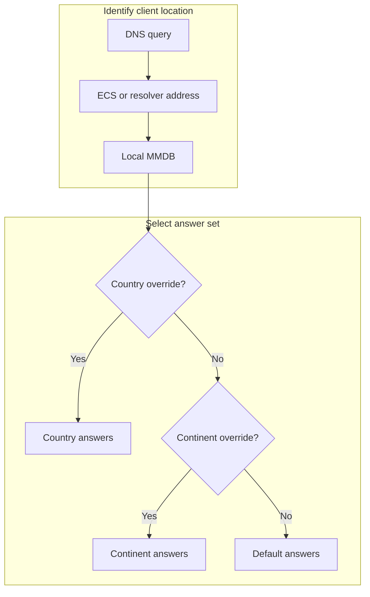

# Geo-DNS

Geo-DNS is a DNS record mode. It returns answers that you supply, chosen by the country or continent of the client. PowerDNS (the DNS server) picks the answer locally from the active zone and a GeoIP database on disk. A DNS query never calls the control plane or an outside GeoIP service.

**You need:** a domain with an active zone, and the answers you want per region.

::: danger Geo-DNS is not CDN edge routing
Geo-DNS changes DNS answers only. It does not proxy HTTP, choose an OpenResty cell, redirect a browser, apply security policy, or check that a target is healthy. Use service pools and pool endpoints for CDN edge placement. Do not use geography for authentication or access control.
:::

## Selection model

Every Geo-DNS record has a required default answer set. It can also have country and continent overrides. The same client location always gives the same answer:



For example, with country `IR`, continent `EU`, and default answer sets:

| Classified request | Selected set | Reason |
| --- | --- | --- |
| Country `IR`, continent `AS` | `IR` country answers | Country is most specific |
| Country `FR`, continent `EU` | `EU` continent answers | No `FR` override exists |
| Unknown country and continent | Default answers | Classification is unavailable |
| Country `US`, continent `NA`, with neither override | Default answers | No configured match exists |

If the location is unknown, the query still succeeds and gets the default set.

::: warning Resolver location and ECS
EDNS Client Subnet (ECS) is a DNS option that carries part of the client's address. Without ECS, the server usually sees only the recursive resolver, which may be far from the user. When a query has ECS, PowerDNS uses it. Any test client can send ECS, so treat it as a hint only. Previewing an IP does not show what a real resolver sends.

DNSdist is the only public DNS endpoint. It forwards the ECS option a resolver sent. When the query has none, it adds the client network (`/24` for IPv4, `/56` for IPv6) before the query reaches PowerDNS. PowerDNS therefore never classifies the private address of DNSdist.
:::

## Supported record types

Geo-DNS supports `A`, `AAAA`, `CNAME`, `MX`, `TXT`, `NS`, `SRV`, and `PTR`.
`CAA` remains DNS-only. Every target is normalized using the same rules as an
ordinary record of that type.

| Type | Geographic target values | Values that stay fixed on the record |
| --- | --- | --- |
| `A` | IPv4 addresses | None |
| `AAAA` | IPv6 addresses | None |
| `CNAME` | Canonical DNS names | None |
| `MX` | Mail exchanger names | Priority |
| `TXT` | Text values | None |
| `NS` | Nameserver names | Administrator-only delegation rules still apply |
| `SRV` | Service target names | Priority, weight, and port |
| `PTR` | Reverse target names | Reverse-zone ownership rules still apply |

An `A` set cannot hold IPv6 values and an `AAAA` set cannot hold IPv4 values. The platform expands relative names inside the zone. It stores fully qualified names with a trailing dot.

## Limits and validation

| Item | Bound |
| --- | ---: |
| Default answers | 1–8 targets |
| Country overrides | 0–64 distinct codes |
| Continent overrides | 0–7 distinct codes |
| Targets in each override | 1–8 unique, type-valid values |
| Target input | At most 4,096 characters before type normalization |

Country keys are uppercase ISO 3166-1 alpha-2 codes. Supported continent codes
are `AF`, `AN`, `AS`, `EU`, `NA`, `OC`, and `SA`. Duplicate targets are compared
case-insensitively and rejected. One Geo-DNS record must be the only record of
its type at that owner; normal CNAME coexistence and zone-boundary rules still
apply.

::: warning Default answers are mandatory
The default set is the fallback when the GeoIP (MMDB) data is missing, the address is unknown, the resolver sends no useful ECS, or no override matches. Do not use a placeholder or an unreachable address. Geo-DNS does not check target health and does not remove a failing target.
:::

## Configure

<DocTabs :labels="['Panel', 'API']">
<template #tab-1>

<div class="steps">

1. Open the domain in `/app` or the administrator domain resource.
2. Open **DNS records** and choose **Add record**.
3. Select a supported record type and set **Mode** to **Geo-DNS**.
4. Enter one to eight **Default answers**.
5. Add optional **Country overrides**. Choose the uppercase country code and
   enter that country's answer set.
6. Add optional **Continent overrides**. Country overrides always win when both
   match.
7. Enter TTL and the fixed MX or SRV numeric fields when applicable.
8. Save, then wait until every enabled DNS cluster acknowledges the domain's
   new desired revision.
9. Use the row's **Preview** action with a known IPv4 and IPv6 address. Record
   the displayed country, continent, and selected answers.

</div>

**Expected result:** the preview shows the country, the continent, and the answers you expect.

The platform checks the whole candidate in one transaction. It raises the domain revision only if something changed, writes an audit entry, and queues one DNS reconciliation after commit. Invalid input changes nothing.

</template>
<template #tab-2>

Create the record with the ordinary DNS-record endpoint. This example
returns an Iran-specific address, a Europe address for other European
countries, and the default everywhere else:

```http
POST /api/domains/42/dns/records
Authorization: Bearer TOKEN
Content-Type: application/json
Idempotency-Key: 810ddb0a-fc60-47b7-8c40-eb4d62ae87bd

{
  "type": "A",
  "name": "download",
  "ttl": 300,
  "mode": "geo_dns",
  "geo": {
    "default": ["203.0.113.10"],
    "countries": {
      "IR": ["203.0.113.30"]
    },
    "continents": {
      "EU": ["203.0.113.20"]
    }
  }
}
```

For an existing Geo-DNS record:

| Method and path | Purpose |
| --- | --- |
| `GET /api/domains/{domain}/dns/records/{record}/geo` | Read the normalized configuration |
| `PUT /api/domains/{domain}/dns/records/{record}/geo` | Replace the complete configuration; requires `Idempotency-Key` |
| `POST /api/domains/{domain}/dns/records/{record}/geo/preview` | Classify one supplied IP and show the selected targets |

Preview request:

```json
{"ip":"2001:db8::1"}
```

The response includes `ip`, nullable `country` and `continent`, the classification
`source` (`mmdb` or `unknown`), the selected `targets`, and a reminder that the live
classification may use the resolver instead of the end user.

</template>
</DocTabs>

## Runtime data and failure behavior

PowerDNS reads `/mmdb/GeoLite2-City.mmdb` from disk. The updater downloads a candidate, checks it with `mmdblookup`, optionally checks its configured SHA-256, and renames it into place in one step. If the download or the check fails, the previous valid database stays.

The DNS candidate holds only checked, bounded answer sets and the selection program. PowerDNS data comes from the desired state in PostgreSQL. If rendering, validation, the API, or activation fails, the platform records a failed deployment and keeps the previous active records. Do not edit the generated Lua record or the PowerDNS database.

::: info TTL controls change visibility
Resolvers may keep the old answer until its TTL (time to live) ends. After you change an override, first query the authoritative server directly. Then wait for the resolver cache TTL before you call the deployment failed.
:::

## Qualify before production

1. Preview one IP known to match a country override, one matching only a
   continent override, and one unknown/unconfigured address.
2. Query `EDGE_1` and `EDGE_2` authoritative DNS directly over UDP and TCP.
3. Test through at least three real recursive resolver or network vantage
   points. Record whether each query carried ECS.
4. In a controlled environment, compare a query without ECS with one carrying
   an explicit subnet:

   ```sh
   dig @DNS_ADDRESS download.example.com A +short
   dig @DNS_ADDRESS download.example.com A +subnet=CLIENT_ADDRESS/24 +short
   ```

5. Repeat for IPv6 when published, using an appropriate IPv6 prefix length.
6. Confirm both authoritative servers return the same selection for the same
   request context.
7. Inject or observe an unknown classification and require the default answer.
8. Confirm a failed MMDB update and a rejected DNS candidate preserve the last
   valid database and active answers.

::: danger A preview is not release evidence
The preview tests control-plane classification for the IP you supply. Production
qualification must include real authoritative queries from external networks,
both DNS transports, both authoritative hosts, resolver-cache behavior, and the
actual ECS policy of the recursive resolvers your users depend on.
:::

For symptom-based diagnosis, see [Troubleshoot DNS](../troubleshooting/dns.md#geo-dns-returns-unexpected-geography).
