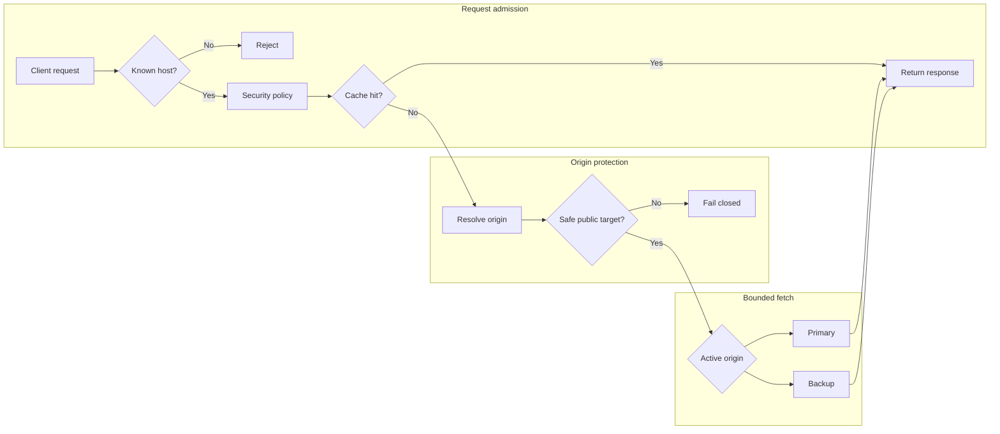

# Proxy and origins

A proxied hostname sends visitors to a CDNFoundry edge. The edge fetches content
from your origin server, the machine that holds the real site. This page shows
how to set an origin, add a backup, test both, and roll back.

**You need:** an active domain with verified nameservers, and an `A`, `AAAA`, or
`CNAME` record you want to proxy. Other record types cannot be proxied. A proxied
record's DNS value is managed by the platform. Do not treat it as the origin.

A hostname has one required primary origin and at most one optional backup. It
never has a weighted, percentage, geographic, or arbitrary origin pool. All cells
run the same shared, data-driven OpenResty runtime.



::: warning Private origins are not supported
Origins on private networks (RFC1918), loopback, link-local, metadata, platform
services, or the proxy itself are refused. Do not try to weaken the checks. An
administrator can allow narrow private networks (see
[Destination safety](#destination-safety)).
:::

## 1. Set the origin

<DocTabs :labels="['Domain panel', 'API']">
<template #tab-1>

Open the domain, then its DNS records. Add or edit an `A`, `AAAA`, or `CNAME`
record and set its mode to proxied. Fill **Origin server**, **Host header**, and
**TLS server name (SNI)**. Turn on **Enable backup origin** to add a backup.

</template>
<template #tab-2>

```sh
curl -X PUT "$CDNF_URL/api/domains/$DOMAIN_ID/dns/records/$RECORD_ID/origin" \
  -H "Authorization: Bearer $CDNF_TOKEN" \
  -H "Idempotency-Key: $(uuidgen)" \
  -H "Content-Type: application/json" \
  -d '{"host": "origin.example.net", "scheme": "https", "port": 443,
       "host_header": "www.example.com", "sni": "www.example.com",
       "verify_tls": true}'
```

</template>
</DocTabs>

**Expected result:** the record shows as proxied. CDNFoundry raises the domain
revision and queues an edge update. The control plane resolves and validates the
destination before it saves, so an unsafe origin is refused at this step.

### Origin fields

| Field | Rule |
| --- | --- |
| `host` | DNS hostname or IP address, up to 253 characters |
| `scheme` | `http` or `https` |
| `port` | One of the [allowed ports](#allowed-origin-ports) |
| `host_header` | Required. The `Host` value sent to the origin, up to 253 characters |
| `sni` | Required for verified HTTPS, up to 253 characters |
| `verify_tls` | Verify the origin certificate when the scheme is HTTPS |
| `connect_timeout_ms` | 100 to 10,000 ms |
| `response_timeout_ms` | 500 to 60,000 ms |
| `retry_count` | 0 to 2 |
| `websocket` | Allow WebSocket upgrade |
| `health_check` | Optional path and an interval of 60 to 86,400 seconds |
| `backup` | Optional origin with the same destination, TLS, header, and timeout rules |
| `failover.failure_threshold` | 1 to 20 consecutive primary failures |
| `failover.recovery_threshold` | 1 to 20 consecutive primary successes |
| `failover.hold_down_seconds` | 5 to 3,600 seconds |
| `failover.failback_delay_seconds` | 5 to 86,400 seconds |

## 2. Test the origin

<DocTabs :labels="['Domain panel', 'API']">
<template #tab-1>

In the DNS records list, choose **Test origin**, or **Test backup** for the backup.

</template>
<template #tab-2>

```sh
curl -X POST "$CDNF_URL/api/domains/$DOMAIN_ID/dns/records/$RECORD_ID/origin/test" \
  -H "Authorization: Bearer $CDNF_TOKEN" \
  -H "Idempotency-Key: $(uuidgen)" \
  -H "Content-Type: application/json" \
  -d '{"origin_role": "primary"}'
```

`origin_role` is `primary` (the default) or `backup`. Add `edge_ids` (up to 20
edge UUIDs) to choose recipients.

</template>
</DocTabs>

**Expected result:** an operation is queued ("Origin test queued" in the panel).
When it finishes, the origin health shows status, address, latency, HTTP status,
or a stable failure reason. Read it with
`GET .../origin/health`.

**If it fails:** tests need an active domain with verified nameservers and update
permission. Pending, disabled, and deprovisioning domains cannot start probes.
The test route is rate limited. Request a fresh test after DNS changes.

How a test works:

- Recipients are edges in the domain's placement. Naming any other edge returns
  `422`. With no list, the placement edges are used. At most 20 are allowed.
- The edge agent resolves the hostname again, validates every answer, and
  requires each to belong to the approved address set for that operation. A
  mix of safe and unsafe answers, new unapproved answers, or a failed lookup
  stops the probe. Literal IP origins are checked without a DNS query.
- A probe admits at most 64 approved addresses and 64 fresh DNS answers, connects
  to one approved address, never follows redirects, and caps response headers
  at 64 KiB. DNS is bounded by the connect timeout and at most three seconds.
  The response timeout covers the whole DNS, HTTP, and TLS operation.
- HTTPS reports `tls_result=verified` only when certificate verification is on.
  Otherwise it reports `unverified`.
- Dispatch and delivery recheck permission, lifecycle, and configuration.
  Obsolete pending tasks are cancelled. Retries keep their recipients.
- Editing an origin clears its old health. Late results for a changed origin stay
  in the operation history and do not replace current health.
- Old agent builds keep their old probe behavior until upgraded. Probes do not
  qualify public IPv6 paths or replace customer-traffic checks.

Scheduled health checks run only when you turn them on. The scheduler sends them
in batches of at most 100 per minute.

## Destination safety

The control plane, the edge agent, and OpenResty all refuse these IPv4 and IPv6
destinations: unspecified, loopback, link-local, multicast, metadata, reserved,
platform listener, edge-service, and proxy-loop addresses. An administrator can
block more networks or single addresses in platform settings.

Private destinations are refused unless they fall inside the narrow
`origin_safety.private_origin_allowlist`. That list never overrides a blocked
network or address. The shared-address range `100.64.0.0/10` also needs an
allowlist entry.

IPv6 transition ranges are refused, because each one embeds an IPv4 address that
could bypass the IPv4 rules: IPv4-compatible `::/96`, 6to4 `2002::/16`, Teredo
and the rest of the IETF block `2001::/23`, and the discard prefix `100::/64`.
IPv4-mapped IPv6 origins are refused too, in any spelling. Use the native IPv4
address instead. Address checks compare IPv6 values whether they are compressed
or expanded.

Native IPv6 origins work with HTTP and verified HTTPS. TLS SNI stays a DNS
hostname.

### Allowed origin ports

An origin may use only these ports: 80, 443, 2052, 2053, 2082, 2083, 2086, 2087,
2095, 2096, 8000, 8008, 8080, 8081, 8088, 8443, 8444, 8880, 8888, 9000, and 9443.
Any other port is refused with a validation error on `port`. The edge enforces
the same set when it connects and probes, so a stale or tampered snapshot cannot
aim an edge at a database or mail port. A test keeps the three copies of the list
equal.

### Resolution at request time

For customer traffic, OpenResty checks the full A and AAAA answer sets before it
picks an address.

- An empty answer for one address family is valid.
- A resolver error, an unsafe address, or an incomplete answer fails that origin
  attempt.
- The answer sections may hold at most 64 records, including CNAME records.
- The whole lookup, with retries and TCP fallback, has a three-second ceiling. It
  is lowered to the response timeout when that is smaller. Connection and
  response limits apply separately.
- Every uncached origin attempt resolves again, even when a keepalive connection
  exists.

The origin connection limit counts in-flight attempts for each domain and origin
role in a cell, including DNS lookup time. When the limit is full, the edge
returns `503`. Those rejections are not origin failures and do not trigger
failover. Removing a hostname from a cell stops new requests for it. Requests
already in flight still release their slots, so a later restore keeps its
capacity.

## Active-passive failover

Each OpenResty cell decides failover on its own and never calls Laravel while
serving. A cell normally uses the primary.

1. Consecutive DNS, connection, timeout, or 5xx failures reach
   `failure_threshold`. The cell switches to the backup.
2. The cell stays on the backup for the longer of the hold-down and the failback
   delay.
3. After `recovery_threshold` successful primary requests, it returns to the
   primary.

Cells may switch at slightly different times, because each uses its own bounded
evidence.

Retries use one budget per origin request. At most two extra attempts are made,
and the security retry limit or an emergency retry stop can lower that. A failed
attempt never renews the budget. Health and failover use the final upstream
response, so a successful retry is not an origin failure. Exhausting retries
records one failed request. Nginx still refuses to replay a POST that was
already sent to an origin.

Two response headers show what happened:

- `X-CDNF-Origin` is `primary` or `backup`.
- `X-CDNF-Origin-Transition` is `none`, `primary_failure_threshold`,
  `backup_failure`, or `primary_recovery_threshold`.

The authenticated cell status lists the active role, the reason, and the
failback time without destination secrets. Vector stores the role and reason with
request events.

When both origins fail, the cache stale window applies before the edge returns a
bounded upstream failure. Cache-only, stale-only, and maintenance policies keep
their precedence. The bounded stale-cache policy may also serve a cached response
after one origin failure.

## Proxy defaults

Domain proxy settings cover: enablement, HTTPS redirect, HTTP versions (`1.1`,
`2`), retry count, and an optional maintenance response. Platform `proxy_defaults`
fill any value the domain does not set. In the panel, choose **Proxy defaults** on
the domain. In the API, use `GET` and `PATCH /api/domains/{domain}/proxy`.
Settings are revisioned and delivered as signed artifacts.

OpenResty strips hop-by-hop input and controls `Host`, SNI, and forwarded
headers. It bounds request and response buffering, temporary storage, and origin
connections. See [Cache and purge](cache.md) for cache admission and stale
behavior.

## Deploy and roll back

Every origin or proxy change raises the domain revision and queues an edge
update. Read `/deployment` and `/revisions` under the domain to follow it.
`/revisions` returns only the revision number, status, checksum, creation time,
and a short summary (hostname count, TLS mode, pools). It never returns the stored
snapshot or certificate keys.

<DocTabs :labels="['Domain panel', 'API']">
<template #tab-1>

Choose **Rollback proxy revision**, pick a retained validated revision, and
confirm. The action shows only when an earlier validated revision exists.

</template>
<template #tab-2>

```sh
curl -X POST "$CDNF_URL/api/domains/$DOMAIN_ID/rollback" \
  -H "Authorization: Bearer $CDNF_TOKEN" \
  -H "Idempotency-Key: $(uuidgen)" \
  -H "Content-Type: application/json" \
  -d '{"revision": 7}'
```

</template>
</DocTabs>

Rollback creates a new, higher revision. It restores only customer-owned fields:
proxied records and origins, proxy defaults, cache, security settings and rules,
WAF level, and TLS mode. Platform policy is never copied back. Every restored
value is validated again against current rules.

**If it is refused:** the whole rollback is refused and nothing changes when:

- a restored value no longer passes (for example, an origin address that policy
  now blocks),
- a DNS-only A, AAAA, or CNAME record now uses a proxied hostname (MX, TXT, and
  other types may share the name), or
- a custom certificate is gone.

WAF exclusions are not restored. If a deployment fails, the previous valid edge
revision stays active.
