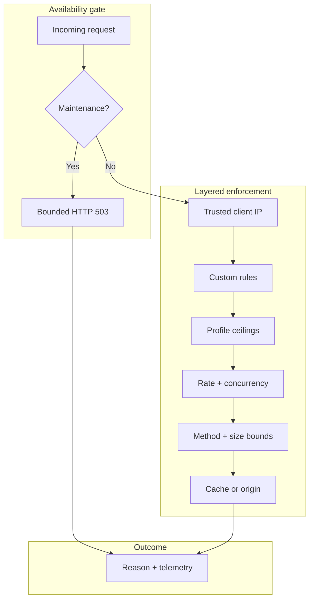

# Security and DDoS readiness

CDNFoundry gives each domain bounded application-layer controls: custom rules,
rate and connection limits, and incident actions. This page shows how to
use them and what each one does.

::: warning Not volumetric scrubbing
These controls do not absorb a flood that fills a host or an uplink. Such attacks
need upstream transit controls or provider scrubbing.
:::



| Layer | Purpose |
| --- | --- |
| Trusted-client parsing | Trust forwarded addresses only from configured proxies |
| Custom rules | Up to five typed conditions and one action per rule |
| Profiles | Fixed presets or bounded manual values |
| Readiness | Remove stale, drained, failed, or overloaded targets |
| Incident controls | Explicit actions for a domain, pool, cell, or edge |

For application attack detection, see [Managed WAF](managed-waf.md).

## Custom rules

**You need:** update rights on the domain.

A rule is up to five conditions that must all match, and one action. Rules are
typed: every condition is a field from a fixed list, an operator from a fixed
list, and a value. There are no regular expressions and no expression language.
The [custom rule reference](../reference/security-rules.md) lists every field,
operator, and action with examples, and complete recipes.

<DocTabs :labels="['Domain panel', 'API']">
<template #tab-1>

Open the domain, then **Custom rules**. **Add rule** opens a sheet with the
conditions, the action, and a "Reads as" line that shows the rule in words.
**Move up** and **Move down** change the order. To add many rules at once, use
the API's bulk import.

</template>
<template #tab-2>

```sh
curl -X POST "$CDNF_URL/api/domains/$DOMAIN_ID/security/rules" \
  -H "Authorization: Bearer $CDNF_TOKEN" \
  -H "Idempotency-Key: $(uuidgen)" \
  -H "Content-Type: application/json" \
  -d '{
    "name": "Admin from abroad",
    "conditions": [
      {"field": "path", "operator": "starts_with", "value": "/admin"},
      {"field": "country", "operator": "not_equals", "value": "DE"}
    ],
    "action": "block", "priority": 100
  }'
```

`POST .../security/rules/preview` validates a rule and returns it normalized with
its position, without saving it. `PUT .../security/rules/order` takes the full
list of rule IDs in the new order. Bulk import is `POST .../security/rules/import`.

</template>
</DocTabs>

**Expected result:** the rule is saved, the domain revision rises, and the edges
receive a new signed revision.

### Fields and operators

| Field | Operators | Value |
| --- | --- | --- |
| `hostname`, `path`, `user_agent`, `referer`, `content_type` | equals, not equals, starts with, ends with, contains, in list | Text, up to 512 characters |
| `header` (with `name`) | the same | Text. The header name is case-insensitive |
| `query_present`, `cookie_present` (with `name` for the cookie) | equals | `true` or `false` |
| `method` | equals, not equals, in list | `GET`, `HEAD`, `POST`, `PUT`, `PATCH`, `DELETE`, `OPTIONS` |
| `country`, `continent` | equals, not equals, in list | A supported code |
| `asn` | equals, not equals, in list, greater than, less than | 0 to 4294967295 |
| `client_ip` | equals, not equals, in list | An IPv4 or IPv6 address or CIDR |
| `body_size` | equals, not equals, greater than, less than | Bytes, up to 1 GiB |
| `referer_host` | equals, not equals, in list, not in list | The host of the Referer header, such as `www.example.com` |
| `referer_present` | equals | `true` when the request has a Referer with an address |
| `file_extension` | equals, not equals, in list, not in list | The extension of the path in lower case, without the dot |
| `tls_version` | equals, not equals, in list | `TLSv1`, `TLSv1.1`, `TLSv1.2`, `TLSv1.3`, or `none` for plain HTTP |
| `attack_score`, `attack_score_sqli`, `attack_score_xss`, `attack_score_rce` | equals, not equals, in list, greater than, less than | 1 to 99 |
| `prompt_injection_score` | equals, not equals, in list, greater than, less than | 1 to 99 (see AI prompts) |
| `prompt_pii` | equals | `true` when the prompt holds personal data (see AI prompts) |
| `schema_violation` | equals, not equals, in list, not in list | `any`, `none`, `unknown_path`, `wrong_method`, `missing_parameter`, `invalid_parameter`, or `body_too_large` (see API schema) |
| `leaked_password` | equals | `true` when the password sent to a login path is in the leaked-password set (see below) |

Hostname, user agent, referer, header, and content type compare without regard to
case. Path compares exactly and uses the decoded request path without the query
string. A visitor whose country, continent, or ASN is unknown never matches
"equals" or a comparison, and does match "not equals".

### Leaked passwords

A detection never blocks by itself: it sets a field, and a custom rule decides what
to do with it. `leaked_password` is set for login requests only.

1. Name the login paths of the domain (up to 5 exact paths such as `/api/login`),
   the body format (form fields or a JSON object), and the field that holds the
   password. A JSON field may be nested with dots, such as `user.password`. The
   username field is recorded for reference and is not read.
   `PUT /api/domains/{domain}/security/credential-check` saves the paths and
   `DELETE` removes them. Saving is one signed revision and returns `202`.
2. On a `POST`, `PUT`, or `PATCH` to one of those paths, the cell reads at most the
   first 8 KiB of the body, hashes the password, and looks the first 8 bytes of the
   hash up in a leaked-password set held in fixed shared memory. The set is built
   from a list that ships inside the cell image of the release. It is never
   downloaded at runtime and is never changed by a domain.
3. Add a custom rule on `leaked_password` equals `true` with the action `log`,
   `challenge`, or `block`.

The password and its hash are never logged, stored, or sent anywhere. A request is
read only while a rule of the domain or a platform ruleset uses `leaked_password`.
A request that is not a login request, or whose password could not be read, leaves
the flag unset, so neither a `true` nor a `false` condition matches it. The set is
a short list of the most common leaked passwords; it is not a full breach corpus.

### Sensitive data in responses

`PUT /api/domains/{domain}/security/sensitive-data` with `kinds` (any of `card`,
`iban`, `private_key`, `api_key`) makes the cell read the first 16 KB of text
responses (`text/*`, JSON, XML, JavaScript) and record one security event per kind
found: `sensitive_data_card`, `sensitive_data_iban`, `sensitive_data_private_key`,
or `sensitive_data_api_key`. `DELETE` turns it off.

- It only logs. The response is not changed or delayed, and nothing blocks.
- Card numbers need a valid Luhn check and a leading digit from 3 to 6. IBANs need
  a known country, its length, and the mod 97 checksum. API keys are AWS access
  keys, GitHub personal tokens, Stripe live keys, Slack tokens, and Google API keys.
- The matched value is never stored, logged, or reported. The security event holds
  the kind and a count only, so Security events show that a kind was found, not the
  value.
- Compressed origin responses and other content types are not read.
- The events do not count toward automatic state changes or the security alert.

### AI prompts

`PUT /api/domains/{domain}/security/ai-protection` names up to five `endpoints`
(exact paths) and the JSON `prompt_field` (dots for a nested field, such as
`input.prompt`). On a `POST` or `PUT` to one of them the cell reads at most the
first 16 KB of the body and sets two fields for custom rules:

- `prompt_injection_score`: 99 when no known injection phrase is present, 29 for
  one phrase, and 1 for two or more. It matches a fixed list of phrases such as
  "ignore previous instructions" and "reveal your system prompt", without regard to
  case or spacing. Use a rule `prompt_injection_score less than 30` to log or block.
- `prompt_pii`: `true` when the prompt holds an email address, a payment card
  number, an IBAN, or a US social security number.

This is pattern based. It does not understand a prompt, it misses rephrased or
translated attacks, and it can match a prompt that quotes an attack phrase. A
prompt field that is a list of messages is read from each message's `content`.
Prompts are never stored or logged. A request that is not to one of the endpoints,
or whose prompt cannot be read, leaves both fields unset.

### API schema

`PUT /api/domains/{domain}/security/api-schema` takes an OpenAPI 3 document as JSON
in `document`, a `base_path` (default `/`), and a `maximum_body_bytes` for JSON
bodies (default 65,536, at most 1,048,576). The control plane keeps only a table of
paths, methods, and parameters, and sends it to the cells in the signed snapshot.
The document is limited to 256 KB and 200 operations, with at most 20 parameters per
operation. Only references to `#/components/parameters/Name` inside the document are
followed. YAML is not accepted, and an invalid document is refused with a message
that says what is wrong while the previous table stays active.

For every request under `base_path` the cell sets `schema_violation` to the first of:

| Value | Meaning |
| --- | --- |
| `unknown_path` | No path in the document fits. A `{name}` part matches exactly one segment |
| `wrong_method` | The path exists but not for this method (`HEAD` follows `GET`, and `OPTIONS` is never a violation) |
| `missing_parameter` | A required path, query, or header parameter is absent |
| `invalid_parameter` | A parameter does not fit its type (`integer`, `number`, `boolean`) |
| `body_too_large` | A request with a JSON content type is larger than `maximum_body_bytes` |
| `none` | The request fits the schema |

Each violation is also counted as a security event (`schema_unknown_path` and so on)
that never moves the domain toward a stricter automatic state. Nothing is blocked by
the schema alone: review the events, then add a rule such as `schema_violation equals
any` with the action block. Request bodies are checked for size only, never for their
fields, cookie parameters are ignored, and requests outside `base_path` are never
checked.

### Client-side security

`PUT /api/domains/{domain}/security/client-side` turns on script reporting.
`maximum_reports_per_minute` (10 to 600, default 120) bounds what one cell accepts
for the domain, and `baseline_minutes` (0 to 1,440, default 60) is the window after
turning it on in which what browsers report is approved at once.

The cell adds `Content-Security-Policy-Report-Only: script-src 'none'; connect-src
'none'; report-uri /.cdnf/csp-report` to HTML responses that carry no report-only
policy of their own. The policy only reports and blocks nothing. Browsers send a
report for each script and connection they would have blocked, to the reserved path
`/.cdnf/csp-report`. The cell reduces a report to its type, the page path (no query
string), and the origin of what was loaded, and discards the rest. Reports for other
hosts or other directives are dropped, and the path answers `204` to every report
that fits the size limit (4 KB) so the page learns nothing. Reports travel through
Vector into ClickHouse with the request log.

A scheduled sync (`cdnf:client-security:sync-scripts`, every minute) records each
page and origin once with the day it was first seen. The first window is the
baseline. After it, a new script or connection is marked **New**, listed in the
domain's **Scripts and connections** tab, and sent as one `client_script.new`
notification per run (see [notifications](notifications.md)). Approving an entry,
or all of them, changes only the list: nothing is enforced and no cell is told.
`GET /api/domains/{domain}/security/client-side/scripts` lists them with cursor
pagination, and `POST .../scripts/approve` or `.../scripts/{id}/approve` approves.

Limits: up to 1,000 entries per domain, and anyone can send a report for your domain,
so a fake entry is possible and a missing one proves nothing. The list shows what
browsers reported, not every script on a page, and inline scripts appear as `inline`.
An enforced policy built from the approved list is not offered.

### Measured results

From `tests/e2e/detections.py` on one cell with a real origin, 150 requests per
case on a development host (not a capacity figure):

| Detection | Result |
| --- | --- |
| Leaked password, JSON and form | A known password sets the flag, a fresh one does not, and no log holds either |
| Sensitive data | Each of the four kinds recorded once; a clean page, a timestamp, an order number, and a binary type recorded nothing |
| Injection score | 6 of 6 known injection prompts below 30; 0 of 20 clean prompts below 30 |
| Median request time | Login 10.6 ms without and 10.7 ms with the check; prompt 9.7 ms and 10.1 ms; response 7.9 ms and 8.7 ms |

The clean sample is 20 prompts written for the test, so it shows that ordinary
requests pass and not a false positive rate on real traffic.

### Attack score

Every request the managed WAF inspects gets a score from 1 (attack) to 99 (clean).
It is 99 minus five points for each anomaly point the OWASP Core Rule Set adds,
never below 1, so a request that trips several rules scores near 1 and a clean
request scores 99. `attack_score` counts every category. The three other fields
count only SQL injection, cross-site scripting, or command injection signs.

- A custom rule on `attack_score < 20` blocks requests that are very likely
  attacks, in any profile. It runs before the managed rules and can also `log`
  or `challenge`.
- The Observe profile scores and logs without blocking. The score is stored on
  every request event as `attack_score` and its three category fields (0 means the
  request was not scored).
- A domain whose WAF profile is Off is scored only while a custom rule uses an
  attack score field, at paranoia level 1, and is never blocked by the managed
  rules.
- A request that could not be scored never matches an attack score condition. A
  body larger than the profile's body limit is not sent for scoring, so only its
  headers and address count.
- Scoring happens once per inspected request on the cell, over a loopback
  listener, and never calls Laravel or any outside service. A blocking profile
  refuses a request at its anomaly threshold from the same score, before the
  request is inspected again on its way to the origin.

### Rate-limit rules

A rate-limit rule is a custom rule that also counts. Turn on **Limit the request
rate** in the rule sheet, or send a `rate_limit` object in the API:

```json
{"conditions": [{"field": "path", "operator": "equals", "value": "/login"}],
 "action": "block", "priority": 10,
 "rate_limit": {"key": "client_ip_path", "threshold": 20, "period_seconds": 60, "duration_seconds": 300}}
```

- `key` is what one client is: `client_ip`, `client_ip_path` (the address on one
  path), or `header` with a `header_name` such as `X-Api-Key`. A request without
  that header is not counted.
- `threshold` requests per `period_seconds` (10, 60, or 600) is the allowance.
  The 21st request in the example goes over.
- Past the allowance the action applies to that key for `duration_seconds` (10 to
  86400), then the key is released and starts again with a fresh allowance.
- The action is `block` (answers 429, `custom_rule_rate_limited`), `challenge`, or
  `log`.
- A rate-limit rule with no conditions counts every request of the domain. Only a
  rate-limit rule may have no conditions.
- Rate-limit rules run after the domain's other custom rules and before the
  managed WAF. A client that an `allow` rule trusts is not counted.
- **Counts are per cell.** Each cell counts on its own with fixed time windows,
  so this is not a global count across locations. Over several cells a client can
  send up to the threshold on each one.
- A domain may have 20 rate-limit rules (a platform setting, never above 50). The
  counters live in fixed shared memory on the cell; when it is full, requests are
  let through, never blocked.

### Presets: user agents and hotlinks

Two presets write ordinary custom rules, so they follow the same order, limits,
and revisions as any rule. In the panel they are under **Presets** on the rules
tab. In the API they are `PUT` and `DELETE` on
`/api/domains/{domain}/security/presets/user-agent` and `.../hotlink`, and
`GET .../security/presets` reads them back.

- **User agents.** A list of up to 50 words and an action, `block` or `challenge`.
  Each word becomes one rule that matches when the user agent contains it, without
  regard to case. Saving again replaces the whole set in one revision.
- **Hotlink protection.** A list of file extensions and a list of allowed referer
  hosts. One rule blocks requests for those extensions that carry a Referer from
  any other host. Your own domain and its `www` form are always allowed, and a
  request with no Referer is never blocked. Hosts match exactly, so list each one
  you want, such as `www.partner.example`. The port and any user name in the
  Referer are ignored.
- A preset rule that you edit by hand becomes an ordinary rule, and the preset no
  longer lists it. Deleting a preset removes only its own rules.

### Platform rulesets

**You need:** an administrator account.

A platform ruleset is a named set of custom and rate-limit rules that an
administrator applies to every domain or to a list of domains. It uses the same
fields, operators, actions, and bounds as a domain's own rules, and it runs
before them.

<DocTabs :labels="['Admin panel', 'API']">
<template #tab-1>

Open **Operate → Platform rulesets**, choose **New ruleset**, and name it. Turn on
**Apply to all domains**, or search for the domains to include. Save, then add
rules on the ruleset page with **Add rule**. The sheet is the same one a domain
uses, including the rate limit.

</template>
<template #tab-2>

```sh
curl -X POST "$CDNF_URL/api/admin/platform-rulesets" \
  -H "Authorization: Bearer $CDNF_TOKEN" -H "Idempotency-Key: $(uuidgen)" \
  -H "Content-Type: application/json" \
  -d '{"name": "Known scanner paths", "domain_ids": [12, 34]}'

curl -X POST "$CDNF_URL/api/admin/platform-rulesets/$RULESET_ID/rules" \
  -H "Authorization: Bearer $CDNF_TOKEN" -H "Idempotency-Key: $(uuidgen)" \
  -H "Content-Type: application/json" \
  -d '{"conditions": [{"field": "path", "operator": "starts_with", "value": "/wp-admin"}], "action": "block", "priority": 10}'
```

`PATCH /api/admin/platform-rulesets/{id}` changes `enabled`, `applies_to_all`, or
`domain_ids`. `DELETE` removes the ruleset. Rules have their own `GET`, `PATCH`,
and `DELETE` under `.../rules`.

</template>
</DocTabs>

**Expected result:** every change answers `202` with an operation ID. The
operation recompiles the edge bundle of each domain the change reached, 500
domains at a time on the bulk lane, and the cells receive the new signed
revision. Disabling or deleting a ruleset takes its rules away from every domain
it reached.

- Platform rules run first, ordered by ruleset and then by priority. Only `block`
  and `allow` end evaluation, as for domain rules. A platform `allow` also stops
  the domain's own rules for that request, and a platform block holds even where a
  domain rule would allow the request.
- A platform rate limit counts per cell, like a domain's.
- The cell records `platform_rule_block`, `platform_rule_challenge`,
  `platform_rule_log`, and `platform_rule_rate_limited`. They never raise a
  domain's automatic security state.
- Domain owners see the names and descriptions of the rulesets that apply, and how
  many requests platform rules matched in the last 24 hours, on the domain's
  **Custom rules** tab and at `GET /api/domains/{id}/security/platform-rulesets`.
  They never see a platform rule's conditions.
- Up to 10 rulesets, 100 rules per ruleset, and 500 listed domains per ruleset.

### Security events

**You need:** view rights on the domain.

The **Security events** tab lists the requests that a custom rule, a platform
ruleset, or the managed firewall blocked, and the requests a rule logged. Each row
shows the time, the rule that acted, the action, the attack score, the path, and the
country. The network, user agent, and request ID columns are available from the
column menu.

- **Filters.** Narrow the list by action, rule reference (`r12` for a rule of this
  domain, `p5` for a platform rule, `waf` for the managed firewall), attack score,
  path, country, ASN, user agent, or request ID. The API is
  `GET /api/domains/{domain}/security/mitigations`, with the same filters.
- **Create rule** opens the rule sheet with the request's path, country, network,
  and user agent as conditions and Block as the action. Remove the conditions that
  should not matter before you save.
- **Create exception** opens the same sheet with a rule that lets such requests
  through. For a rule of your own, the exception runs just before it. For the
  managed firewall it skips the managed rules for that path. It is not offered for a
  platform rule, because platform rules run before the domain's own rules.
- A platform rule is named by its ruleset only. Its conditions are never shown.

**What the list is.** The list is built from stored request events: the newest 500
mitigated requests of the last 24 hours, kept for 7 days. During a large attack
that is a sample, not every request. The counts in **Analytics and logs** and the
event counters that drive alerts come from the cells' own counters and rollups and
are not limited to 500. The client address is shown masked to the network.

### Security alerts

**You need:** update rights on the domain, and a notification channel that receives
the event (see [Notifications](notifications.md)).

An alert tells you when your rules and the managed firewall block a lot of
requests. Open the domain, choose **Security, Security alert**, enter how many
blocked requests should trigger it and over 5, 10, or 15 minutes, and save. The API
is `PUT /api/domains/{domain}/security/alert` with `threshold` (1 to 1,000,000) and
`period_minutes`; `DELETE` removes it and `GET` reads it.

- The count is the blocked, challenged, and rate-limited requests that all cells
  report for the domain, from custom rules, platform rulesets, and the managed
  firewall. Requests that a rule only logs are not counted.
- **One alert per attack.** After an alert the domain stays quiet for an hour, even
  while the attack continues, then alerts again if the count is still over the
  threshold. The check runs every minute.
- The notification names the domain, the count, and the period. It goes to
  administrator channels and to the channels of users assigned to the domain that
  chose the event **Mitigated requests above threshold**.

### Actions

| Action | Effect |
| --- | --- |
| `block` | Answers 403 (`custom_rule_block`). |
| `challenge` | Asks a browser for the same short proof of work as the incident profile. A solved challenge lasts one hour. Scripts without a token get 403. |
| `log` | Records a `custom_rule_log` security event and continues. |
| `allow` | Stops evaluating custom rules and skips the challenge. |
| `skip_managed` | Turns the managed WAF off for matching requests. Body size limits still apply. |

### How rules run

- A lower priority number runs first. The rule ID breaks ties. Disabled rules are
  ignored. Only `block` and `allow` end evaluation; the other actions let later
  rules run.
- A domain may have up to 1,000 rules, a list condition up to 100 values, and one
  import up to 500 rules. The list limit is a platform setting that can only be
  lowered.
- A rule with the same conditions and action as another rule of the domain is
  refused. An import normalizes every rule, rejects duplicates, and can append to
  or replace the existing set in one revision.
- A rule the cell cannot read (no conditions, more than five, or an unknown field)
  never matches and never stops the cell.
- Custom rules never count against the domain: `custom_rule_block`,
  `custom_rule_challenge`, and `custom_rule_log` are recorded but do not raise the
  automatic security state.

::: warning Upgrading from 1.x
The old IP, CIDR, country, and continent rules are converted in place by one
migration, keep their IDs and priorities, and become one condition each. The old
rule shape is gone from the API. The migration cannot be reversed, so run it as
an explicit upgrade step with a database backup.
:::

## Profiles

A profile sets the ceilings for request rate and burst, client and domain
connections, TLS handshakes, body and header size, timeouts, keepalive, request
duration, origin concurrency and retries, cache key length, and cache admission.

- `standard`, `protected`, and `quarantine` are fixed platform ceilings.
- `manual` accepts values up to the standard ceiling. It cannot exceed platform
  capacity policy.

Choose **Security profile and limits** on the domain, or use
`PATCH /api/domains/{domain}/security`. The exact ceilings are in
[Limits](../reference/limits.md).

TLS handshakes are limited in two places. The edge gateway sees the real client
address. It allows each client prefix (one IPv4 address or one IPv6 /64) at most
the profile's per-second budget of new TLS connections per hostname. One client
cannot spend the budget other clients of the domain need. The cell adds a
separate, higher ceiling for the whole domain, 20 times that budget.

## Security state

A domain's security state is `normal`, `suspected`, `restricted`, `quarantined`,
or `recovering`. Two sources set it, and the domain shows the stricter of the two.

- **Operator state.** Administrator actions (quarantine, return to normal) are
  desired configuration. Each one is a configuration revision with an
  author, and it is delivered in the signed domain snapshot.
- **Automatic state.** Agent heartbeats carry a bounded set of noisy-domain summaries
  and reason codes. When the rate of events crosses a threshold, the platform moves
  the domain to `suspected` or `restricted` on its own. This is not a configuration
  revision and never changes the snapshot. It travels to the edges as a small
  per-domain overlay with its own increasing sequence, the way purge epochs travel.
  A cell enforces the stricter value of the snapshot and the overlay for every limit,
  keeps the overlay across a restart because the agent replays it, and ignores an
  overlay with an older sequence.

The rate is the number of events in the last five minutes: `suspected` at 50 or more,
and `restricted` at 100 or more when the domain's quarantine policy is automatic. It
is measured as the increase since the previous report, not as the cell's lifetime
counter, so a counter that keeps growing or restarts does not trigger a change. A
domain moves back one step (`restricted` to `recovering` to `normal`, or `suspected`
to `normal`) after ten minutes without a new event. A domain an operator has
restricted or quarantined is never changed automatically.

A domain's own protections never count against it. A request refused by a customer
custom rule (`custom_rule_block`) or an operator restriction (`domain_restricted`), a method restriction (`invalid_method`), an
emergency mode (`edge_emergency_mode`), an incident profile refusal (`incident_method`,
`incident_body_size`, `challenge_required`, `challenge_invalid`), or an unknown host or SNI is
still recorded as an event, but it does not raise the rate.

Edge-reported security events keep one row per domain, edge, reason, and hour, and a
daily job deletes events beyond `security_event_retention_days`. Every automatic
change is written to the audit log with its cause, and the domain's **History** tab
lists operator actions and automatic changes separately, with a filter. A returned
state shows in the API as `automatic_state`, `configured_state`, and the stricter
`state`.

Quarantine uses the normal placement protocol: CDNFoundry delivers the domain to
the quarantine pool, publishes its addresses, then drains the shared source.

## Incident controls

Each scope has only controls with clear runtime behavior. A cell enforces seven
emergency actions and rejects any other name with `400`, so it never reports a
protection that does nothing. The seven are `disable_request_bodies`,
`allow_get_head_only`, `disable_origin_retries`, `serve_cache_only`,
`serve_stale_only`, `return_maintenance_response`, and `disable_compression`.

| Scope | Control | Who | Effect |
| --- | --- | --- | --- |
| Domain | **Under attack mode** | Domain owner | For a chosen time: tighter limits, the WAF blocking at high sensitivity, restricted methods and body size, and a browser challenge. See [Incident response](incident-response.md). |
| Domain | **Quarantine domain** | Administrator | Deploys the domain to the quarantine pool, target first. |
| Domain | **Start maintenance** | Domain owner | Returns the configured HTTP 503 for that domain only. |
| Edge | Drain | Administrator | Stops new placement and traffic for that edge. |
| Cell | Drain, Restart | Administrator | Removes one cell from readiness, or restarts it. |
| Pool | Maintenance | Administrator | Returns HTTP 503 from the pool's cells until its required expiry. |
| Pool | Withdraw | Administrator | Removes the pool from gateway and DNS publication. It does not control BGP. |

Under attack mode is `POST /api/domains/{domain}/incident` (and `DELETE` to end it).
Quarantine is `POST /api/admin/domains/{domain}/quarantine`, reversed by `.../return-to-normal`. Pool actions
include `POST /api/admin/edge-pools/{pool}/maintenance` and `.../withdraw`.

The WAF detects common application attacks all the time, at the domain's Off,
Observe, Recommended, or High sensitivity choice. Under attack mode raises it to
blocking at high sensitivity only while it is on.

### Recover

Use the inverse action: **Return to normal**, **End maintenance**, **Undrain**,
or **Restore** (pools: `DELETE .../maintenance` and `POST .../restore`; domains:
`POST .../return-to-normal`).

Pool maintenance is stored in PostgreSQL, sent as durable per-edge tasks only to
assigned cells, audited, and expires on its own. Domain maintenance is part of the
normal signed domain revision. A failed deployment therefore keeps the previous
valid edge snapshot.

The old `quarantine_domain` pool and edge flag is gone. It had no domain identity
and could not change placement. Quarantine is only the explicit domain action.
