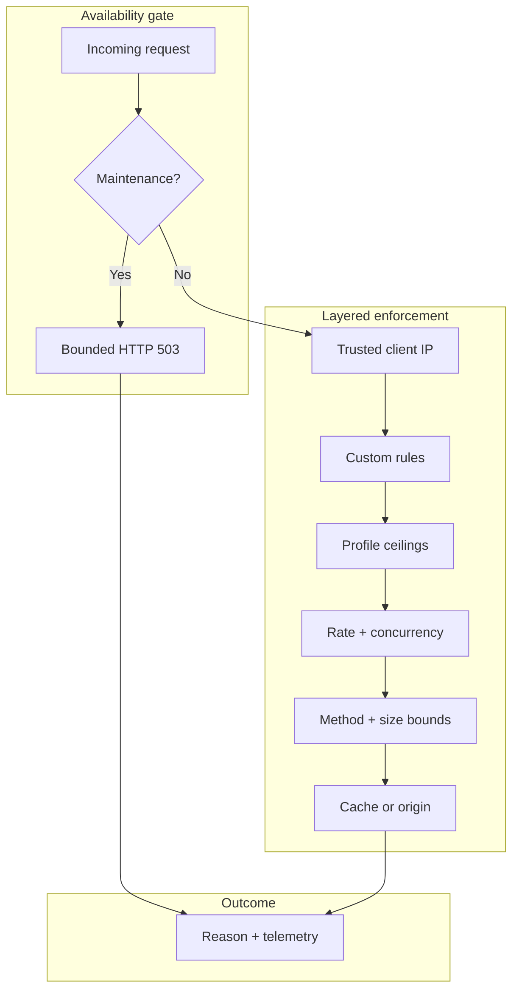

# Security and DDoS readiness

CDNFoundry gives each domain bounded application-layer controls: custom rules,
rate and connection limits, and incident actions. This page shows how to
use them and what each one does.

::: warning Not volumetric scrubbing
These controls do not absorb a flood that fills a host or an uplink. Such attacks
need upstream transit controls or provider scrubbing.
:::



| Layer | Purpose |
| --- | --- |
| Trusted-client parsing | Trust forwarded addresses only from configured proxies |
| Custom rules | Up to five typed conditions and one action per rule |
| Profiles | Fixed presets or bounded manual values |
| Readiness | Remove stale, drained, failed, or overloaded targets |
| Incident controls | Explicit actions for a domain, pool, cell, or edge |

For application attack detection, see [Managed WAF](managed-waf.md).

## Custom rules

**You need:** update rights on the domain.

A rule is up to five conditions that must all match, and one action. Rules are
typed: every condition is a field from a fixed list, an operator from a fixed
list, and a value. There are no regular expressions and no expression language.

<DocTabs :labels="['Domain panel', 'API']">
<template #tab-1>

Open the domain, then **Custom rules**. **Add rule** opens a sheet with the
conditions, the action, and a "Reads as" line that shows the rule in words.
**Move up** and **Move down** change the order, and **Import rules** adds many.

</template>
<template #tab-2>

```sh
curl -X POST "$CDNF_URL/api/domains/$DOMAIN_ID/security/rules" \
  -H "Authorization: Bearer $CDNF_TOKEN" \
  -H "Idempotency-Key: $(uuidgen)" \
  -H "Content-Type: application/json" \
  -d '{
    "name": "Admin from abroad",
    "conditions": [
      {"field": "path", "operator": "starts_with", "value": "/admin"},
      {"field": "country", "operator": "not_equals", "value": "DE"}
    ],
    "action": "block", "priority": 100
  }'
```

`POST .../security/rules/preview` validates a rule and returns it normalized with
its position, without saving it. `PUT .../security/rules/order` takes the full
list of rule IDs in the new order. Bulk import is `POST .../security/rules/import`.

</template>
</DocTabs>

**Expected result:** the rule is saved, the domain revision rises, and the edges
receive a new signed revision.

### Fields and operators

| Field | Operators | Value |
| --- | --- | --- |
| `hostname`, `path`, `user_agent`, `referer`, `content_type` | equals, not equals, starts with, ends with, contains, in list | Text, up to 512 characters |
| `header` (with `name`) | the same | Text. The header name is case-insensitive |
| `query_present`, `cookie_present` (with `name` for the cookie) | equals | `true` or `false` |
| `method` | equals, not equals, in list | `GET`, `HEAD`, `POST`, `PUT`, `PATCH`, `DELETE`, `OPTIONS` |
| `country`, `continent` | equals, not equals, in list | A supported code |
| `asn` | equals, not equals, in list, greater than, less than | 0 to 4294967295 |
| `client_ip` | equals, not equals, in list | An IPv4 or IPv6 address or CIDR |
| `body_size` | equals, not equals, greater than, less than | Bytes, up to 1 GiB |
| `tls_version` | equals, not equals, in list | `TLSv1`, `TLSv1.1`, `TLSv1.2`, `TLSv1.3`, or `none` for plain HTTP |

Hostname, user agent, referer, header, and content type compare without regard to
case. Path compares exactly and uses the decoded request path without the query
string. A visitor whose country, continent, or ASN is unknown never matches
"equals" or a comparison, and does match "not equals".

### Actions

| Action | Effect |
| --- | --- |
| `block` | Answers 403 (`custom_rule_block`). |
| `challenge` | Asks a browser for the same short proof of work as the incident profile. A solved challenge lasts one hour. Scripts without a token get 403. |
| `log` | Records a `custom_rule_log` security event and continues. |
| `allow` | Stops evaluating custom rules and skips the challenge. |
| `skip_managed` | Turns the managed WAF off for matching requests. Body size limits still apply. |

### How rules run

- A lower priority number runs first. The rule ID breaks ties. Disabled rules are
  ignored. Only `block` and `allow` end evaluation; the other actions let later
  rules run.
- A domain may have up to 1,000 rules, a list condition up to 100 values, and one
  import up to 500 rules. The list limit is a platform setting that can only be
  lowered.
- A rule with the same conditions and action as another rule of the domain is
  refused. An import normalizes every rule, rejects duplicates, and can append to
  or replace the existing set in one revision.
- A rule the cell cannot read (no conditions, more than five, or an unknown field)
  never matches and never stops the cell.
- Custom rules never count against the domain: `custom_rule_block`,
  `custom_rule_challenge`, and `custom_rule_log` are recorded but do not raise the
  automatic security state.

::: warning Upgrading from 1.x
The old IP, CIDR, country, and continent rules are converted in place by one
migration, keep their IDs and priorities, and become one condition each. The old
rule shape is gone from the API. The migration cannot be reversed, so run it as
an explicit upgrade step with a database backup.
:::

## Profiles

A profile sets the ceilings for request rate and burst, client and domain
connections, TLS handshakes, body and header size, timeouts, keepalive, request
duration, origin concurrency and retries, cache key length, and cache admission.

- `standard`, `protected`, and `quarantine` are fixed platform ceilings.
- `manual` accepts values up to the standard ceiling. It cannot exceed platform
  capacity policy.

Choose **Security profile and limits** on the domain, or use
`PATCH /api/domains/{domain}/security`. The exact ceilings are in
[Limits](../reference/limits.md).

TLS handshakes are limited in two places. The edge gateway sees the real client
address. It allows each client prefix (one IPv4 address or one IPv6 /64) at most
the profile's per-second budget of new TLS connections per hostname. One client
cannot spend the budget other clients of the domain need. The cell adds a
separate, higher ceiling for the whole domain, 20 times that budget.

## Security state

A domain's security state is `normal`, `suspected`, `restricted`, `quarantined`,
or `recovering`. Two sources set it, and the domain shows the stricter of the two.

- **Operator state.** Administrator actions (Under Attack mode, quarantine, return to
  normal) are desired configuration. Each one is a configuration revision with an
  author, and it is delivered in the signed domain snapshot.
- **Automatic state.** Agent heartbeats carry a bounded set of noisy-domain summaries
  and reason codes. When the rate of events crosses a threshold, the platform moves
  the domain to `suspected` or `restricted` on its own. This is not a configuration
  revision and never changes the snapshot. It travels to the edges as a small
  per-domain overlay with its own increasing sequence, the way purge epochs travel.
  A cell enforces the stricter value of the snapshot and the overlay for every limit,
  keeps the overlay across a restart because the agent replays it, and ignores an
  overlay with an older sequence.

The rate is the number of events in the last five minutes: `suspected` at 50 or more,
and `restricted` at 100 or more when the domain's quarantine policy is automatic. It
is measured as the increase since the previous report, not as the cell's lifetime
counter, so a counter that keeps growing or restarts does not trigger a change. A
domain moves back one step (`restricted` to `recovering` to `normal`, or `suspected`
to `normal`) after ten minutes without a new event. A domain an operator has
restricted or quarantined is never changed automatically.

A domain's own protections never count against it. A request refused by a customer
custom rule (`custom_rule_block`) or an operator restriction (`domain_restricted`), a method restriction (`invalid_method`), an
emergency mode (`edge_emergency_mode`), an incident profile refusal (`incident_method`,
`incident_body_size`, `challenge_required`, `challenge_invalid`), or an unknown host or SNI is
still recorded as an event, but it does not raise the rate.

Edge-reported security events keep one row per domain, edge, reason, and hour, and a
daily job deletes events beyond `security_event_retention_days`. Every automatic
change is written to the audit log with its cause, and the domain's **History** tab
lists operator actions and automatic changes separately, with a filter. A returned
state shows in the API as `automatic_state`, `configured_state`, and the stricter
`state`.

Quarantine uses the normal placement protocol: CDNFoundry delivers the domain to
the quarantine pool, publishes its addresses, then drains the shared source.

## Incident controls

Each scope has only controls with clear runtime behavior. A cell enforces seven
emergency actions and rejects any other name with `400`, so it never reports a
protection that does nothing. The seven are `disable_request_bodies`,
`allow_get_head_only`, `disable_origin_retries`, `serve_cache_only`,
`serve_stale_only`, `return_maintenance_response`, and `disable_compression`.

| Scope | Control | Who | Effect |
| --- | --- | --- | --- |
| Domain | **Enable Under Attack mode** | Administrator | Tightens request and connection limits for a time. It does not move the domain or change the WAF. |
| Domain | **Quarantine domain** | Administrator | Deploys the domain to the quarantine pool, target first. |
| Domain | **Start maintenance** | Domain owner | Returns the configured HTTP 503 for that domain only. |
| Edge | Drain | Administrator | Stops new placement and traffic for that edge. |
| Cell | Drain, Restart | Administrator | Removes one cell from readiness, or restarts it. |
| Pool | Maintenance | Administrator | Returns HTTP 503 from the pool's cells until its required expiry. |
| Pool | Withdraw | Administrator | Removes the pool from gateway and DNS publication. It does not control BGP. |

The domain actions for Under Attack mode and quarantine are
`POST /api/admin/domains/{domain}/protect` and `.../quarantine`. Pool actions
include `POST /api/admin/edge-pools/{pool}/maintenance` and `.../withdraw`.

The WAF level is independent from Under Attack mode. The WAF detects common
application attacks all the time, at the domain's Off, Observe, Recommended, or
High sensitivity choice. Under Attack mode is an administrator response to
active abusive load.

### Recover

Use the inverse action: **Return to normal**, **End maintenance**, **Undrain**,
or **Restore** (pools: `DELETE .../maintenance` and `POST .../restore`; domains:
`POST .../return-to-normal`).

Pool maintenance is stored in PostgreSQL, sent as durable per-edge tasks only to
assigned cells, audited, and expires on its own. Domain maintenance is part of the
normal signed domain revision. A failed deployment therefore keeps the previous
valid edge snapshot.

The old `quarantine_domain` pool and edge flag is gone. It had no domain identity
and could not change placement. Quarantine is only the explicit domain action.
