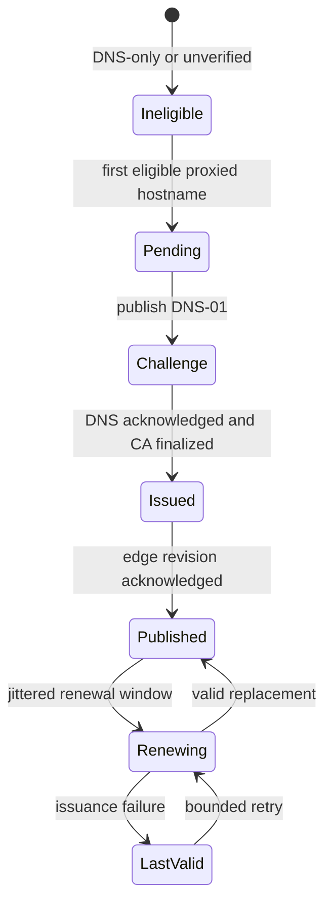

# TLS certificates

A TLS certificate lets visitors reach your site over HTTPS. Each domain uses one
of three modes. This page shows how to choose one, upload a certificate, renew,
and recover when issuance fails.

**You need:** a domain with verified nameservers. Managed certificates also need
at least one proxied hostname.

| Mode | Private-key owner | How it is validated |
| --- | --- | --- |
| `managed` | The control plane, encrypted | ACME DNS-01 (see below) after a hostname becomes proxied |
| `custom` | You upload it, then CDNFoundry encrypts it | Key match, chain, names, expiry, and size |
| `disabled` | No domain certificate | Explicit choice |



ACME is the protocol certificate authorities (CAs) use to issue certificates
automatically. DNS-01 proves control of a name with a temporary DNS TXT record.

## Choose a mode

<DocTabs :labels="['Domain panel', 'API']">
<template #tab-1>

Open the domain and choose **TLS mode**. Select **Managed**, **Custom**, or
**Disabled**, and save.

</template>
<template #tab-2>

```sh
curl -X PATCH "$CDNF_URL/api/domains/$DOMAIN_ID/tls" \
  -H "Authorization: Bearer $CDNF_TOKEN" \
  -H "Idempotency-Key: $(uuidgen)" \
  -H "Content-Type: application/json" \
  -d '{"mode": "managed"}'
```

</template>
</DocTabs>

**Expected result:** the mode and domain revision are saved and the edges get a
new revision. `GET /api/domains/{domain}/tls/status` shows the latest order.

**If it fails:** custom mode needs a current, active, unexpired custom
certificate when the domain is locked for the change. If it was removed or
expired while the request waited, the API returns `409` with code `conflict` and
the panel shows a **Mode** validation error. Upload a valid certificate, then try
again. A rejected change keeps the saved mode, certificate, and revision.

::: danger Private-key handling
Never log or expose certificate keys. Recovery needs the original application
encryption key, the edge recovery key, and externally kept TLS material.
:::

## How edges hold keys

In production, edge runtime generations, including active certificate keys, live
in the shared 512 MiB `edge-runtime-memory` tmpfs volume. Each successful
activation also writes an AES-GCM encrypted recovery snapshot to
`edge-agent-state`. The agent's own enrollment key is encrypted in that volume
with the same externally supplied recovery key.

After an edge restart, the agent verifies and restores the snapshot before it
contacts the control plane. A failed rotation keeps the current tmpfs generation
and its last valid encrypted snapshot.

The recovery key is a 32-byte random value. Supply it from external secret
storage into host tmpfs as 64 hex characters in a `0400` file. The bootstrap
listener key must also be on host tmpfs. Cells and the agent refuse disk-backed
mounts and active host swap. If the recovery key is missing or changed, the
control plane must rebuild the edge snapshot. Keep the key with your recovery
material.

## Managed certificates

Managed issuance requires all of the following:

- lifecycle state `active`;
- verified nameservers;
- at least one proxied hostname;
- ACME enabled and configured;
- healthy authoritative DNS reconciliation.

DNS-only and unverified domains do not create ACME orders.

The ACME client reuses the `Replay-Nonce` returned with each response, waits at
least the `Retry-After` an ACME server sends when polling an order or
authorization or answering `429` or `503` (bounded to one hour), and registers
its account once under a lock even when several workers start together.

The certificate-name compiler creates bounded name sets. The usual set includes
the apex and wildcard; deep hostnames that a wildcard cannot cover use a
supplemental order. A valid existing certificate is reused where it covers the
required names.

Managed planning reads the current domain under its database lock. Reusing a
certificate cannot overwrite a newer custom-certificate selection, and
activation advances from the latest desired revision. Certificate activation,
orders and their operation records commit together; queued issuance and edge
reconciliation are released after commit. A failed write rolls back the plan
so the job can retry without leaving a partial activation.

The workflow writes DNS-01 challenges as desired TXT state with a default
30-second TTL, waits for every required DNS acknowledgement, then requires an
authoritative, exact TXT answer from each enabled cluster's nameservers before
acknowledging the challenge to the ACME server. The development fixture probes
its private DNSdist endpoint through `ACME_DNS_PROBE_SERVER`. DNSdist has no
packet cache in the supported configuration, so no stale cache entry needs
flushing. A missing or non-authoritative answer delays the order; it does not
replace an active certificate. The issuer stores the
encrypted private key and certificate, publishes a new edge revision that
references the certificate by id (edges fetch the key separately), and
cleans challenge records. New orders are globally bounded per hour and initial
work is jittered.

Hourly maintenance renews certificates inside `ACME_RENEW_BEFORE_DAYS`, retries
eligible orders, removes expired challenge state, and creates deduplicated
administrator alerts for failures or impending expiry.

Each maintenance invocation considers at most `--limit` eligible domains
(default 500, clamped to 1–2,000). A shared cache cursor advances through a
fixed domain-ID range, then starts another sweep. Domains added during a sweep
join the next one. Disabled, unverified and DNS-only domains are excluded.
Overlapping domain scans are skipped under a shared lease; dispatch failure
does not advance the cursor. Lost cache progress restarts the sweep and may
repeat idempotent work; it does not remove certificates.

Budget the maintenance interval and queue capacity against the renewal window.
For a stable set of N eligible domains and batch size L, a sweep needs at most
`ceil(N / L) + 1` successful invocations, including a possible empty final batch.
At the default hourly cadence, 10,000 eligible domains therefore need up to
21 hours just to enqueue their checks. This is a scheduling bound, not a load
qualification or an issuance-time guarantee. Queue delay, retries and CA/DNS
work require additional margin.

Expired-challenge cleanup shares the domain lock with issuance and finalization.
It rechecks whether each selected challenge is still expired and uncleaned;
another worker's completed cleanup does not create an extra revision. Challenge
cleanup, the revision increment and its DNS reconciliation operation commit
together, with dispatch after commit. A persistence failure rolls them back
for retry. Certificate material is not removed by this maintenance step.

Issuance failure callbacks recheck the current order under the domain and order
locks. A late or repeated failure preserves a completed outcome, completion time
and active certificate. A late request error does not add retry metadata to a
completed order or reopen its operation. The first failure cleans remaining
challenges and records any resulting DNS reconciliation in the same transaction.
Inspect the current TLS order and runtime acknowledgement when diagnosing an
older worker error.

Before sending ACME finalization, the issuer stores the new private key encrypted
and stores its CSR on the order. If the CA accepts finalization but its response
is lost, retry checks the remote order and reuses that same key and CSR. A
remote `processing` or `valid` order moves to certificate polling; a `ready`
order resubmits the saved CSR. The current valid certificate stays selected
until a replacement is admitted and activated. Keep application encryption keys
in recovery material so an in-flight order remains readable after restore.
The issuer also rechecks active domain lifecycle, verified delegation and the
current proxied hostname set before work and under the domain lock before
admitting the downloaded certificate. A disabled, retired or changed domain
marks the order obsolete and retains any previously valid certificate.

Certificate finalization also rechecks the locked order's state before writing.
A response arriving after the order succeeded, failed or became obsolete leaves
that outcome, certificate selection and revision intact. Retrying a completed
finalization does not insert another certificate. Failed or obsolete work must
go through eligible managed planning to create a new order.

Obsolescence rechecks terminal order state under the domain/order locks. Its
challenge cleanup, revision, DNS reconciliation operation and issuance receipt
commit together. A receipt write failure rolls them back for retry; delayed
obsolescence preserves an already completed outcome.

## Renew or reissue by hand

<DocTabs :labels="['Domain panel', 'API']">
<template #tab-1>

Choose **Renew managed certificate** or **Reissue managed certificate** on the
domain.

</template>
<template #tab-2>

```sh
curl -X POST "$CDNF_URL/api/domains/$DOMAIN_ID/tls/renew" \
  -H "Authorization: Bearer $CDNF_TOKEN" \
  -H "Idempotency-Key: $(uuidgen)"
```

Use `.../tls/reissue` to force a new order.

</template>
</DocTabs>

- **Renew** creates work only when renewal is due.
- **Reissue** forces a new managed order.
- `GET .../tls/status` includes the latest order without private material.

**Expected result:** both actions return `202` and an operation UUID.

Each action's operation reports completion of its planning job. Renewal may
reuse valid coverage and return an empty `queued_order_ids` list. A pending
reissue remains pending until its forced planning job runs; ordinary renewal
does not complete it. When reissue creates an order, its receipt records the
order ID and retains that result on retry. Planning success does not establish
certificate issuance or edge activation: inspect TLS order status, runtime
acknowledgements and verified HTTPS separately.

## Custom certificates

Upload a leaf certificate, its intermediate certificates, and the private key in
PEM. The chain is optional when a trusted root issued the leaf directly. Limits
are 16 KiB for the leaf and the key, and 64 KiB for the chain.

<DocTabs :labels="['Domain panel', 'API']">
<template #tab-1>

Choose **Upload custom certificate**. Fill **Leaf certificate PEM**,
**Intermediate certificates PEM**, and **Private key PEM**, and save. To go back
to managed mode, choose **Remove custom certificate**.

</template>
<template #tab-2>

```sh
curl -X POST "$CDNF_URL/api/domains/$DOMAIN_ID/tls/upload" \
  -H "Authorization: Bearer $CDNF_TOKEN" \
  -H "Idempotency-Key: $(uuidgen)" \
  -H "Content-Type: application/json" \
  -d @certificate.json
```

`certificate.json` holds `certificate`, `chain` (optional), and `private_key`.
Remove the custom certificate with `DELETE .../tls/custom-certificate`.

</template>
</DocTabs>

**Expected result:** the reply holds only metadata and a fingerprint, never the
key. The edges get a new revision.

Validation confirms:

- the key matches the leaf;
- accepted key algorithm and size;
- the leaf verifies for TLS server authentication against the platform trust
  store, with at most ten uploaded certificates used only as untrusted
  intermediates;
- CA constraints, signing key usage, path length, server purpose, name
  constraints and critical extensions permit the leaf;
- chain keys and non-root signatures satisfy OpenSSL authentication level 2
  (at least 112-bit security), rejecting 1024-bit RSA and SHA-1 leaf/issuer
  signatures; root self-signatures do not establish trust;
- the leaf, issuers and root are currently valid;
- names cover every required proxied hostname.

CDNFoundry encrypts private keys before saving them and never returns them.
Removing the active custom certificate
returns the domain to managed mode and queues managed issuance.

Only normalized public certificate blocks are stored in the issuing-chain
field. Extra export text or private-key blocks in that field are discarded;
paste the private key only into **Private key PEM**. Re-uploading the same leaf
updates its validated chain without changing the certificate ID and queues a
new domain revision. A rejected upload changes neither the active certificate
nor the domain revision or edge artifact.
If another request changes the domain during certificate validation, the API
returns `409` with code `conflict`; the panel shows a validation error on
**Leaf certificate PEM**. Reload current domain state and retry with a bundle
covering its current proxied hostnames. The conflicting upload leaves the
active certificate and other request's committed revision intact.

A root the customer supplies is never trusted. A self-signed certificate, or a
chain whose root the platform does not trust, is rejected with a `chain` error,
and a root included in the upload is dropped from the stored chain. The platform
trusts the operating system roots of the control-plane image. An operator who
runs a private PKI sets `TLS_UPLOAD_TRUST_FILE` to a PEM bundle of the roots to
trust instead; see [Configuration](../reference/configuration.md). This does
not install any CA into visitors' trust stores or prove public-browser trust.
Validation performs no remote CA or revocation lookup.
The control-plane image includes the pinned OpenSSL command-line verifier.
It checks public certificate PEM locally with a five-second timeout; private
keys never enter its input or command arguments. Custom non-container PHP
test environments also need the OpenSSL 3 command available on `PATH`.

When upgrading from an earlier validator, review existing custom bundles in a
restricted environment without printing their contents. Re-upload a complete,
currently valid bundle to replace legacy chain text, including when retaining
the same leaf. If a private key was pasted into the old chain field, treat its
unencrypted database and backup copies as exposed material: issue a replacement
key/certificate and revoke the old certificate through its issuer. Preserve
required backups under restricted access; this update does not erase historical
rows, snapshots or backups. Existing invalid chains require a valid replacement;
the update does not silently deactivate currently serving certificates.

## If issuance fails

An ACME failure records the order error, cleans unusable challenge state, and
preserves any valid active certificate and edge artifact. Do not delete a valid
certificate to force recovery. Repair DNS, CA access, clock, or configuration,
then renew or reissue.

See [Certificates](../deployment/certificates.md) for internal service PKI, which is
separate from customer TLS.
