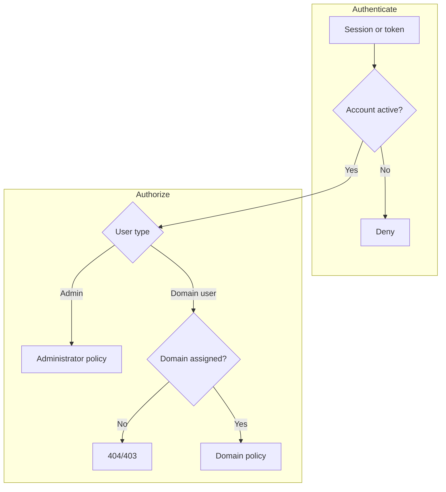

# Users and access

CDNFoundry has two kinds of human user: administrators and domain users. This
page shows how to create them, give domain users their domains, secure
sign-in, and issue API tokens.

**You need:** an administrator account for the user steps. Any user can manage
their own profile and tokens.

| Concern | Implemented boundary |
| --- | --- |
| Human identity | `users.type` is `admin` or `user` |
| Browser authentication | Panel session with active-user enforcement |
| API authentication | Hashed Sanctum bearer tokens shown once |
| Tenant scope | Explicit `domain_user` assignments plus scoped route binding |
| Machine identity | Separate edge mTLS enrollment, never a human token |



::: warning One-time secrets
Passwords, new Sanctum tokens, and edge bootstrap tokens are not recoverable
status fields. Capture them only at their intended one-time boundary.
:::

CDNFoundry has two user types: `admin` and `user`. It does not implement custom
roles or per-feature permission matrices.

## Administrators

Administrators can access `/admin`, all administrator API routes, Horizon,
system settings, DNS clusters, edges, pools, operations, backups, telemetry,
audit logs, and every domain. An administrator cannot disable, demote, or delete
their own account.

Create the first administrator on the command line. It takes `--name` and
`--email` and asks for the rest:

```sh
php artisan cdnf:admin:create --name="Ada Admin" --email=ada@example.com
```

Create later administrators and users as follows.

<DocTabs :labels="['Admin panel', 'API']">
<template #tab-1>

Open **Customers → Users**, choose the create action, fill the name, email,
password, and type, and save.

</template>
<template #tab-2>

```sh
curl -X POST "$CDNF_URL/api/admin/users" \
  -H "Authorization: Bearer $CDNF_TOKEN" \
  -H "Idempotency-Key: $(uuidgen)" \
  -H "Content-Type: application/json" \
  -d '{"name": "Sam User", "email": "sam@example.com", "password": "Correct-horse-42", "type": "user"}'
```

</template>
</DocTabs>

**Expected result:** the user appears in the list and can sign in.

## Domain users

Domain users access `/app` and only domains in the assignment pivot table. They
can create domains and manage assigned domains according to `DomainPolicy`.
Administrators attach and detach users in the domain's users tab, or through
`/api/admin/domains/{domain}/users` (`POST` to attach, `DELETE .../{user}` to
detach).

A user with domain assignments or active API tokens cannot be permanently
deleted. Remove assignments and revoke tokens first.

## Log in as a domain user

An administrator can open the domain panel as a domain user to see exactly what they see, for example to answer a
support question. Open **Users**, choose **Log in as user** on the user's row, and confirm. The domain panel opens as that
user, with their domains and permissions, and the user's password is not needed.

- A banner on every page says whose account you are using. **Return to admin** ends it and opens **Users** again.
- Starting and ending are audit entries (`user.impersonation_started` and `user.impersonation_ended`). Every change you
  make meanwhile is recorded as the user's, with `impersonated_by` set to your user ID. The user is not notified.
- You cannot create an API token or change the user's profile or password while acting as them, so nothing you create
  outlives the session in their name.
- It is offered only for active domain users: never for another administrator, a disabled user, or yourself.

## Disabled accounts

In the panel, open the user and choose **Disable access** (or **Enable access**).
In the API, use `POST /api/admin/users/{user}/disable` or `.../enable`.
Disabling an account sets `disabled_at`, revokes all Sanctum tokens, blocks new
login, and rejects later session/API requests through `account.active`.
Re-enabling does not recreate tokens.

## Profiles and passwords

Both panels expose the shared profile page. API equivalents are:

- `GET /api/me`
- `PATCH /api/me`
- `PUT /api/me/password`

Password change requires the current password and confirmation, revokes other
tokens, and writes an audit event. Changing the email address also requires
`current_password`. Every user, including those an administrator creates or
resets, follows one password policy: at least 12 characters with upper-case and
lower-case letters and a number. An administrator who sets a user's password
revokes all of that user's tokens.

Sign-in is limited per account (`login_per_minute` attempts a minute whatever the
source address) and per address (ten times that). An unknown address and a wrong
password get the same answer and take the same time.

### Two-step sign-in for administrators

An administrator can enrol an authenticator app under **Account → Profile**
(scan the QR code, confirm a code, and save the recovery codes, which are shown
once). Once enrolled, the panel asks for a code after the password, and
`POST /api/auth/login` answers `401 otp_required` until the request carries
`otp` (a current code or one unused recovery code). A recovery code works once.
Enrolling or removing the app revokes the account's API tokens. Domain users
sign in with a password only.

## API tokens

The shared **API tokens** page and `/api/me/tokens` API list cursor-paginated
metadata. A new plaintext token is shown once; only its hash and final six
characters are retained. Send it as:

```http
Authorization: Bearer TOKEN
Accept: application/json
```

Never put a token in a URL, commit, screenshot, or shared log.

### Expiry, abilities, and domain scope

Every token expires: 90 days by default, at most 365 (`expires_in_days`), and 30
days for a token issued by `POST /api/auth/login`. Create a token with
`abilities` to limit what it can do:

| Ability | Allows |
| --- | --- |
| `*` (default) | Everything the user can do |
| `read` | `GET` and `HEAD` requests |
| `dns` | The domain DNS routes (records, import, export, deployment), except origins |
| `purge` | Cache purge requests and their status |

Add `domain_ids` (up to 50 domains the user can already see) to limit a token to
those domains. A domain-limited token sees only them in `GET /api/domains`,
gets `404` for any other domain, and cannot call `/api/admin`, even for an
administrator. A token that is not full access, or is domain-limited, cannot
create or list tokens or change the profile or password, so it cannot widen
itself. A request beyond a token's ability returns `403 token_scope_exceeded`.

```http
POST /api/me/tokens
{"name": "purge-bot", "abilities": ["purge"], "expires_in_days": 30, "domain_ids": [12]}
```

An administrator should issue each integration its own narrow token.

### Bootstrap tokens and proxies

An edge bootstrap token that was never used expires after 24 hours; rotate the
identity to get a new one. Laravel trusts forwarded headers only from the
addresses in `TRUSTED_PROXIES` (default: loopback and private ranges, which is
where the ingress proxy runs). Do not publish PHP-FPM or the web container on
a public address.
