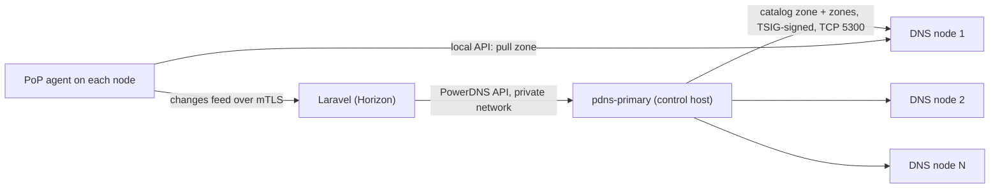

# DNS nodes and the hidden primary

<Screenshot name="admin-dns-clusters" alt="The DNS clusters list in the admin panel." />

CDNFoundry answers DNS queries on DNS nodes. Laravel never talks to them. It writes each zone (the records of one domain) to one private PowerDNS primary on the control host. Each DNS node is a PowerDNS secondary that pulls the zones it serves. This page explains the flow, how to register the primary and a node, how to check that nodes are current, and what happens when one is lost.

**You need:** a running control host, administrator access, and for a node, a PoP host that runs the edge agent.

The primary is hidden: it answers no public queries. The control plane never calls a node, and a node needs no API gateway, no certificate, and no `dns-api-N` name.

## Add the primary

You register the one primary once. The panel and the API both call it a DNS cluster.

When Fleet installs the control node, it registers the primary for you: the cluster `pdns-primary` is created with the nameservers `ns1` and `ns2` of the platform domain, tested in the background, and enabled once healthy. Use the steps below only to add it by hand, for example after an install from an earlier Fleet version.

<DocTabs :labels="['Admin panel', 'API']">
<template #tab-1>

1. Open **Infrastructure → DNS primary** and create a cluster.
2. Fill in the form:

   | Field | Value |
   | --- | --- |
   | Name, Location | Labels for you |
   | API URL | `http://pdns-primary:8081` |
   | Server ID | `localhost` (the default) |
   | API key | The control host's `PDNS_API_KEY` |
   | Transfer endpoint | The control host's public IP and `5300`, such as `192.0.2.10:5300` or `[2001:db8::10]:5300` |
   | Zone capacity | Default 100,000 |
   | Nameservers | At least two authoritative nameserver hostnames |

3. Save, then choose **Test connection** on the cluster. The new cluster stays disabled until a connection test succeeds.
4. When the **Health** column is healthy, turn on **Enabled** and save.

</template>
<template #tab-2>

1. `POST /api/admin/dns/clusters` creates the cluster, always disabled.
2. `POST /api/admin/dns/clusters/{cluster}/test` starts the connection test and returns an operation.
3. After the cluster reports healthy, `POST /api/admin/dns/clusters/{cluster}/enable` enables it.

</template>
</DocTabs>

The transfer endpoint must be an IP address, because PowerDNS accepts a primary only as an IP. Only one cluster can be enabled, because zones are written to exactly one primary. Enabling a second returns `409`. Enabling before a successful test also returns `409`.

To check it worked, open the cluster: **Health** shows a healthy test result.

## Add a node

Run the `dns` Compose profile on a PoP host that also runs the edge agent. Set `EDGE_DNS_API_URL` and `EDGE_DNS_API_KEY` on that host. The Fleet tool does this for nodes with the `dns-edge` role.

On its first synchronization, the agent installs the transfer key and creates the catalog consumer. The node then fills itself with zones. It keeps them in a local SQLite store that the primary can always rebuild, so a node needs no database and no backup.

## How a change reaches a node

1. A change is committed in PostgreSQL. The `ReconcileDnsZone` job renders the zone and writes it to the primary. The job reads the write back before it counts.
2. The primary adds the zone to its **catalog zone**, `catalog.cdnfoundry.invalid`. The control plane records the zone in a change feed.
3. Each node's PoP agent reads the feed from `GET /edge/v1/dns/changes` after its cursor. For every changed zone, the agent makes sure the zone carries the transfer key. It then asks its local PowerDNS to pull the zone. PowerDNS fetches it over TSIG-signed TCP from the primary.
4. The agent moves its cursor forward only past zones the node already serves. It reports the cursor in its heartbeat.

A zone deleted on the primary leaves the catalog, and every node drops it. A new node needs no list of zones: it follows the catalog and pulls them all.

## Transfers are signed

The primary accepts zone transfers only when they are signed with the TSIG key `cdnf-nodes`. CDNFoundry sets it as `TSIG-ALLOW-AXFR` on every zone and on the catalog. You do not maintain an address allowlist.

The secret is generated when the primary is registered and stored encrypted in PostgreSQL. Each node's agent receives it sealed to that agent's identity key. It appears in no API response and no log.

The primary listens for transfers on port `5300`, TCP and UDP, published on the control host. Restrict that port in your firewall to the node addresses. An unsigned request is refused either way.

## Check that a node has converged

Each heartbeat carries `dns.cursor` (the last change this node serves), `dns.latest` (the newest change the control plane knows), `dns.pending`, the catalog serial, and any `dns.error`.

A node is converged when `cursor` equals `latest` and `pending` is `0`. If a node cannot pull a zone for ten minutes, that zone stops holding the cursor back. The agent logs it as `dns_zone_stuck`.

## Lose a node, or the primary

- **A node:** nothing changes for the others. Resolvers use the remaining nodes, and DNSdist and anycast routing already do that. Replace the node and let it fill itself.
- **The primary:** nodes keep serving the zones they have. Writes queue and retry for 30 minutes, then the drift check repairs the rest. When a rebuilt primary is up, run a global DNS reconcile. It recreates every zone, and nodes pull them again.
