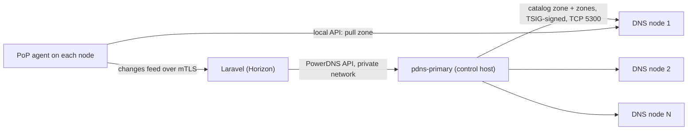

# DNS nodes and the hidden primary

<Screenshot name="admin-dns-clusters" alt="The DNS clusters list in the admin panel." />

Laravel writes every zone to **one private PowerDNS primary** that runs on the
control host. It answers no public queries. Each DNS node is a PowerDNS
**secondary** that pulls the zones it serves. Nothing connects to a node from the
outside: the control plane never calls a node, and a node needs no API gateway,
no certificate, and no `dns-api-N` name.

## How a change reaches a node

1. A change is committed in PostgreSQL and `ReconcileDnsZone` renders the zone and
   writes it to the primary. The write is read back before it counts.
2. The primary adds the zone to its **catalog zone**, `catalog.cdnfoundry.invalid`,
   and the control plane records the zone in a change feed.
3. Each node's PoP agent reads the feed from `GET /edge/v1/dns/changes` after its
   cursor. For every changed zone it makes sure the zone carries the transfer key
   and asks its local PowerDNS to pull it. PowerDNS fetches it over TSIG-signed
   TCP from the primary, on the node's own initiative.
4. The agent moves its cursor forward only past zones the node already serves, and
   reports the cursor in its heartbeat.

A zone deleted on the primary leaves the catalog, and every node drops it. A new
node needs no list of zones: it follows the catalog and pulls them all.

## Transfers are signed

Zone transfers are accepted only when signed with the TSIG key `cdnf-nodes`, set as
`TSIG-ALLOW-AXFR` on every zone and on the catalog. There is no address allowlist
to maintain. The secret is generated when the primary is registered, stored
encrypted in PostgreSQL, and delivered to each node's agent sealed to that agent's
identity key; it appears in no API response and no log.

The primary listens for transfers on `5300` (TCP and UDP), published on the
control host. Restrict it at your firewall to the node addresses; a request that
is not signed is refused either way.

## Add the primary

In **Infrastructure → DNS clusters**, create the one cluster:

| Field | Value |
| --- | --- |
| API URL | `http://pdns-primary:8081` |
| API key | The control host's `PDNS_API_KEY` |
| Transfer endpoint | The control host's public IP and `5300`, such as `192.0.2.10:5300` or `[2001:db8::10]:5300` |

The transfer endpoint must be an address, because PowerDNS accepts a primary only
as an IP. Only one cluster can be enabled: zones are written to exactly one
primary, and enabling a second returns `409`.

## Add a node

Run the `dns` profile on a PoP host that also runs the edge agent, with
`EDGE_DNS_API_URL` and `EDGE_DNS_API_KEY` set (Fleet does this for `dns-edge`
nodes). On its first synchronization the agent installs the transfer key, creates
the catalog consumer, and the node fills itself. The node keeps its zones in a
local SQLite store that the primary can always rebuild, so a node needs no
database and no backup.

## Convergence

Each heartbeat carries `dns.cursor` (the last change this node serves),
`dns.latest` (the newest change the control plane knows), `dns.pending`, the
catalog serial, and any `dns.error`. A node is converged when `cursor` equals
`latest` and `pending` is `0`. A zone the node cannot pull for ten minutes stops
holding the cursor back and is reported in the agent log (`dns_zone_stuck`).

## Lose a node, or the primary

- **A node:** nothing changes for the others. Resolvers use the remaining nodes;
  DNSdist and anycast routing already do that. Replace it and let it fill itself.
- **The primary:** nodes keep serving the zones they have. Writes queue and retry
  for 30 minutes, then the drift check repairs the rest. After a rebuilt primary
  comes up, run a global DNS reconcile; it recreates every zone, and nodes pull
  them again.
