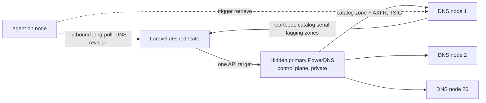

# Platform rebuild roadmap

**Status: active.** This roadmap replaces the closed staged-delivery roadmap.
CDNFoundry is not in production yet, so this plan makes breaking changes on
purpose: **no backward compatibility, no data migration from 1.2.x, and no
legacy code paths.** Every phase starts from a fresh install
(zero state) and ends with a platform that installs, serves traffic, and passes
its tests.

All work happens on the `dev` branch. `main` receives a phase only after that
phase's completion gate passes.

## How to read this roadmap

1. [Audit gap register](#audit-gap-register) lists every confirmed problem,
   with its evidence in the code and the phase that fixes it.
2. [Target designs](#target-designs) describe the decisions the phases build:
   the PoP model, anycast DNS, nameserver pairs, and defaults-first setup.
3. [Target setup](#target-setup-after-the-roadmap) and
   [daily checks](#target-day-to-day-checks) describe the administrator
   experience the platform must deliver at the end.
4. [Phases](#phases) are ordered. Do not start a phase until the previous
   gate passes.

### Definition of done for every phase

A phase is complete only when all five are true:

| Gate field | Required evidence |
| --- | --- |
| Implementation | The code is merged to `dev`. Removed code and files are actually deleted. Nothing is left behind a flag "for later". |
| Documentation | Every page touched by the change is rewritten to match it. Docs never describe behavior that does not exist. |
| Automated tests | Unit, feature, and static checks pass in the isolated SQLite test command. |
| Runtime tests | Python E2E under `tests/e2e` passes against a real Compose stack, including IPv4 and IPv6. |
| Browser tests | From Phase 0 onward, the agentic browser suite covers every screen the phase changed and passes. |

A gate that has any failing field means the phase is still open.

## Audit gap register

The audit read the domain, DNS, PoP (edge), delegation, setup, test, and
documentation code paths in full. For proxy, cache, TLS, WAF, security, and
analytics it reviewed their scope and interfaces. Phase 5 audits those modules
line by line. Gaps marked **verify** are suspected but not yet proven.

### Licensing and repository hygiene

| ID | Gap | Evidence | Phase |
| --- | --- | --- | --- |
| G01 | The docs site footer said "Licensed under MIT", and the archived README/CONTRIBUTING said MIT. The `LICENSE`, `NOTICE`, package manifests, and image labels were already Apache-2.0. | `docs/.vitepress/config.mts`, `docs/legacy/root/*` | 0 (**fixed**) |
| G02 | 69 archived files under `docs/legacy/` are still tracked and searchable. They contradict the current behavior. | `git ls-files docs/legacy` | 0 |
| G03 | Test files carry roadmap phase numbers in their names, against the naming rule in `AGENTS.md`. | `tests/e2e/phase2_dns.py` … `phase9_waf.py` | 0 |
| G04 | The 53 migrations contain expand/contract history from earlier releases, for example `remove_legacy_cell_addresses_and_name_management_addresses`. A zero-state product does not need that history. | `core/database/migrations/` | 0 |
| G05 | Compatibility branches for older installs remain in the code. Example: the "legacy verified installations" fallback in `Domain::assignedNameservers()`. | `core/app/Models/Domain.php:99` | 0, 3 |

### PoPs (edges)

| ID | Gap | Evidence | Phase |
| --- | --- | --- | --- |
| G06 | PoPs have optional management IPv4/IPv6 addresses in the model, API, Filament form/table, and validation. Nothing needs them: the agent connects outbound, and traffic addresses belong to service endpoints. | `EdgeController.php:30,53`, `EdgeResource.php:45-46,107-108`, `OriginData.php:155`, `EdgePoolEndpointData.php:30`, `ReconcileEdgeDomain.php:120`, `docs/guides/edges.md:59-62` | 1 |
| G07 | Serving a domain needs four separate operator concepts: edges, pools, cell slots, and per-pool endpoints. Cell assignment is manual ("There is no fleet-wide reconcile or automatic assignment step"). A new PoP serves nothing until an administrator assigns its cells by hand. | `docs/operations/simple-anycast.md`, `docs/concepts/edges-and-cells.md` | 1 |
| G08 | Each edge needs a manual `EDGE_GATEWAY_ADDRESS_MAP` that maps public service addresses to local addresses. | `docs/operations/simple-anycast.md` step 6 | 1, 4 |
| G09 | Geo-Unicast endpoints repeat the PoP's public address for every pool. The address belongs to the PoP and should be entered once. | `EdgePoolEndpoint`, `POST /edge-pools/{pool}/edges/{edge}/endpoint` | 1 |

### Authoritative DNS

| ID | Gap | Evidence | Phase |
| --- | --- | --- | --- |
| G10 | Laravel pushes every zone change to every DNS cluster through the PowerDNS HTTP API, so the work grows as zones × DNS hosts. Each DNS host also needs an inbound API gateway, a TLS certificate, and a `dns-api-N` hostname. This does not scale to 20 or more PoPs. | `ReconcileDnsZone.php:64`, `docs/deployment/topology.md:50,175` | 2 |
| G11 | There is no anycast model for DNS. A nameserver is one hostname with one IPv4 address. Many nodes cannot share one nameserver address, and no node-health contract exists to withdraw a broken node's route. | `PlatformDnsSettingsRequest.php:19-22` | 2 |
| G12 | The nameserver list is accepted as 2–8 entries in two places, platform settings and each DNS cluster. That makes two sources of truth for one fact. The product limit should be 2–4. | `PlatformDnsSettingsRequest.php:19`, `DnsClusterController.php:103`, `DnsCluster::$nameservers` | 2 |
| G13 | Control has no per-node, per-zone serial view. It cannot tell that one DNS node is serving stale data. | `DnsDeployment` tracks clusters, not nodes | 2 |
| G14 | Zones are unsigned, and DNSSEC is not supported. Customers must remove their DS record before onboarding. | `NameserverResolver.php:23` | 2 (owner decision) |

### Delegation and domain ownership

| ID | Gap | Evidence | Phase |
| --- | --- | --- | --- |
| G15 | Each domain gets a random 32-hex label, for example `3f9a…c1.ns1.example.net`. Users find it hard to read and type, and no mainstream CDN works this way. | `Domain.php:119-127` | 3 |
| G16 | A wildcard `*.nsN` A/AAAA record answers every label. A random name such as `anything.ns1.example.net` resolves, so typos are never caught. | `PlatformDnsZone.php:34-37` | 3 |
| G17 | `domains.name` is globally unique, so the first claim wins. A squatter's pending claim blocks the real owner for 7 days. A previous owner's active zone blocks a new legitimate registrant permanently, because no re-delegation takeover path exists. | migration `create_domains_tables.php:23`, `Domain.php:72-74` | 3 |
| G18 | **verify**: A claim for a subdomain of another customer's zone (`shop.example.com` while `example.com` belongs to someone else) is not checked when the claim is created. | `Domain::createPendingFor()` | 3 |

### Setup and administration

| ID | Gap | Evidence | Phase |
| --- | --- | --- | --- |
| G19 | The starter quick start is 773 lines long, and the full set of deployment pages is about 2,800 lines. An administrator has to understand fleet JSON, bundles, tmpfs keys, metrics-token ownership, DNS API certificates, and edge listener material before the first domain works. | `docs/deployment/production-quick-start.md` | 4 |
| G20 | Two DNS zones are required: an external operator zone with `control`, `edge-control`, `telemetry`, `grafana`, and `dns-api-N`, plus the platform zone. Phase 2 removes the `dns-api-N` names. The rest should be reduced to as few external records as possible. | `docs/deployment/topology.md:32-50` | 2, 4 |
| G21 | There is no first-run wizard. Platform DNS identity, clusters, pools, and cells are separate screens with an order the administrator must already know. | `Filament/Admin/Pages`, `Resources` | 4, 7 |

### Quality, tests, and agent tooling

| ID | Gap | Evidence | Phase |
| --- | --- | --- | --- |
| G22 | Browser qualification is manual only, because `AGENTS.md` forbids agents from running browser automation. The owner now requires agentic browser tests. | `AGENTS.md`, `docs/manual-browser-qualification.md` | 0 |
| G23 | There is no customer CLI. Testing "API, CLI, and web for every feature" needs one. | route list (196 API routes), operator-only Artisan commands | 6 |
| G24 | Agent skills live in `.agents/skills/` and describe the 1.2.x design. There is no project MCP server and no compact code map, so agents spend tokens rediscovering the structure. | `.agents/skills/*/SKILL.md` | 9 |
| G25 | No test follows the documentation itself. A broken quick start is only found by a human. | `tests/docs` checks links only | 10 |

### Modules for line-by-line audit in Phase 5

These modules were reviewed only at the scope and interface level. Phase 5
turns each row into confirmed gaps or a "no defect" record:

| Module | Questions to answer |
| --- | --- |
| Proxy and origin | Is a DNS name re-resolved before every connection and checked against the unsafe address list (rebinding)? Are hop-by-hop and forwarding headers normalized in one place? Are retries bounded per request and per origin? |
| Cache | Do lookup, URL purge, and full-purge epoch use the same key function in PHP and Lua? Is the `Vary` header bounded? Does development mode expire on time? |
| TLS | Is renewal spread across days? Is the previous certificate kept active when a renewal fails? Does DNS-01 run only for proxied hostnames? Is uploaded-chain validation complete? |
| WAF and security | Are rule imports bounded? Do exclusions expire? Are per-client, per-domain, and per-cell limits enforced in the cell, not in Laravel? |
| Analytics and logs | Do retention, query time windows, and redaction match the docs? What happens when ClickHouse is down? |
| Fleet rollouts and backups | Does rollback restore the previous valid generation? Does a restore preflight detect missing keys? |

## Target designs

### D1 — PoP model

A **PoP** is one site that runs any of the `dns` and `edge` roles. It has:

- a name, a country, and a continent (used for Geo-DNS and placement);
- its **public service addresses**: IPv4 and optional IPv6, entered once;
- its roles.

It does **not** have management addresses. The agent always connects
outbound to control. Control records the agent's observed source address
automatically, as read-only diagnostic data, for example for the zone transfer
access list in D2.

Pools and cells remain as internal capacity mechanisms, but the defaults handle
them:

- A fresh platform has one `shared` pool and one `quarantine` pool.
- A new PoP automatically joins the `shared` pool. Its first cell serves
  `shared` and its second cell serves `quarantine`.
- The edge gateway binds the PoP's public service addresses by default. An
  address map is needed only behind NAT or a load balancer. In that case the
  agent reports its local addresses and the administrator picks the mapping
  once.
- Dedicated and reserved pools, manual cell moves, and extra endpoints become
  advanced actions. They are never setup steps.

### D2 — Authoritative DNS at any scale (2 to 20+ PoPs)

**Two separate ideas, kept separate:**

- **Nameserver endpoints**: the public addresses that resolvers query. There
  are at least 2 and at most 4. Each one is a hostname with an IPv4 address and
  an optional IPv6 address, for example `ns1.example.net` and
  `ns2.example.net`. Each endpoint is either `unicast` (exactly one DNS node
  serves it) or `anycast` (many DNS nodes announce the same address).
- **DNS nodes**: the PoPs with the `dns` role. Their number has no relation to
  the number of endpoints. Each node serves one or more endpoints (by default,
  all of them). The node limit is bounded, at 64 per platform initially.

**Example with 20 PoPs.** The administrator gets two anycast addresses,
ideally from two different prefixes and upstreams:

```text
ns1.example.net  → 203.0.113.53   (anycast prefix A)
ns2.example.net  → 198.51.100.53  (anycast prefix B)

20 PoPs, each running DNSdist + PowerDNS secondary:
  every PoP announces prefix A and prefix B   → best latency
  or PoPs 1–10 announce A, PoPs 11–20 announce B → a bad
     announcement or route leak can affect only one nameserver
```

Resolvers reach the nearest healthy PoP for each nameserver.

**How 20 nodes get updated.** Zone changes cannot be pushed to an anycast
address, because a packet sent to it reaches only the nearest node. So DNS
uses a hidden primary and pull-based secondaries:



1. Laravel writes each zone to **one** hidden primary PowerDNS. The primary is
   private, in the control plane, and is the only API target. The
   per-cluster push loop and the `dns-api-N` gateways are deleted (G10).
2. A **catalog zone** lists every customer zone and the platform zone. Every
   node consumes the catalog, so adding a zone needs no per-node work.
3. Nodes fetch zones with AXFR, authenticated by a per-node TSIG key. The
   transfer listener on control accepts only TSIG-signed requests from the
   nodes' observed agent addresses (D1).
4. The PoP agent, which is already on every PoP, long-polls control for the
   DNS revision and tells the local PowerDNS to retrieve changed zones. Changes
   therefore reach every node within seconds, with no inbound port on the
   node. A short SOA refresh is the fallback if the agent is down.
5. Each agent heartbeat reports the catalog serial and the number of lagging
   zones. Control shows convergence per node and alerts when a node falls
   behind.
6. Each node exposes a local health endpoint. It fails when PowerDNS is down,
   when the node is behind by more than a bounded time, or when the MMDB is
   invalid. **CDNFoundry still does not run BGP.** The documentation ships
   tested BIRD and ExaBGP health-check examples, so the operator's routing
   withdraws a broken node automatically.
7. Geo-DNS LUA records transfer as normal records (PowerDNS to PowerDNS).
   Each node evaluates them against its local MMDB. No query reaches Laravel.

Validation: 2 ≤ endpoints ≤ 4, endpoint addresses are unique and public, and
every endpoint has at least one enabled node before it is published.

**Owner decision (G14):** DNSSEC. The recommendation is to sign zones on the
hidden primary, with online keys stored encrypted, so nodes transfer signed
zones. Phase 2 builds the primary so that DNSSEC can be enabled later, and
Phase 5 delivers it if the owner approves.

### D3 — Nameserver pairs (replaces random tokens)

The owner's idea is sound, and it is the same principle Cloudflare uses: a
new claim must use nameservers that are **different from the ones the domain
uses now**. Only the real registrant can change the delegation at the
registrar, so a successful switch proves control of the domain. The design
below keeps that idea and adds two improvements.

**Setup.** From the 2–4 nameserver endpoints (D2), the platform generates
**nameserver pairs**. A pair has two names, each on a different endpoint. The
names use short, readable words from a fixed list:

```text
Pair A:  mary.ns1.example.net   car.ns2.example.net
Pair B:  lake.ns1.example.net   rose.ns2.example.net
```

The default is 2 pairs (4 names), and the administrator can configure 2 to 8.
The administrator may edit the words before the first domain is added. Each
name gets explicit A/AAAA records for its endpoint, and the wildcard is
removed (G16). Every DNS node serves every zone on every name, so pairs cost
nothing at runtime.

**Claim rules.**

1. When a user adds `example.com`, control queries the parent registry, as
   `NameserverResolver` already does, for the current delegation.
2. If the domain is currently delegated to one of our pairs, the claim gets a
   **different** pair. If it is delegated elsewhere, the claim gets the
   account's **home pair** (improvement 1: a user sees the same two
   nameservers for all their domains, like Cloudflare).
3. A claim reserves its pair for that domain. Two open claims for the same
   domain never share a pair, and no open claim uses the pair that is
   delegated now. If no pair is free, the user gets a clear `409
   claim_in_progress` with the time it frees.
4. Verification succeeds only when the parent delegation **exactly** equals the
   claim's pair. The pair observed when the claim was created never qualifies.
5. On success, the claim becomes the active zone. If another account held
   the active zone for the same name, that zone moves to `disabled`
   immediately and then follows the normal deprovision path. The previous
   owner is notified. This is the takeover path that G17 is missing.

**Data model.** The global unique index on `domains.name` is replaced by a
partial unique index over active, disabled, and deprovisioning states. Each
pending claim stores the account, the assigned pair, the observed delegation,
and its expiry (default 3 days, down from 7). There is a unique constraint on
(name, pair) for open claims. Improvement 2: a claim for a name inside
another account's active zone (G18) is refused, and a claim for a parent of
an existing zone requires administrator approval.

**Why this is safe.** A user who never controls the registrar cannot make
the parent delegation equal a pair that is different from the current one.
The random-token design proved the same thing with ugly names. The pair
design proves it with readable names, and it adds a real takeover path.

### D4 — Defaults first

- One installer command asks only: platform domain, administrator email,
  nameserver endpoint addresses, and the PoP list (name, country, public
  addresses, roles). Everything else has a safe default that can be changed
  later in **Platform settings**.
- Internal PKI, the TSIG keys, the agent bootstrap tokens, and the
  cache/WAF/TLS defaults are generated automatically.
- A PoP joins with one command (`cdnfoundry pop join <token>`). The token
  carries the control URL and the CA fingerprint.
- Advanced settings remain available but never appear in the quick start.

## Target setup after the roadmap

This is the administrator journey that Phase 10 tests on real servers. The
Quick start page will contain exactly these steps.

1. **Prepare servers.** One control host and at least two PoP hosts with
   Docker installed. Open the ports listed on one page.
2. **Create two external DNS records** at your existing DNS provider:
   `control.<platform-domain>` and `ns1`/`ns2` glue at your registrar.
3. **Install control:** `cdnfoundry install` answers the four questions from
   D4 and starts the control plane.
4. **Sign in.** The first-run wizard confirms the platform domain, the
   nameserver endpoints (anycast or unicast), and the generated pairs.
5. **Join PoPs:** copy one join command per PoP from **PoPs → Add PoP** and
   run it on that host. Each PoP shows `ready` when DNS and HTTP pass their
   local checks.
6. **Confirm health:** the dashboard shows the nameservers answering, all PoPs
   converged, and certificates valid.
7. **Add the first domain:** create a user, add the domain, set the two
   nameservers shown, and wait for `active`. Turn on proxy for one hostname
   with its origin.

## Target day-to-day checks

The admin dashboard shows each check as a single green, amber, or red row
with a link to the fix. The `cdnfoundry status` CLI prints the same rows.

| Check | Green means | Where |
| --- | --- | --- |
| Nameservers | Every endpoint answers SOA from at least one external probe, over IPv4 and IPv6 | Dashboard, DNS |
| DNS convergence | Every node's catalog serial is current. Zero lagging zones | PoPs |
| PoP health | Every PoP heartbeat is fresh, its cells are ready, and its gateway revision is acknowledged | PoPs |
| Queues | No failed jobs. Runtime lane latency is under its bound | Operations |
| Certificates | None expiring within 14 days without a renewal in progress | TLS |
| Origins | No proxied hostname is failing its origin checks | Domains |
| Security | No cell at its protection limits. WAF block rate is normal | Security |
| Telemetry | Vector to ClickHouse lag is under its bound, and disk is under 80% | Telemetry |
| Backups | The last backup succeeded within 24 hours, and the last restore preflight passed | Backups |

Weekly: review the audit log and pending claims. Monthly: run a restore
preflight and rotate one PoP identity as a drill.

## Phases

Each phase lists its goal, its tasks, and its exit criteria. Every phase
ends with the five-field gate from
[Definition of done](#definition-of-done-for-every-phase).

### Phase 0 — Baseline, contract, and test harness

**Goal:** a clean repository and the test tools that every later phase uses.

- [x] Change all license statements to Apache-2.0 (G01).
- [ ] Amend `AGENTS.md`: point to this roadmap, record "no backward
      compatibility until 2.0", and allow agents to run the
      browser suite in `tests/browser` against non-production stacks (G22).
- [ ] Delete `docs/legacy/` and any code, scripts, or fixtures used only by it
      (G02).
- [ ] Rename phase-numbered E2E files to feature names, for example
      `phase2_dns.py` → `dns_zones.py` (G03).
- [ ] Squash migrations into one fresh baseline per schema (G04). Delete
      compatibility branches (G05).
- [ ] Add the agentic browser suite: Playwright with Python under
      `tests/browser`, run by `make test-browser` against the Compose dev
      stack. Convert every step in `docs/manual-browser-qualification.md` into
      a test, then delete the manual checklist.
- [ ] Add `make qualify`, which runs static checks, unit tests, Compose
      validation, E2E, and browser tests, and writes one summary file.

**Exit:** `make qualify` passes on a fresh `dev` stack, and no legacy files
remain.

### Phase 1 — PoP model and default capacity

**Goal:** a PoP is one simple object, and a new PoP serves traffic without
manual cell work (D1).

- [ ] Remove management IPv4/IPv6 from the schema, API, Filament, validation,
      origin and endpoint checks, and docs (G06).
- [ ] Rename "edge" to "PoP" in the UI and docs. API resources become
      `/pops`.
- [ ] Add public service addresses to the PoP, and derive pool endpoints
      from them (G09).
- [ ] Auto-join the `shared` pool and auto-assign the default cells on
      enrollment (G07). Keep manual moves as an advanced action.
- [ ] Make the gateway bind PoP addresses by default. Add an agent-reported
      local address list and an optional one-time mapping (G08).
- [ ] Record the agent's observed source address as read-only data.

**Exit:** E2E adds two PoPs with only name, country, addresses, and roles.
A proxied hostname is served over IPv4 and IPv6 from both PoPs. The browser
suite creates a PoP without any cell or pool step.

### Phase 2 — Authoritative DNS distribution and anycast

**Goal:** DNS scales from 2 to 64 nodes with one write target, and
nameserver endpoints support anycast (D2).

- [ ] Model nameserver endpoints (2–4, unicast or anycast) and DNS nodes
      (PoPs with the `dns` role). Delete `DnsCluster.nameservers` and the
      2–8 validation (G11, G12).
- [ ] Add the hidden primary PowerDNS to the control profile. Laravel
      reconciles only the primary. Delete the per-cluster push, the DNS API
      gateway, `dns-api-N` names, and their certificates (G10, G20).
- [ ] Turn PoP DNS into catalog-zone consumers with per-node TSIG keys, and
      add agent-triggered retrieval.
- [ ] Report per-node serial and lagging zones in the heartbeat. Show DNS
      convergence and alert on lag (G13).
- [ ] Add the local DNS health endpoint, plus tested BIRD and ExaBGP example
      configurations in the docs.
- [ ] Prepare primary-side DNSSEC (G14) and record the owner decision.

**Exit:** E2E with 2 nodes and with a 20-node simulation (20 node
containers): a record change converges on every node within the documented
bound. A stopped node fails health and catches up after it restarts. A node
that is killed during a transfer never serves a partial zone. Anycast mode is
tested with two nodes that share an address in an isolated network.

### Phase 3 — Nameserver pairs and safe claims

**Goal:** readable nameservers and a domain that a non-owner cannot hijack
(D3).

- [ ] Add pair generation from the word list, explicit name records, and
      wildcard removal (G15, G16).
- [ ] Add account home pairs and the claim rules 1–5 from D3.
- [ ] Replace the global unique index on `domains.name` with the partial
      index, and add the (name, pair) unique constraint for open claims
      (G17).
- [ ] Add the takeover path: the old zone is disabled, the owner is notified,
      and the normal deprovision follows.
- [ ] Add nested and parent zone checks (G18).
- [ ] Delete the token columns, the token code, and the legacy fallback (G05).

**Exit:** E2E with a real parent-zone fixture covers: first claim; a claim
while the domain is already on pair A (gets pair B); two competing claims;
`409` when no pair is free; a verification attempt with the old pair
(refused); a successful takeover; and nested-name refusal. The browser suite
shows the pair to the user and the takeover notice.

### Phase 4 — One-command setup and defaults

**Goal:** a new operator reaches a working domain by following the seven
setup steps above (D4).

- [ ] Add `cdnfoundry install` and `cdnfoundry pop join`, replacing the fleet
      JSON, bundle, and tmpfs-key steps for the default path.
- [ ] Generate PKI, TSIG, and bootstrap tokens automatically. Keep secrets on
      the host, and never print them.
- [ ] Add the first-run wizard in the admin panel (G21).
- [ ] Group every setting into **Platform settings** with its default
      visible and a reset-to-default action.
- [ ] Reduce the external DNS records to the documented minimum (G20).

**Exit:** a scripted run of the quick start on fresh virtual machines, with
no undocumented command, reaches an active proxied domain.

### Phase 5 — Feature logic audit and fixes

**Goal:** every domain feature is correct, bounded, and proven.

- [ ] Run the line-by-line audit of the Phase 5 module table. Add each
      finding to this register, then fix it.
- [ ] Add DNSSEC if the owner approved it.
- [ ] Write one E2E file per feature: DNS records and import/export, Geo-DNS,
      proxy and origin failover, cache and purge, compression, TLS
      managed/custom/renewal, WAF and exclusions, security rules and DDoS
      limits, emergency mode, analytics and logs, usage, users and tokens.

**Exit:** every feature has a passing E2E file and a passing browser test. The
register has no open Phase 5 rows.

### Phase 6 — Operations, monitoring, and CLI

**Goal:** daily operation is a single screen and a single command.

- [ ] Build the daily-check dashboard rows and `cdnfoundry status` from
      [Target day-to-day checks](#target-day-to-day-checks).
- [ ] Add a customer and operator CLI (`cdnf`), generated from the OpenAPI
      document, with the same authentication and policies as the API (G23).
- [ ] Add alert rules for every check, and a runbook link in every alert.
- [ ] Rehearse the backup, restore, and PoP identity rotation drills in E2E.

**Exit:** each red state can be triggered in E2E and appears in the
dashboard, the CLI, and an alert.

### Phase 7 — User interface

**Goal:** a professional, consistent, and fast UI for both panels.

- [ ] Add a domain onboarding flow: add domain → show pair → live delegation
      status → enable proxy.
- [ ] Give every list the same filters, status badges, empty states, and
      bulk actions.
- [ ] Put help next to each field, and make every error message say what to
      do next.
- [ ] Test light and dark themes and phone width in the browser suite.

**Exit:** the browser suite covers every screen at desktop and phone width.

### Phase 8 — Documentation rewrite

**Goal:** documentation that is strong, simple, and clear.

- [ ] Restructure the docs into: Start here → Quick start (one page) →
      Multi-region → Concepts → Guides per feature → Operations → Reference.
- [ ] Rewrite every page to the current behavior, and delete the pages that
      the new design removes.
- [ ] Use short sentences. Show the command or screen first and the
      explanation after it. Give each concept one page.
- [ ] Add a docs test that runs every shell block marked `test` in a fresh
      environment (G25).

**Exit:** the docs build, link checks, and executable-block tests pass. No
page mentions removed concepts.

### Phase 9 — Agent tooling

**Goal:** coding agents work with fewer tokens and fewer mistakes.

- [ ] Rewrite the skills for the new design and move them to
      `.claude/skills/`. Keep `.agents/skills/` as a link for other tools.
- [ ] Add `docs/development/code-map.md`: one line per module, with its
      entry points and tests.
- [ ] Add a project MCP server (`.mcp.json`) that wraps safe local actions:
      run the isolated test command, run one E2E file, read the effective
      configuration, query the dev database read-only, and call the dev API.
- [ ] Make tool output terse by default, and verbose only on request.

**Exit:** a fresh agent session completes a scripted small change by using
the skills and the MCP server, and `make qualify` passes.

### Phase 10 — Real production qualification

**Goal:** proof on real servers that a new user can build and run
CDNFoundry from the documentation alone.

- [ ] Provision real servers: one control host and at least three PoPs in two
      regions, with IPv4 and IPv6, and anycast nameserver addresses if they
      are available (otherwise unicast).
- [ ] **Docs-follow test:** an agent follows Quick start, Multi-region, and
      the Docker setup pages word for word. Every deviation is a docs defect
      to fix and retest.
- [ ] **Full feature test through all three interfaces:** API (Python E2E),
      CLI (`cdnf`), and web (agentic browser suite). The tests run against the
      real servers and real domains, and cover every feature in Phase 5 plus
      monitoring, backups, and rollouts.
- [ ] **Failure tests:** kill a PoP, kill a DNS node, stop ClickHouse, fail an
      origin, and expire a certificate. Each one shows the documented
      behavior, and serving continues.
- [ ] **External checks:** resolution from public probes on several
      continents, TLS grading, and HTTP/2 and HTTP/3 if they are enabled.
- [ ] Publish the release notes for 2.0.0 with the qualification evidence.

**Exit:** every test passes on real servers, and every result is recorded in
the 2.0.0 release notes.

## Out of scope unless the owner admits it

BGP control by CDNFoundry, Kubernetes, microservices, billing or reseller
hierarchies, plugin runtimes, and multi-origin load balancing.
These remain excluded by `AGENTS.md`.
