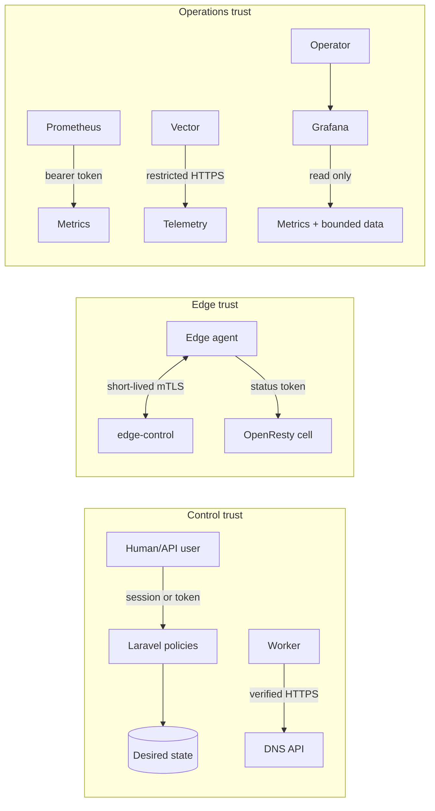

# Security model

This page explains who and what is trusted in a CDNFoundry deployment, and where
each secret lives. Read it before you plan access, backups, or key rotation. To
lock down a host, go to [Deployment hardening](hardening.md).

CDNFoundry keeps these identities and secrets apart: management users, edge
identities, runtime status tokens, artifact signing, service TLS, database
credentials, backup credentials, and metrics access.

## Who can do what

- An active administrator can use `/admin` and the administrator API routes.
- An active domain user can use `/app` and only the domains assigned to them.
- A disabled user loses their API tokens, and later session requests are rejected.
- An edge agent enrolls once, then uses short-lived client certificates.
- `/metrics` needs its own bearer token. It is not a user API.

Browser sessions and API tokens go through the same policies. See
[Users and access](../guides/users-and-access.md).

## Grafana access

Grafana has its own administrator credential. It never receives Laravel,
Vector-ingestion, or database-write credentials. Its ClickHouse account is
read-only with query limits. Its PostgreSQL account reads only domain inventory
columns and the sanitized operational view. Port 3000 listens on loopback. For
remote access, put an authenticated HTTPS proxy or a trusted tunnel in front of it.

## Private keys

- Status APIs never return private keys.
- Sanctum stores only a hash of each API token.
- CDNFoundry encrypts custom and managed TLS private keys with the application
  encryption key (`APP_KEY`).
- PostgreSQL holds a private key only in `tls_certificates`. Edge revisions and edge
  artifacts carry a certificate ID, never key material.
- An edge fetches the key it needs from `GET /edge/v1/certificates/{id}/key` over
  mutual TLS. Control seals the key to that edge's identity key (ECDH P-256,
  HKDF-SHA256, AES-256-GCM, bound to the edge ID and certificate ID). Control answers
  404 unless the domain is assigned to that edge.
- The agent caches the key in its state directory at mode `0600`. It removes keys
  that no active domain uses.
- DNS cluster API keys are stored encrypted and are never shown again.

## Secret classes

| Secret | Owner | Consequence of rotation |
| --- | --- | --- |
| `APP_KEY` | control recovery system | Needed to decrypt stored application secrets |
| Artifact signing key | control | Must stay compatible with agent verification |
| Edge identity CA key | control only | Replacing it needs an agent re-enrollment plan |
| Edge server CA key | protected PKI | Reissue the control, runtime, and DNS API server identities |
| Agent private key | one edge identity volume | Rotate only that edge identity |
| Edge status token | one edge host | Update the agent and cells together |
| PowerDNS API key | one DNS target | Update the gateway and the encrypted cluster credential |
| Metrics token | protected file | Update the metrics client and the mounted file |
| Restic password | recovery system | Needed to open existing backups |

::: danger Never log secrets
In diagnostics, use fingerprints, checksums, operation IDs, and setting names with
values redacted. Never paste environments, tokens, private keys, or customer data.
:::

Continue with [Deployment hardening](hardening.md) and
[Report a vulnerability](reporting.md).
